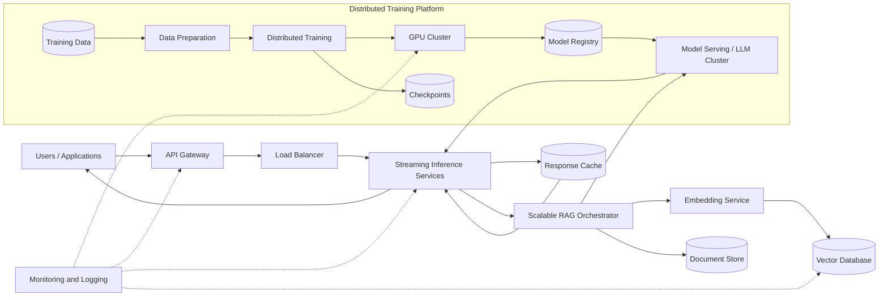
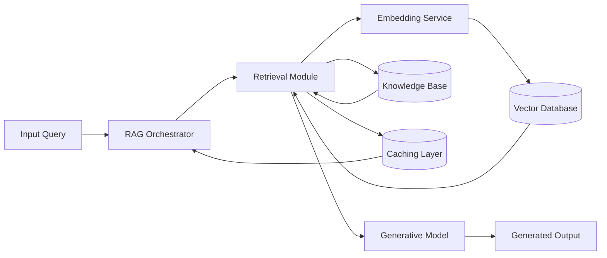

# AI SYSTEM DESIGN

### Overview
AI system design is a critical phase in the development of AI applications, focusing on creating scalable, efficient, and robust architectures that can handle the demands of modern AI workloads. This phase encompasses various aspects, including distributed training, GPU clusters, scalable retrieval-augmented generation (RAG) systems, vector retrieval architecture, caching strategies, streaming inference, load balancing, and latency optimization.

### Key Components
1. **Distributed Training**: Implementing distributed training techniques to leverage multiple GPUs or nodes, enabling faster model training and handling larger datasets.
2. **GPU Clusters**: Utilizing GPU clusters to accelerate computation and enable the processing of large-scale AI models.
3. **Scalable RAG**: Designing scalable retrieval-augmented generation systems that can efficiently retrieve relevant information from large datasets to enhance model performance.
4. **Vector Retrieval Architecture**: Developing vector retrieval architectures that facilitate efficient similarity search and retrieval of high-dimensional data representations.
5. **Caching**: Implementing caching mechanisms to reduce latency and improve response times for frequently accessed data or model outputs.
6. **Streaming Inference**: Enabling real-time inference capabilities by designing systems that can process data streams and provide immediate predictions or outputs.
7. **Load Balancing**: Distributing workloads across multiple servers or nodes to ensure optimal resource utilization and prevent bottlenecks in the system.
8. **Latency Optimization**: Employing techniques to minimize latency in AI systems, ensuring fast response times and a seamless user experience.

### Architecture Diagram 

## 1. Distributed Training
Distributed training is a technique used to train machine learning models across multiple GPUs or nodes, allowing for faster training times and the ability to handle larger datasets. This approach is essential for training complex models that require significant computational resources.

### Need for Distributed Training

1. **Large Datasets**: As datasets grow in size, training on a single GPU becomes impractical due to memory constraints. Distributed training allows for the partitioning of data across multiple GPUs, enabling the processing of larger datasets.

2. **Complex Models**: Modern AI models, such as deep neural networks, often have millions or even billions of parameters. Training these models on a single GPU can be time-consuming and inefficient. Distributed training allows for the parallelization of computations, speeding up the training process.

3. **Faster Training**: By leveraging multiple GPUs or nodes, distributed training can significantly reduce the time required to train models, enabling faster experimentation and iteration in the development of AI applications.

4. **Resource Utilization**: Distributed training allows for better utilization of available computational resources, ensuring that GPUs are used efficiently and reducing idle time.

### Techniques for Distributed Training
1. **Data Parallelism**: Splitting the training data across multiple GPUs, where each GPU processes a subset of the data and computes gradients independently. The gradients are then averaged and used to update the model parameters.

2. **Model Parallelism**: Dividing the model itself across multiple GPUs, where each GPU is responsible for computing a portion of the model's layers. This approach is useful for very large models that cannot fit into the memory of a single GPU.

3. **Hybrid Parallelism**: Combining data and model parallelism to leverage the benefits of both approaches, allowing for efficient training of large models on distributed systems.

4. **Synchronous vs. Asynchronous Training**: In synchronous training, all GPUs synchronize their gradients before updating the model parameters, while in asynchronous training, GPUs update the model parameters independently, which can lead to faster training but may introduce inconsistencies.

5. **Gradient Accumulation**: Accumulating gradients over multiple mini-batches before performing a parameter update, which can help reduce communication overhead in distributed training.

6. **Communication Strategies**: Implementing efficient communication strategies, such as ring-allreduce or parameter server architectures, to minimize the overhead of gradient synchronization across GPUs.

7. **Fault Tolerance**: Designing distributed training systems to handle node failures gracefully, ensuring that training can continue without significant disruption.

### Architecture Considerations
When designing distributed training systems, several architectural considerations must be taken into account:
1. **Network Bandwidth**: Ensuring sufficient network bandwidth to handle the communication overhead between GPUs or nodes, especially when synchronizing gradients.
2. **Memory Management**: Efficiently managing memory across GPUs to prevent out-of-memory errors and ensure that data is loaded and processed effectively.
3. **Scalability**: Designing the system to scale effectively as the number of GPUs or nodes increases, allowing for the addition of more resources without significant performance degradation.
4. **Fault Tolerance**: Designing the system to handle node failures gracefully, ensuring that training can continue without significant disruption.
5. **Load Balancing**: Distributing the computational load evenly across all available resources to prevent any single node from becoming a bottleneck.

### Bootlenecks and Challenges
1. **Communication Overhead**: The need to synchronize gradients across multiple GPUs can introduce significant communication overhead, especially in large-scale distributed training setups. Efficient communication strategies are essential to minimize this overhead.
2. **Memory Constraints**: Large models and datasets can quickly exhaust the memory available on individual GPUs, leading to out-of-memory errors. Techniques such as gradient checkpointing and mixed precision training can help mitigate this issue.
3. **Hyperparameter Tuning**: Distributed training can introduce additional complexity in hyperparameter tuning, as the optimal settings may vary depending on the number of GPUs or nodes used. Careful experimentation and tuning are required to achieve the best performance.   
4. **Fault Tolerance**: Node failures can disrupt the training process, requiring mechanisms to recover from failures and continue training without significant loss of progress.
5. **Load Imbalance**: Uneven distribution of workloads across GPUs can lead to some nodes being underutilized while others are overloaded, resulting in suboptimal performance. Load balancing strategies are necessary to ensure efficient resource utilization.

### Training Frameworks and Tools
1. **PyTorch Distributed**: A popular deep learning framework that provides built-in support for distributed training, including data parallelism and model parallelism. It offers various communication backends and tools for managing distributed training workflows.
2. **TensorFlow Distributed**: TensorFlow provides a distributed training API that allows for easy implementation of data and model parallelism. It supports various strategies for distributed training, including mirrored strategy and parameter server strategy.
3. **Horovod**: An open-source distributed training framework that simplifies the process of scaling deep learning models across multiple GPUs and nodes. It integrates with popular frameworks like TensorFlow, PyTorch, and Keras, providing efficient communication strategies for gradient synchronization.

### Tricky Questions and answers
1. How can we effectively balance the trade-off between communication overhead and model accuracy in distributed training?
    - To balance communication overhead and model accuracy, we can use techniques such as gradient accumulation, where gradients are accumulated over multiple mini-batches before being synchronized. This reduces the frequency of communication while maintaining model accuracy. Additionally, using asynchronous training can help reduce communication overhead, but care must be taken to ensure that it does not negatively impact model convergence.

2. What strategies can be employed to handle node failures during distributed training?
    - To handle node failures during distributed training, we can implement checkpointing mechanisms that save the model state at regular intervals. In the event of a node failure, training can resume from the last checkpoint, minimizing the loss of progress. Additionally, using fault-tolerant distributed training frameworks that can automatically detect and recover from node failures can help ensure continuity in the training process.

3. How can we optimize memory usage in distributed training to prevent out-of-memory errors?
    - To optimize memory usage in distributed training, we can employ techniques such as mixed precision training, which uses lower-precision data types to reduce memory consumption without significantly impacting model accuracy. Gradient checkpointing can also be used to save memory by storing only a subset of intermediate activations during the forward pass and recomputing them during the backward pass. Additionally, careful management of batch sizes and model architecture can help ensure that memory usage remains within the limits of available GPU resources.

4. What are the best practices for hyperparameter tuning in distributed training environments?
    - Best practices for hyperparameter tuning in distributed training environments include using automated hyperparameter optimization tools, such as Optuna or Ray Tune, to efficiently explore the hyperparameter space. It is also important to conduct experiments with different configurations of GPUs and nodes to understand how hyperparameters scale with the number of resources. Additionally, using techniques like learning rate warm-up and adaptive learning rate schedules can help improve convergence in distributed settings.

## 2. GPU Clusters
GPU clusters are groups of interconnected GPUs that work together to accelerate computation for AI workloads. They are essential for training large-scale models and performing inference on complex tasks. GPU clusters can be configured in various ways, depending on the specific requirements of the AI application.

### Need for GPU Clusters
1. **High Computational Demand**: AI models, especially deep learning models, require significant computational resources for training and inference. GPU clusters provide the necessary processing power to handle these demands efficiently.
2. **Parallel Processing**: GPU clusters enable parallel processing of data and model computations, allowing for faster training and inference times. This is particularly important for large datasets and complex models that would be impractical to process on a single GPU.
3. **Scalability**: GPU clusters can be scaled horizontally by adding more GPUs or nodes to the cluster, allowing for increased computational capacity as the demands of the AI application grow. This scalability is crucial for handling larger datasets and more complex models over time.
4. **Fault Tolerance**: GPU clusters can be designed with redundancy and failover mechanisms to ensure that the system remains operational even in the event of hardware failures. This is important for maintaining the reliability and availability of AI applications.
5. **Cost Efficiency**: By leveraging GPU clusters, organizations can optimize resource utilization and reduce costs associated with training and inference. Clusters allow for better allocation of resources based on workload demands, leading to more efficient use of hardware.

### Architecture of GPU Clusters
The architecture of GPU clusters typically consists of multiple interconnected GPUs, often organized into nodes. Each node may contain one or more GPUs, along with CPU resources, memory, and storage. The nodes are connected via high-speed networking to facilitate efficient communication and data transfer between GPUs.

GPU clusters can be configured in various topologies, such as:
1. **Star Topology**: A central node connects to multiple GPU nodes, allowing for efficient communication and coordination. This topology is simple to implement but may create a bottleneck at the central node.
2. **Mesh Topology**: Each GPU node is connected to multiple other nodes, creating a network that allows for direct communication between nodes. This topology can improve fault tolerance and reduce communication latency but may be more complex to manage.
3. **Ring Topology**: GPU nodes are connected in a circular fashion, allowing for efficient communication and data transfer between nodes. This topology can help balance the load across the cluster but may introduce latency if the ring is large.   
4. **Hybrid Topology**: A combination of different topologies, such as star and mesh, to leverage the benefits of each while mitigating their drawbacks. This approach can provide flexibility in cluster design and improve overall performance.
5. **High-Speed Interconnects**: Utilizing high-speed interconnects, such as NVLink or InfiniBand, to facilitate fast data transfer between GPUs and nodes. This is crucial for minimizing communication overhead and ensuring efficient parallel processing.
6. **Resource Management**: Implementing resource management tools and frameworks, such as Kubernetes or Slurm, to efficiently allocate and manage GPU resources within the cluster. This ensures that workloads are distributed effectively and that GPUs are utilized optimally.

### GPU Cluster Techniques
1. **Load Balancing**: Distributing workloads evenly across the GPUs in the cluster to prevent any single GPU from becoming a bottleneck. Load balancing can be achieved through various scheduling algorithms and resource management tools.
2. **Fault Tolerance**: Implementing redundancy and failover mechanisms to ensure that the cluster remains operational in the event of hardware failures. This may include replicating data across multiple nodes or using checkpointing to save the state of computations.
3. **Monitoring and Logging**: Setting up monitoring and logging systems to track the performance and health of the GPU cluster. This allows for proactive identification of issues and optimization of resource utilization.
4. **Scalability**: Designing the GPU cluster to be easily scalable, allowing for the addition of more GPUs or nodes as the demands of the AI application grow. This may involve using modular designs or cloud-based solutions that can dynamically allocate resources.
5. **Energy Efficiency**: Implementing energy-efficient practices and hardware to reduce the power consumption of GPU clusters. This may include using energy-efficient GPUs, optimizing cooling systems, and implementing power management strategies.

### Bottlenecks and Challenges
1. **Communication Overhead**: The need for GPUs to communicate with each other can introduce significant overhead, especially in large clusters. Efficient communication protocols and high-speed interconnects are essential to minimize this overhead.
2. **Resource Contention**: Multiple workloads competing for the same GPU resources can lead to contention and reduced performance. Implementing effective resource management and scheduling strategies is crucial to mitigate this issue.
3. **Fault Tolerance**: Ensuring that the GPU cluster can handle hardware failures without significant disruption to ongoing computations is a challenge. Redundancy, failover mechanisms, and checkpointing are necessary to maintain reliability.
4. **Scalability**: As the size of the GPU cluster increases, managing and coordinating the resources becomes more complex. Ensuring that the cluster can scale effectively without performance degradation requires careful planning and architecture design.
5. **Energy Consumption**: GPU clusters can consume significant amounts of power, leading to high operational costs and environmental impact. Implementing energy-efficient practices and hardware is essential to address this challenge.
6. **Software Compatibility**: Ensuring that the software stack used for training and inference is compatible with the GPU cluster architecture can be challenging. This includes ensuring that libraries, frameworks, and drivers are properly configured and optimized for the specific hardware.

### Training Frameworks and Tools
1. **NVIDIA CUDA**: A parallel computing platform and programming model that enables developers to leverage the power of NVIDIA GPUs for general-purpose computing. CUDA provides a comprehensive set of libraries and tools for developing GPU-accelerated applications, including deep learning frameworks.
2. **NVIDIA NCCL**: The NVIDIA Collective Communications Library (NCCL) is a library that provides optimized communication primitives for multi-GPU and multi-node training. It enables efficient data transfer and synchronization between GPUs, making it essential for distributed training in GPU clusters.
3. **Kubernetes**: An open-source container orchestration platform that can be used to manage and deploy GPU workloads in a cluster environment. Kubernetes provides features for resource allocation, scaling, and monitoring, making it suitable for managing GPU clusters in production environments.
4. **Slurm**: An open-source workload manager that can be used to schedule and manage jobs in a GPU cluster. Slurm provides features for resource allocation, job scheduling, and monitoring, making it suitable for managing large-scale GPU clusters in research and production environments.

### Tricky Questions and answers
1. How can we optimize communication overhead in large GPU clusters?
   - To optimize communication overhead in large GPU clusters, we can use high-speed interconnects such as NVLink or InfiniBand to facilitate fast data transfer between GPUs. Additionally, implementing efficient communication protocols, such as ring-allreduce or hierarchical communication strategies, can help minimize the overhead associated with gradient synchronization. Techniques like gradient compression and quantization can also reduce the amount of data that needs to be communicated between GPUs.

2. What strategies can be employed to ensure fault tolerance in GPU clusters?
   - To ensure fault tolerance in GPU clusters, we can implement redundancy and failover mechanisms, such as replicating data across multiple nodes or using checkpointing to save the state of computations. In the event of a hardware failure, the system can automatically switch to a backup node or restore from the last checkpoint, minimizing disruption to ongoing computations. Additionally, monitoring and alerting systems can be set up to detect hardware failures early and trigger appropriate recovery actions.

3. How can we effectively manage resource contention in GPU clusters?
   - To effectively manage resource contention in GPU clusters, we can implement resource management and scheduling strategies that prioritize workloads based on their requirements and resource availability. This may include using job scheduling algorithms that allocate GPU resources based on workload priority, estimated execution time, and resource utilization. Additionally, implementing containerization and virtualization techniques can help isolate workloads and prevent interference between competing jobs. Monitoring resource usage and adjusting allocations dynamically can also help mitigate contention issues.

4. What are the best practices for scaling GPU clusters to handle increasing workloads?
   - Best practices for scaling GPU clusters include designing the architecture to be modular and easily expandable, allowing for the addition of more GPUs or nodes as needed. Utilizing cloud-based solutions can provide flexibility in scaling resources dynamically based on workload demands. Implementing efficient resource management and scheduling strategies can help ensure that workloads are distributed effectively across the cluster. Additionally, monitoring performance metrics and identifying bottlenecks can inform decisions on when and how to scale the cluster to maintain optimal performance.

## 3. Scalable RAG
Scalable Retrieval-Augmented Generation (RAG) systems are designed to enhance the capabilities of AI models by integrating external knowledge sources into the generation process. These systems combine retrieval mechanisms with generative models to provide more accurate and contextually relevant outputs. Scalable RAG systems are particularly useful in applications where access to large knowledge bases or dynamic information is required.

### Need for Scalable RAG
1. **Enhanced Knowledge Integration**: Scalable RAG systems allow AI models to access and integrate external knowledge sources, enabling them to generate more informed and contextually relevant outputs. This is particularly important in applications such as question answering, summarization, and content generation, where access to up-to-date information is crucial.
2. **Dynamic Information Retrieval**: In many applications, the information required for generating outputs may change over time. Scalable RAG systems can retrieve the most relevant and current information from external sources, ensuring that the generated outputs remain accurate and up-to-date.
3. **Improved Model Performance**: By incorporating external knowledge, scalable RAG systems can improve the performance of generative models, leading to more accurate and contextually appropriate outputs. This can enhance user satisfaction and trust in AI applications.
4. **Scalability**: Scalable RAG systems are designed to handle large volumes of data and queries, making them suitable for applications that require real-time information retrieval and generation. This scalability is essential for supporting high-traffic applications and ensuring responsiveness.

### Architecture of Scalable RAG
The architecture of scalable RAG systems typically consists of several key components that work together to retrieve relevant information and generate outputs. These components include:
1. **Retrieval Module**: This module is responsible for retrieving relevant information from external knowledge sources based on the input query. It may use techniques such as vector search, keyword matching, or semantic search to identify the most relevant documents or data points.
2. **Generative Model**: The generative model takes the retrieved information and the input query to produce the final output. This model can be a transformer-based architecture, such as GPT or BERT, that is capable of generating coherent and contextually appropriate text.
3. **Knowledge Base**: The knowledge base serves as the external source of information that the retrieval module accesses. It can consist of structured databases, unstructured text corpora, or a combination of both, depending on the application requirements.
4. **Vector Database**: A vector database is often used to store embeddings of documents or data points, enabling efficient similarity search and retrieval. This allows the retrieval module to quickly identify relevant information based on the input query.
5. **Caching Layer**: A caching layer can be implemented to store frequently accessed information or previously retrieved results, reducing latency and improving response times for repeated queries.
6. **Orchestration Layer**: An orchestration layer manages the flow of data between the retrieval module, generative model, and knowledge base, ensuring that the system operates efficiently and effectively.

    Draw the architecture diagram of the scalable RAG system.

### Implementation Considerations
1. **Data Preprocessing**: Before integrating external knowledge into the RAG system, it is essential to preprocess the data to ensure consistency and quality. This may involve cleaning, normalizing, and structuring the data to make it suitable for retrieval and generation.
2. **Model Selection**: Choosing the right generative model is crucial for achieving optimal performance. Factors such as the complexity of the task, available computational resources, and desired output quality should be considered when selecting a model.
3. **Scalability**: The system should be designed to scale horizontally to accommodate increasing volumes of data and queries. This may involve using distributed computing frameworks or cloud-based solutions to ensure that the system can handle growth without compromising performance.
4. **Monitoring and Maintenance**: Continuous monitoring of the system's performance is necessary to identify potential issues and optimize its operation. Regular maintenance tasks, such as updating the knowledge base and retraining the generative model, are also important for maintaining the system's effectiveness over time.
5. **Latency Optimization**: Implementing techniques to minimize latency in the retrieval and generation processes is essential for providing a responsive user experience. This may involve optimizing query processing, caching frequently accessed data, and using efficient algorithms for retrieval and generation.

### Techniques for Scalable RAG
1. **Vector Search**: Utilizing vector search techniques to retrieve relevant information based on the similarity of embeddings. This allows for efficient retrieval of semantically similar documents or data points, improving the relevance of the retrieved information.
2. **Knowledge Distillation**: Applying knowledge distillation techniques to transfer knowledge from larger models to smaller, more efficient models. This can help reduce the computational requirements of the generative model while maintaining performance, making it suitable for deployment in resource-constrained environments.
3. **Caching Strategies**: Implementing caching strategies to store frequently accessed information or previously retrieved results, reducing latency and improving response times for repeated queries. This can involve using in-memory caches or distributed caching systems to optimize data retrieval. 
4. **Dynamic Retrieval**: Designing the retrieval module to adaptively select the most relevant information based on the input query and context. This may involve using reinforcement learning or other adaptive techniques to improve retrieval performance over time.
5. **Hybrid Retrieval**: Combining multiple retrieval techniques, such as keyword-based search and vector search, to improve the accuracy and relevance of retrieved information. This approach can leverage the strengths of different retrieval methods to enhance overall system performance.
6. **Streaming Inference**: Implementing streaming inference capabilities to process data streams in real-time, allowing the system to provide immediate responses to user queries. This can involve using techniques such as online learning or incremental updates to the generative model.
7. **Load Balancing**: Distributing workloads across multiple servers or nodes to ensure optimal resource utilization and prevent bottlenecks in the system. This can involve using load balancing algorithms and monitoring tools to dynamically allocate resources based on demand.
8. **Latency Optimization**: Employing techniques to minimize latency in the retrieval and generation processes, ensuring fast response times and a seamless user experience. This may involve optimizing query processing, caching frequently accessed data, and using efficient algorithms for retrieval and generation.
9. **Monitoring and Logging**: Setting up monitoring and logging systems to track the performance and health of the RAG system. This allows for proactive identification of issues and optimization of resource utilization, ensuring that the system operates efficiently and effectively.
10. **Security and Privacy**: Implementing security measures to protect sensitive data and ensure compliance with privacy regulations. This may involve encrypting data, implementing access controls, and anonymizing user information to safeguard against unauthorized access and data breaches.

### Bottlenecks and Challenges
1. **Data Quality**: The quality of the external knowledge sources can significantly impact the performance of the RAG system. Inaccurate or outdated information can lead to poor outputs, making it essential to ensure that the knowledge base is reliable and up-to-date.
2. **Scalability**: As the volume of data and queries increases, the system must be able to scale effectively to handle the growing demands. This may involve using distributed computing frameworks or cloud-based solutions to ensure that the system can accommodate growth without compromising performance.
3. **Latency**: The retrieval and generation processes can introduce latency, especially when dealing with large datasets or complex queries. Implementing caching strategies, optimizing query processing, and using efficient algorithms are essential to minimize latency and provide a responsive user experience.
4. **Model Complexity**: The complexity of the generative model can impact both performance and resource requirements. Balancing model complexity with computational efficiency is crucial to ensure that the system can operate effectively within the available resources.    
5. **Integration Challenges**: Integrating the retrieval and generative components of the RAG system can be complex, requiring careful design and coordination to ensure that the system operates seamlessly. This may involve addressing issues related to data flow, synchronization, and compatibility between different components.
6. **Security and Privacy**: Ensuring the security and privacy of user data and external knowledge sources is a challenge, particularly when dealing with sensitive information. Implementing robust security measures and complying with privacy regulations are essential to protect against unauthorized access and data breaches.

### Training Frameworks and Tools
1. **Haystack**: An open-source framework for building scalable RAG systems that provides tools for document retrieval, question answering, and generative modeling. Haystack supports various backends for retrieval and generation, making it suitable for building flexible and efficient RAG systems.
2. **LangChain**: A framework for developing applications that integrate language models with external knowledge sources. LangChain provides tools for building RAG systems, including support for vector databases, retrieval modules, and generative models, enabling developers to create scalable and efficient AI applications.
3. **LlamaIndex**: A framework for building RAG systems that focuses on efficient retrieval and generation of information. LlamaIndex provides tools for indexing and searching large datasets, as well as integrating with generative models to produce contextually relevant outputs.
4. **FAISS**: A library for efficient similarity search and clustering of dense vectors, which can be used to implement vector search in RAG systems. FAISS provides tools for indexing and searching large datasets, enabling fast retrieval of relevant information based on vector embeddings.
5. **Milvus**: An open-source vector database designed for scalable similarity search and retrieval of high-dimensional data. Milvus can be used to store and manage embeddings in RAG systems, enabling efficient retrieval of relevant information based on vector similarity.

### Tricky Questions and answers
1. How can we ensure the quality and relevance of retrieved information in a scalable RAG system?
   - To ensure the quality and relevance of retrieved information in a scalable RAG system, we can implement techniques such as relevance feedback, where user interactions and feedback are used to refine the retrieval process. Additionally, using advanced retrieval algorithms, such as semantic search or hybrid retrieval methods, can improve the accuracy of retrieved information. Regularly updating and curating the knowledge base to include reliable and up-to-date sources is also essential for maintaining the quality of retrieved information.

2. What strategies can be employed to minimize latency in the retrieval and generation processes of a RAG system?
   - To minimize latency in the retrieval and generation processes of a RAG system, we can implement caching strategies to store frequently accessed information or previously retrieved results, reducing the need for repeated queries. Optimizing query processing and using efficient algorithms for retrieval and generation can also help reduce latency. Additionally, employing streaming inference techniques and load balancing across multiple servers or nodes can further enhance responsiveness and minimize delays in the system.

3. How can we effectively scale a RAG system to handle increasing volumes of data and queries?
   - To effectively scale a RAG system, we can utilize distributed computing frameworks or cloud-based solutions that allow for horizontal scaling of resources. This may involve adding more servers or nodes to the system to accommodate growing workloads. Implementing efficient resource management and scheduling strategies can help ensure that workloads are distributed effectively across the system. Additionally, monitoring performance metrics and identifying bottlenecks can inform decisions on when and how to scale the system to maintain optimal performance.

4. What are the best practices for integrating retrieval and generative components in a RAG system?
   - Best practices for integrating retrieval and generative components in a RAG system include designing a clear data flow and communication protocol between the components, ensuring that the retrieved information is effectively utilized by the generative model. Implementing modular architectures that allow for easy updates and maintenance of individual components can also enhance integration. Additionally, using standardized interfaces and APIs can facilitate seamless interaction between the retrieval and generative modules, improving overall system performance and maintainability.

## 4. Vector Retrieval Architecture
Vector retrieval architecture is a critical component of scalable RAG systems, enabling efficient retrieval of relevant information based on vector representations of data. This architecture leverages vector embeddings to represent documents, queries, and other data points in a high-dimensional space, allowing for similarity-based retrieval.

Vector retrieval architecture is essential for applications that require fast and accurate access to large knowledge bases, such as question answering, recommendation systems, and content generation. By utilizing vector embeddings, the architecture can capture semantic relationships between data points, enabling more effective retrieval of relevant information.

### Need for Vector Retrieval Architecture
1. **Semantic Search**: Vector retrieval architecture allows for semantic search capabilities, enabling the retrieval of information based on meaning rather than exact keyword matches. This is particularly important for applications where users may use different terminology or phrasing to express the same concept.
2. **High-Dimensional Representations**: By representing data points as high-dimensional vectors, the architecture can capture complex relationships and similarities between documents, queries, and other data points. This enables more accurate retrieval of relevant information based on semantic similarity.
3. **Scalability**: Vector retrieval architecture is designed to handle large volumes of data and queries, making it suitable for applications that require real-time information retrieval and generation. This scalability is essential for supporting high-traffic applications and ensuring responsiveness.
4. **Flexibility**: The architecture can accommodate various types of data, including text, images, and structured data, allowing for versatile retrieval capabilities across different domains and applications. This flexibility enables the integration of diverse knowledge sources into the RAG system.
5. **Integration with Generative Models**: Vector retrieval architecture can be seamlessly integrated with generative models, enabling the retrieval of relevant information to inform the generation process. This integration enhances the quality and relevance of generated outputs, improving user satisfaction and trust in AI applications.

## Architecture of Vector Retrieval
The architecture of vector retrieval typically consists of several key components that work together to enable efficient retrieval of relevant information based on vector representations. These components include:
1. **Embedding Service**: This component is responsible for generating vector embeddings for documents, queries, and other data points. It may use pre-trained models or custom embedding techniques to convert raw data into high-dimensional vector representations that capture semantic relationships.
2. **Vector Database**: The vector database stores the generated embeddings and provides efficient indexing and retrieval capabilities. It allows for fast similarity search and retrieval of relevant information based on vector representations, enabling the system to quickly identify the most relevant documents or data points.
3. **Retrieval Module**: The retrieval module is responsible for processing input queries and retrieving relevant information from the vector database. It may use techniques such as nearest neighbor search, approximate nearest neighbor search, or other similarity-based retrieval methods to identify the most relevant embeddings based on the input query.

4. **Knowledge Base**: The knowledge base serves as the external source of information that the retrieval module accesses. It can consist of structured databases, unstructured text corpora, or a combination of both, depending on the application requirements. The knowledge base provides the raw data that is transformed into vector embeddings for retrieval.
5. **Caching Layer**: A caching layer can be implemented to store frequently accessed embeddings or previously retrieved results, reducing latency and improving response times for repeated queries. This layer helps optimize the retrieval process by minimizing the need for repeated computations and database accesses.
6. **Orchestration Layer**: An orchestration layer manages the flow of data between the embedding service, vector database, retrieval module, and knowledge base, ensuring that the system operates efficiently and effectively. It coordinates the interactions between components and handles tasks such as query routing, result aggregation, and error handling.

### Techniques for Vector Retrieval
1. **Approximate Nearest Neighbor (ANN) Search**: Implementing ANN search algorithms, such as HNSW (Hierarchical Navigable Small World) or FAISS (Facebook AI Similarity Search), to efficiently retrieve the most similar embeddings from the vector database. ANN search allows for fast retrieval of relevant information based on vector similarity, even in large datasets.
2. **Dimensionality Reduction**: Applying dimensionality reduction techniques, such as PCA (Principal Component Analysis) or t-SNE (t-distributed Stochastic Neighbor Embedding), to reduce the dimensionality of vector embeddings while preserving their semantic relationships. This can improve retrieval efficiency and reduce storage requirements without significantly impacting retrieval accuracy.
3. **Indexing Strategies**: Utilizing indexing strategies, such as inverted indices or tree-based structures, to organize and optimize the storage of vector embeddings in the database. Effective indexing can significantly improve retrieval speed and efficiency, enabling faster access to relevant information.
4. **Hybrid Retrieval**: Combining vector-based retrieval with traditional keyword-based search methods to improve the accuracy and relevance of retrieved information. This approach leverages the strengths of both retrieval methods, allowing for more comprehensive and effective information retrieval.
5. **Caching Strategies**: Implementing caching strategies to store frequently accessed embeddings or previously retrieved results, reducing latency and improving response times for repeated queries. This can involve using in-memory caches or distributed caching systems to optimize data retrieval.
6. **Streaming Retrieval**: Implementing streaming retrieval capabilities to process data streams in real-time, allowing the system to provide immediate responses to user queries. This can involve using techniques such as online learning or incremental updates to the embedding service and vector database.
7. **Load Balancing**: Distributing retrieval workloads across multiple servers or nodes to ensure optimal resource utilization and prevent bottlenecks in the system. This can involve using load balancing algorithms and monitoring tools to dynamically allocate resources based on demand.
8. **Monitoring and Logging**: Setting up monitoring and logging systems to track the performance and health of the vector retrieval architecture. This allows for proactive identification of issues and optimization of resource utilization, ensuring that the system operates efficiently and effectively.

### Bottlenecks and Challenges
1. **High-Dimensional Data**: Working with high-dimensional vector embeddings can lead to increased computational complexity and storage requirements. Efficient indexing and retrieval algorithms are essential to manage the challenges associated with high-dimensional data.
2. **Scalability**: As the volume of data and queries increases, the vector retrieval architecture must be able to scale effectively to handle the growing demands. This may involve using distributed computing frameworks or cloud-based solutions to ensure that the system can accommodate growth without compromising performance.
3. **Latency**: The retrieval process can introduce latency, especially when dealing with large datasets or complex queries. Implementing caching strategies, optimizing query processing, and using efficient algorithms are essential to minimize latency and provide a responsive user experience.
4. **Integration with Generative Models**: Ensuring seamless integration between the vector retrieval architecture and generative models can be challenging, requiring careful design and coordination to ensure that the retrieved information is effectively utilized in the generation process. This may involve addressing issues related to data flow, synchronization, and compatibility between different components.
5. **Data Quality**: The quality of the vector embeddings and the underlying data can significantly impact the performance of the retrieval architecture. Inaccurate or poorly generated embeddings can lead to suboptimal retrieval results, making it essential to ensure that the embedding service produces high-quality representations of the data.

### Training Frameworks and Tools
1. **FAISS**: A library for efficient similarity search and clustering of dense vectors, which can be used to implement vector search in retrieval architectures. FAISS provides tools for indexing and searching large datasets, enabling fast retrieval of relevant information based on vector embeddings.
2. **Milvus**: An open-source vector database designed for scalable similarity search and retrieval of high-dimensional data. Milvus can be used to store and manage embeddings in vector retrieval architectures, enabling efficient retrieval of relevant information based on vector similarity.
3. **Annoy**: A C++ library for approximate nearest neighbor search that can be used to implement vector retrieval in large datasets. Annoy provides efficient indexing and search capabilities, allowing for fast retrieval of similar embeddings based on vector representations.
4. **HNSWlib**: A library for Hierarchical Navigable Small World (HNSW) graphs that can be used to implement efficient approximate nearest neighbor search in vector retrieval architectures. HNSWlib provides fast indexing and search capabilities, enabling quick retrieval of relevant information based on vector similarity.
5. **ScaNN**: A library for scalable nearest neighbor search that can be used to implement vector retrieval in large datasets. ScaNN provides efficient indexing and search capabilities, allowing for fast retrieval of similar embeddings based on vector representations.

### Tricky Questions and answers
1. How can we efficiently handle high-dimensional vector embeddings in a retrieval architecture?
   - To efficiently handle high-dimensional vector embeddings in a retrieval architecture, we can implement dimensionality reduction techniques, such as PCA or t-SNE, to reduce the dimensionality of the embeddings while preserving their semantic relationships. Additionally, using approximate nearest neighbor (ANN) search algorithms, such as HNSW or FAISS, can enable fast retrieval of relevant information based on vector similarity. Effective indexing strategies and caching frequently accessed embeddings can also help optimize retrieval performance.

2. What strategies can be employed to ensure seamless integration between vector retrieval architecture and generative models?
   - To ensure seamless integration between vector retrieval architecture and generative models, we can design a clear data flow and communication protocol between the components, ensuring that the retrieved information is effectively utilized by the generative model. Implementing modular architectures that allow for easy updates and maintenance of individual components can also enhance integration. Additionally, using standardized interfaces and APIs can facilitate seamless interaction between the retrieval and generative modules, improving overall system performance and maintainability.

3. How can we optimize latency in the retrieval process of a vector retrieval architecture?
   - To optimize latency in the retrieval process of a vector retrieval architecture, we can implement caching strategies to store frequently accessed embeddings or previously retrieved results, reducing the need for repeated queries. Optimizing query processing and using efficient algorithms for retrieval can also help reduce latency. Additionally, employing streaming retrieval techniques and load balancing across multiple servers or nodes can further enhance responsiveness and minimize delays in the system.

4. What are the best practices for scaling a vector retrieval architecture to handle increasing volumes of data and queries?
   - Best practices for scaling a vector retrieval architecture include utilizing distributed computing frameworks or cloud-based solutions that allow for horizontal scaling of resources. This may involve adding more servers or nodes to the system to accommodate growing workloads. Implementing efficient resource management and scheduling strategies can help ensure that workloads are distributed effectively across the system. Additionally, monitoring performance metrics and identifying bottlenecks can inform decisions on when and how to scale the architecture to maintain optimal performance.

5. How can we ensure the security and privacy of vector embeddings in a retrieval architecture?
   - To ensure the security and privacy of vector embeddings in a retrieval architecture, we can implement encryption techniques to protect embeddings during storage and transmission. Access controls and authentication mechanisms can be used to restrict access to sensitive data, ensuring that only authorized users can retrieve or manipulate embeddings. Additionally, anonymization techniques can be applied to embeddings to prevent the identification of individuals or sensitive information. Regular security audits and compliance with privacy regulations are also essential for maintaining the security and privacy of vector embeddings in the system.

## 5. Caching
Caching is a critical component of scalable AI systems, enabling the storage and retrieval of frequently accessed data to improve performance and reduce latency. In the context of AI systems, caching can be applied to various components, including model outputs, intermediate computations, and external knowledge sources. By storing frequently accessed information in a cache, AI systems can provide faster responses to user queries and reduce the computational load on underlying models.

## Need for Caching
1. **Performance Improvement**: Caching frequently accessed data can significantly improve the performance of AI systems by reducing the time required to retrieve information. This is particularly important in applications that require real-time responses, such as conversational AI, recommendation systems, and content generation.
2. **Reduced Latency**: By storing frequently accessed data in a cache, AI systems can minimize the latency associated with retrieving information from slower storage mediums or external knowledge sources. This leads to faster response times and a more seamless user experience.
3. **Resource Optimization**: Caching can help optimize the use of computational resources by reducing the need for repeated computations or data retrievals. This can lead to lower resource consumption and improved efficiency, allowing AI systems to handle larger workloads without compromising performance.
4. **Scalability**: Caching enables AI systems to scale more effectively by reducing the load on underlying models and external knowledge sources. This allows the system to handle increasing volumes of data and queries without experiencing performance degradation, making it suitable for high-traffic applications.
5. **Cost Reduction**: By minimizing the need for repeated computations and data retrievals, caching can help reduce operational costs associated with running AI systems. This is particularly relevant in cloud-based environments where resource usage directly impacts costs.
6. **Improved User Experience**: Faster response times and reduced latency resulting from caching can enhance the overall user experience, leading to increased user satisfaction and engagement. This is especially important in applications where users expect immediate feedback or results.

### Architecture of Caching
The architecture of caching in AI systems typically consists of several key components that work together to store and retrieve frequently accessed data efficiently. These components include:
1. **Cache Store**: The cache store is the primary storage component where frequently accessed data is stored. It can be implemented using in-memory data stores, such as Redis or Memcached, to provide fast access to cached data. The cache store may also support various eviction policies, such as Least Recently Used (LRU) or Least Frequently Used (LFU), to manage the storage of cached items effectively.
2. **Cache Manager**: The cache manager is responsible for managing the cache store, including adding, retrieving, and evicting cached items based on predefined policies. It monitors cache usage and performance metrics to ensure that the cache operates efficiently and effectively. The cache manager may also handle cache invalidation and updates to ensure that cached data remains accurate and up-to-date.
3. **Cache Client**: The cache client is the interface through which AI system components interact with the cache store. It provides methods for adding, retrieving, and removing cached items, allowing other components to access cached data seamlessly. The cache client may also support features such as cache expiration and versioning to manage cached data effectively.