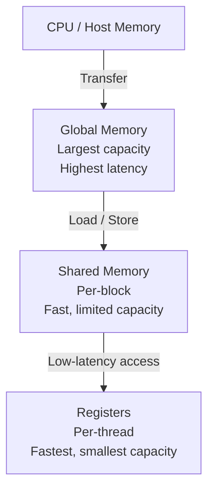

# 🧠 Comprehensive AI Engineering Notes

## 1. N-Grams

### 1.1 What is an N-Gram?
An N-gram is a **contiguous sequence of N items** from a given sequence of text (or other tokens), where **N** is the number of items in the sequence.

**Example:** `"The quick brown fox"`
* **Unigrams (1-gram):** `["The", "quick", "brown", "fox"]`
* **Bigrams (2-gram):** `["The quick", "quick brown", "brown fox"]`
* **Trigrams (3-gram):** `["The quick brown", "quick brown fox"]`
* **4-grams:** `["The quick brown fox"]`

**The "Sliding Window" Concept:**
A window of size N slides one step at a time. Each position equals one N-gram. N-grams are like taking a magnifying glass and sliding it across text, capturing every window of N words you see.

```text
[The][quick][brown][fox]
 ↑─────↑              = "The quick"     (bigram 1)
      ↑─────↑         = "quick brown"   (bigram 2)
            ↑─────↑   = "brown fox"     (bigram 3)
```

### 1.2 Types of N-Grams

#### By N Value
* **N=1 (Unigram):** "I love pizza" → `["I", "love", "pizza"]`
* **N=2 (Bigram):** "I love pizza" → `["I love", "love pizza"]`
* **N=3 (Trigram):** "I love hot pizza" → `["I love hot", "love hot pizza"]`
* **N=4 (Quadgram):** "I really love hot pizza" → `["I really love hot", "really love hot pizza"]`
* **N=5 (Five-gram):** "I really love very hot pizza" → `["I really love very hot", "really love very hot pizza"]`
* **N=∞:** As N increases, you get more context but less data to learn from.

#### By Token Type
* **Word N-Grams (Most common):** Sequences of words.
* **Character N-Grams:** Sequences of characters (e.g., "hello" → bigrams: `["he", "el", "ll", "lo"]`). Useful because it is language-agnostic, handles misspellings, works for code/DNA, and captures morphology.
* **Sentence N-Grams:** Sequences of sentences (used in discourse analysis).
* **Byte N-Grams:** Raw bytes (useful for binary data, language detection).
* **Subword N-Grams (Modern NLP):** Tokenization between character and word level (e.g., BPE). Used by GPT, BERT, and most modern LLMs.

### 1.3 How to Compute N-Grams
**Input:** `"the cat sat on the mat"`

1. **Tokenize:** `["the", "cat", "sat", "on", "the", "mat"]` (Length: 6 tokens)
2. **Generate N-Grams:**
   ```python
   for i in range(0, len(tokens) - N + 1):
       ngram = tokens[i : i+N]
   ```
**Formula:** `Number of N-grams = len(tokens) - N + 1`

### 1.4 N-Gram Language Models
A language model assigns a probability to a sequence of words to estimate how "natural" a sentence is.
* **The N-Gram Assumption (Markov Assumption):** Probability of the next word depends ONLY on the last N-1 words.
* **Smoothing (Handling Unseen N-grams):** Avoids zero probabilities.

    * **PROBLEM:** If an N-gram never appeared in training, its probability is 0, which makes the entire sentence probability 0.

    * **Smoothing Techniques:**

    * **Add-One (Laplace):** Add 1 to every count.
    
       **Problem: Too much probability mass is given to unseen N-grams.**
    * **Add-K:** Add k (< 1) instead of 1. k is a hyperparameter.
    * **Good-Turing:** Use count of n-grams that appeared ONCE.
    * **Kneser-Ney (Best in practice):** Uses continuation probability.
    * **Interpolation:** Mix unigram, bigram, and trigram probabilities.

**Perplexity:** Measures how "surprised" the model is by test text. Lower = better.

```python
import math

def perplexity(model, test_sentences):
    total_log_prob = 0
    total_tokens = 0
    
    for sentence in test_sentences:
        tokens = preprocess(sentence)
        total_log_prob += model.log_probability(sentence)
        total_tokens += len(tokens)
        
    avg_log_prob = total_log_prob / total_tokens
    return math.exp(-avg_log_prob)
```
 ### **N-Grams in search and NLP Applications:** 

* **text similarity**
* **spell checking and fuzzy search**
* **autocomplete / Typeahead**
* **Search engine query expansion**

### **Word2Vec and N-Grams context**
* Word2Vec uses a **sliding window** to create context for each word.

* **SSkip-Gram Model:** Predicts context words given a target word.
* **CBOW( Continuous Bag of Words ) Model:** Predicts a target word given context words. Reverse of Skip-Gram.

### **BERT and Subword N-Grams**
* **BERT** (Bidirectional Encoder Representations from Transformers) is a transformer-based model that uses subword tokenization to handle rare words and out-of-vocabulary tokens.
* BERT uses **WordPiece Tokenization** (subword N-grams) to handle rare words and out-of-vocabulary tokens. It splits words into subword units, allowing it to represent unseen words as combinations of known subwords.
* **Example:** "unhappiness" → `["un", "##happiness"]` (where `##` indicates a subword continuation).
* **Advantage:** BERT can understand and generate embeddings for rare or unseen words by leveraging the embeddings of their subword components.

* **FastText** (by Facebook) also uses subword N-grams to create word embeddings. It represents each word as a bag of character N-grams, allowing it to generate embeddings for words not seen during training.
* **Example:** "where" → `["whe", "her", "ere"]` (character trigrams). The embedding for "where" is the sum of the embeddings of its character trigrams.
* **Advantage:** FastText can handle misspellings and morphological variations better than traditional word embeddings.

* **BLEU Score** (Bilingual Evaluation Understudy) is a metric for evaluating the quality of machine-translated text. It compares the N-grams of the candidate translation to those of reference translations, calculating precision for N-grams of different lengths (typically up to 4-grams). BLEU uses a modified precision score that accounts for multiple reference translations and applies a brevity penalty to discourage overly short translations.
* **Example:** If the candidate translation is "the cat sat" and the reference translation is "the cat is sitting", BLEU would compare the unigrams, bigrams, trigrams, and 4-grams of both sentences to compute a score.
* **Advantage:** BLEU provides a quantitative measure of translation quality, allowing for automated evaluation of machine translation systems.

### **N-Grams in Industry**
* **Search Engines:** Google, Bing, and Elasticsearch use N-grams for query expansion, autocomplete, and spell correction.
* **Text Analytics:** N-grams are used in sentiment analysis, topic modeling, and text classification to capture context and relationships between words.
* **Chatbots and Virtual Assistants:** N-grams help in understanding user queries and generating relevant responses by analyzing the context of the conversation.


### 1.5 Edge Cases & Gotchas
> **⚠️ Edge Case 1: Data Sparsity Problem**
> As N grows, there's more context but less data per context. 
> **Solutions:** Smoothing (Kneser-Ney), Backoff models, or Modern Neural LMs.
> 
> **⚠️ Edge Case 2: N-gram Explosion**
> For vocabulary $V$ and size $N$, possible N-grams = $V^N$.
> **Solutions:** Minimum count thresholds, Bloom filters, Hashing tricks, Pruning.
>
> **⚠️ Edge Case 3: Case and Punctuation Handling**
> "The" vs "the" splits the model entries. 
> **Solution:** Normalization pipeline (lowercase, separate punctuation).
>
> **⚠️ Edge Case 4: Character N-gram Boundary**
> Very short words fail to generate larger character N-grams.
> **Solution:** Pad with special characters (e.g., `<a\>`).

### **Tricky Interview Questions**
**Q1. What is the trade-off between using unigrams vs trigrams in a language model?**

**A1.** Unigrams capture individual word frequencies but lose context, leading to ambiguity. Trigrams capture more context (two preceding words) but suffer from data sparsity and require more memory. The trade-off is between **contextual understanding** (trigrams) and **data availability** (unigrams).

**Q2. How does Google's search autocomplete work at a high level using N-grams?**

**A2.** Google uses N-grams to predict the next word(s) in a query based on historical search data. It analyzes the frequency of N-grams in past queries and suggests completions that are statistically likely given the user's input. The system may also incorporate user location, trending searches, and personalization to refine suggestions.

**Q3. Why do character N-grams handle out-of-vocabulary words better than word N-grams?**

**A3.** Character N-grams break words into smaller units, allowing the model to recognize patterns in prefixes, suffixes, and roots. This enables it to generate embeddings for unseen words based on their subword components, making it more robust to misspellings and morphological variations compared to word N-grams, which treat each word as a distinct token.

**Q4. How would you use N-grams to detect plagiarism?**

**A4.** To detect plagiarism, you can generate N-grams (typically bigrams or trigrams) from both the source and the target documents. By comparing the sets of N-grams, you can identify overlapping sequences that indicate potential copying. A high percentage of shared N-grams suggests that the target document may have been plagiarized from the source.

**Q5. What is the difference between BLEU score and perplexity, and when would you use each?**

**A5.** BLEU score evaluates the quality of machine-translated text by comparing N-grams of the candidate translation to reference translations, focusing on precision and brevity. Perplexity measures how well a language model predicts a sequence of words, indicating how "surprised" the model is by the test data. Use BLEU for evaluating translation quality and perplexity for assessing language model performance.

**Q6. How would you build a real-time autocomplete for a search box that handles 10,000 requests per second?**

**A6.** To build a real-time autocomplete system handling 10,000 requests per second, you can:
1. **Precompute N-grams:** Generate and store N-grams from historical search queries in a fast-access data structure (e.g., Trie or HashMap).
2. **Use Caching:** Implement caching for popular queries to reduce computation.
3. **Asynchronous Processing:** Use asynchronous request handling to manage high throughput.
4. **Load Balancing:** Distribute requests across multiple servers to handle traffic spikes.

### **Mental Model Summary**

* **RAM \= Sliding window of N items over sequence**


* **WINDOW SIZES:**  
  N=1 (Unigram)  → individual tokens, no context

  N=2 (Bigram)   → pairs, local context 

  N=3 (Trigram)  → triples, better context  

  N=4+           → more context, more sparsity

* **TOKEN TYPES:**  
  Word n-grams    → standard NLP, search  
  
  Char n-grams    → fuzzy search, morphology, OOV
  
  Subword n-grams → modern tokenization (BPE, WordPiece)

* **APPLICATIONS:**  
  Language model   → P(next word | context) 
  
  Text similarity  → Jaccard / cosine of n-gram sets

  Spell check      → char n-gram overlap
  
  Autocomplete     → n-gram frequency predictioN
  
  Search           → TF-IDF with n-gram features 
  
  Translation eval → BLEU score

  Plagiarism       → fingerprint matching

* **CORE TRADE-OFFS:**  
  Large N: more context, better model, more sparsity 
  
  Small N: less context, weaker model, less sparsity

* **SOLVE SPARSITY WITH:**  

    Smoothing (Laplace, Kneser-Ney)

    Backoff models 

    Interpolation


*  **GOLDEN RULES:**  
   ✅ Always normalize text before building n-grams

   ✅ Add sentence boundary markers (\<START\>, \<END\>)

   ✅ Use smoothing — zero probability is never right 

   ✅ Character n-grams for typo-tolerance and OOV  

   ✅ Minimum frequency threshold to reduce noise  

    ✅ For search: character trigrams enable substring matching 
   
   ❌ Don't cross sentence boundaries with n-grams  
   
   ❌ Don't forget sparsity grows exponentially with N  
  
   ❌ Don't use KEYS  in Redis n-gram index
---

## 2. Recurrent Neural Networks (RNN)

### 2.1 What is an RNN?
* An RNN is a neural network designed to work with **SEQUENTIAL DATA** by maintaining a **HIDDEN STATE** (memory) that carries information from previous time steps to the current one. Unlike regular NNs, the SAME network is applied at EACH TIME STEP with SHARED WEIGHTS.

  * Think of it as a "rolling window" that processes one token at a time, updating its memory as it goes.

* Why Sequential data needs special treatment:
  * **Temporal Dependencies:** The meaning of a word often depends on previous words.
  * **Variable Length Sequences:** Sentences can be of different lengths.
  * **Context Preservation:** RNNs can, in theory, remember long-term dependencies.
  * **Example:** "The cat sat on the mat. It was very comfortable." The pronoun "It" refers to "the mat," which is context from earlier in the sequence.


### 2.2 RNN Architecture

**Unrolled View (across time steps):**
```text
         x_1         x_2         x_3         x_4
          │           │           │           │
          ▼           ▼           ▼           ▼
      ┌───────┐   ┌───────┐   ┌───────┐   ┌───────┐
      │       │   │       │   │       │   │       │
h_0 ─►│  RNN  ├──►│  RNN  ├──►│  RNN  ├──►│  RNN  │──► h_4
      │       │   │       │   │       │   │       │
      └───┬───┘   └───┬───┘   └───┬───┘   └───┬───┘
          │           │           │           │
          ▼           ▼           ▼           ▼
         y_1         y_2         y_3         y_4
```
**Key Insights:**
* **Weight Sharing:** The same RNN cell (with the same weights) is applied at each time step.
* **Hidden State:** The hidden state `h_t` captures information from all previous time steps.
* **Output:** The output `y_t` is generated at each time step based on the hidden state.

 **The Math Behind RNN:**
 1. **Hidden State Update:** `h_t = tanh(W_xh * x_t + W_hh * h_{t-1} + b_h)`
 2. **Output:** `y_t = W_hy * h_t + b_y`


**RNN types by Input/Output:**

| Input | Output | Description |
|-------|--------|-------------|
| Sequence | Sequence | Many-to-Many (e.g., translation) |
| Sequence | Single | Many-to-One (e.g., sentiment analysis) |
| Single | Sequence | One-to-Many (e.g., image captioning) |
| Single | Single | One-to-One (e.g., classification) |

### 2.3 Vanishing & Exploding Gradients
When backpropagating through T time steps, gradients involve multiplying $W_{hh}^{T-1}$.
* **Exploding Gradients:** Solved with **Gradient Clipping**.
* **Vanishing Gradients:** RNN forgets long-ago context. Solved with **LSTM / GRU**.
* Example: For a weight matrix $W_{hh}$ with eigenvalues < 1, repeated multiplication causes gradients to shrink exponentially. 

  Weight matrix spectral radius = 0.9
Gradient at t = 1 : 0.9^99 ≈ 0.00003 (vanished)

  Weight matrix spectral radius \= 1.1
Gradient at t=1: 1.1^99 ≈ 13,780 (exploded)

* Consequences
  * **Vanishing:** Model fails to learn long-term dependencies.
  * **Exploding:** Model becomes unstable and diverges during training.

* Solutions:
  * **Gradient Clipping:** Limit the gradient norm to a threshold.
  * **LSTM / GRU:** Use gating mechanisms to preserve long-term dependencies.
  

### 2.4 LSTM — Long Short-Term Memory
Introduces a **CELL STATE (c_t)** as a "highway" for information flow, controlled by three gates.
Cell state is a vector that runs through the entire sequence, allowing information to flow unchanged unless explicitly modified by the gates.
Gates control information : forget, input, and output.


```text
         ┌────────────────────────────────────────────────┐
         │                  LSTM Cell                     │
         │                                                │
x_t ──── ┼─────────────────────────────────────────────   │
h_{t-1}─ ┼──┬────────┬──────────┬─────────────────────    │
         │  │        │          │                         │
         │  ▼        ▼          ▼          ▼              │
         │  f_t      i_t       g_t        o_t             │
         │ forget   input   candidate    output           │
         │  gate    gate      cell        gate            │
         │                                                │
c_{t-1}──┼─► × f_t → + ← × (i_t × g_t) → c_t ──► tanh     │
         │                                    ↓           │
         │                             × o_t → h_t        │
         └────────────────────────────────────────────────┘
```
**LSTM Equations:**
1. **Forget Gate:** `f_t = σ(W_f · [h_{t-1}, x_t] + b_f)`

   "What to erase from cell state?" (0 = forget, 1 = keep)

2. **Input Gate:** `i_t = σ(W_i · [h_{t-1}, x_t] + b_i)`
    
    "What to add to cell state?" (0 = ignore, 1 = add)

3. **Candidate:** `g_t = tanh(W_g · [h_{t-1}, x_t] + b_g)`

   "Potential new information for cell state"

4. **Cell State:** `c_t = f_t ⊙ c_{t-1} + i_t ⊙ g_t`

    "Update the memory"

5. **Output Gate:** `o_t = σ(W_o · [h_{t-1}, x_t] + b_o)`

   "Controlled output of the cell state"

6. **Hidden State:** `h_t = o_t ⊙ tanh(c_t)`

   " Final output of the LSTM cell"

#### **GRU — Gated Recurrent Unit**

Similar to LSTM but with fewer parameters and simpler architecture. Combines the forget and input gates into a single update gate.

Fewer parameters = faster training, but may not capture long-term dependencies as well as LSTM.

Reset Gate: `r_t = σ(W_r · [h_{t-1}, x_t] + b_r)`

" What to forget from the previous hidden state?"

Update Gate: `z_t = σ(W_z · [h_{t-1}, x_t] + b_z)`

" How much of the previous hidden state to keep?"

### **Bidirectional RNNs**

Bidirectional RNNs process the sequence in both forward and backward directions, allowing the model to capture context from both past and future tokens.

```text
         ┌───────────────┐
         │ Forward RNN   │
         └───────────────┘
                │
                ▼          
         ┌───────────────┐
         │ Backward RNN  │
         └───────────────┘
                │
                ▼
         ┌───────────────┐
         │ Concatenate   │
         └───────────────┘
                │
                ▼
             Output

```
* Example: For the sentence "The cat sat," a bidirectional RNN can use information from both "The" and "sat" to better understand the context of "cat."

* Use cases :

  ✅ Text classification (can see full sentence)

  ✅ Named Entity Recognition (context both ways)

  ✅ Question answering

  ✅ Encoder in seq2seq models


  ❌ Language modeling (can't see future during generation)

  ❌ Real-time streaming (can't wait for futur

  ❌ Decoder in seq2seq (generates left-to-right)


### 2.5 Sequence-to-Sequence (Seq2Seq)
Powers machine translation and chatbots. Uses an **Encoder** to read input into a context vector and a **Decoder** to generate output.

### **Seq2Seq Architecture:**
```text
         ┌───────────────┐
         │   Encoder     │
         └───────────────┘
                │
                ▼
         ┌───────────────┐
         │ Context Vector│
         └───────────────┘
                │
                ▼
         ┌───────────────┐
         │   Decoder     │
         └───────────────┘
```

**Encoder (processess input sequence):** Takes the input sequence and encodes it into a context vector that captures the essential information from the input.

Eg: For machine translation, the encoder reads the source language sentence and produces a context vector that summarizes its meaning.

**Decoder (generates output sequence):** Takes the context vector and generates the output sequence, one token at a time.

Eg: For machine translation, the decoder takes the context vector and generates the target language sentence.

**RNN LIMITATIONS:**

* Sequential processing (no parallelism) : RNNs process one token at a time, which can be slow for long sequences.

* Fixed-length context vector : The context vector may not capture all relevant information for long input sequences, leading to information loss.

* Long-term dependency issues : Even with LSTM/GRU, RNNs may struggle to capture dependencies over long sequences.


**RNN USEFULLNESS:**

* Good for sequential data with short-term dependencies.

* Can be used for tasks like sentiment analysis, speech recognition, and time series prediction.


* Simple to implement and train.

* Can handle variable-length inputs.

### 2.6 Edge Cases & Gotchas
> **⚠️ Edge Case 1: Vanishing Gradients Even in LSTM**
> Forget gate saturating near 0 or 1.
> **Solution:** Initialize forget gate bias to 1.0, and apply Layer Normalization.
>
> **⚠️ Edge Case 2: Exploding Gradients**
> Always use gradient clipping.
> Gradient clipping is a technique to prevent the gradients from becoming too large during backpropagation, which can cause the model to diverge or become unstable. It involves scaling down the gradients if their norm exceeds a certain threshold.
> ```python
> torch.nn.utils.clip_grad_norm_(model.parameters(), max_norm=1.0)
> ```
>
> **⚠️ Edge Case 3: Padding in Batches**
> Use `pack_padded_sequence` so the LSTM skips padding tokens. Padding tokens are something added to sequences to make them the same length in a batch. If not handled properly, they can introduce noise and affect the model's performance. `pack_padded_sequence` allows the LSTM to ignore these padding tokens during processing. 
>
> **⚠️ Edge Case 4: Teacher Forcing Instability**
> Exposure bias causes error spiraling during inference. 
>
> **Solution:** Scheduled sampling (gradually decrease teacher forcing ratio).
>

### **Tricky Interview Questions**

**Q1. Why do RNNs struggle with long-term dependencies, and how do LSTMs address this issue?**

RNNs struggle with long-term dependencies because the information from earlier time steps is exponentially decayed as it propagates through the network. This leads to the vanishing gradient problem, where gradients become very small during backpropagation, making it difficult for the network to learn long-term patterns. LSTMs address this issue by introducing a memory cell that can maintain information over longer periods. The forget gate in LSTMs allows them to decide which information to discard and which to keep, helping to preserve important information across time steps.

**Q2. How does a bidirectional RNN differ from a standard RNN, and when would you use it?**

A bidirectional RNN processes the input sequence in both forward and backward directions, allowing it to capture context from both past and future tokens. This is particularly useful in tasks where understanding the entire context of a sequence is important, such as text classification, named entity recognition, and question answering. In contrast, a standard RNN only processes the sequence in one direction (typically forward), which may limit its ability to capture context from future tokens.

**Q3. What is the main advantage of using Transformers over RNNs?**

The main advantage of using Transformers over RNNs is their ability to process sequences in parallel, rather than sequentially. This allows for significantly faster training times and the ability to capture long-range dependencies more effectively. Transformers use self-attention mechanisms to weigh the importance of different tokens in the input sequence, enabling them to consider the entire context at once. In contrast, RNNs process one token at a time, which can lead to issues with vanishing gradients and difficulty in capturing long-term dependencies.


**Q4. Explain backpropagation through time and why we use truncated BPTT.**

Truncated Backpropagation Through Time (BPTT) is a technique used to train RNNs on long sequences without running into memory and computational issues. In standard BPTT, the gradients are computed for the entire sequence, which can be computationally expensive and lead to vanishing or exploding gradients. Truncated BPTT addresses this by dividing the sequence into smaller segments and performing backpropagation on these segments independently. This allows for more manageable computations and helps mitigate the issues associated with long sequences while still allowing the model to learn from temporal dependencies.

**Q5. How would you implement a Seq2Seq model for machine translation using RNNs?**

To implement a Seq2Seq model for machine translation using RNNs, you would follow these steps:
1. **Data Preparation:** Collect parallel corpora of source and target language sentences. Tokenize the sentences and create vocabulary mappings for both languages.
2. **Encoder:** Build an RNN (or LSTM/GRU) encoder that takes the source language sentence as input and encodes it into a context vector (the final hidden state).
3. **Decoder:** Build an RNN (or LSTM/GRU) decoder that takes the context vector as input and generates the target language sentence token by token. Use teacher forcing during training to feed the correct previous token to the decoder.
4. **Training:** Define a loss function (e.g., cross-entropy loss) and an optimizer (e.g., Adam). Train the model on the parallel corpora, minimizing the loss between the predicted and actual target sentences.


###  Mental Model Summary

* **RNN = Rolling window of hidden states over sequence**
* **Vanilla RNN = Sequential processing of one token at a time**
* **LSTM = RNN with memory cell and gates to preserve long-term dependencies**
* **GRU = Simplified LSTM with fewer parameters**
* **Seq2Seq = Encoder-Decoder architecture for sequence-to-sequence tasks**
* **Bidirectional RNN = Processes sequence in both forward and backward directions**
* **Transformer = Parallel processing of entire sequence with self-attention**

---

## 3. Transformers

### 3.1 What is a Transformer?
A deep learning architecture that uses **SELF-ATTENTION** to process sequences in **PARALLEL** without recurrence or convolution (Introduced by Google, 2017).

**Why Transformers Beat RNNs:**
1. **Full Parallelism:** 10-100x faster training.
2. **Direct Connections:** O(1) dependency distance avoids gradient bottlenecks.
3. **Full Context:** No information compression loss.

```text
┌──────────────────────────────────────────────────────────────────┐
│                    TRANSFORMER (Seq2Seq)                         │
│                                                                  │
│  INPUT: "The cat sat"    OUTPUT: "Le chat s'est assis"           │
│                                                                  │
│ ┌────────────────────┐         ┌─────────────────────────────┐   │
│ │      ENCODER       │         │         DECODER             │   │
│ │                    │         │                             │   │
│ │  Input Embedding   │         │  Output Embedding           │   │
│ │  + Pos Encoding    │         │  + Pos Encoding             │   │
│ │         │          │         │         │                   │   │
│ │  ┌──────▼───────┐  │         │  ┌──────▼────────────┐      │   │
│ │  │  Self-Attn   │  │         │  │  Masked Self-Attn │      │   │
│ │  │  (Multi-Head)│  │         │  └──────┬────────────┘      │   │
│ │  └──────┬───────┘  │         │         │                   │   │
│ │  ┌──────▼───────┐  │         │  ┌──────▼────────────┐      │   │
│ │  │  Add & Norm  │  │         │  │  Cross-Attention  │◄───┼─┐ │   │
│ │  └──────┬───────┘  │         │  │ (attends encoder) │    │ │ │   │
│ │  ┌──────▼───────┐  │ encoder │  └──────┬────────────┘    │ │ │   │
│ │  │ Feed Forward │  │ outputs │  ┌──────▼────────────┐    │ │ │   │
│ │  │    Network   │ ─────────┼─►  │ Feed Forward Net  │    │ │ │   │
│ │  └──────┬───────┘  │         │  └──────┬────────────┘    │ │ │   │
│ │  ┌──────▼───────┐  │         │  ┌──────▼────────────┐    │ │ │   │
│ │  │  Add & Norm  │  │         │  │ Linear + Softmax  │    │ │ │   │
│ │  └──────────────┘  │         │  └───────────────────┘    │ │ │   │
│ │    × N layers      │         │       × N layers            │ │ │   │
│ └────────────────────┘         └─────────────────────────────┘ │ │   │
└──────────────────────────────────────────────────────────────────┘
```

### 3.2 Self-Attention

Attention decides **HOW MUCH** to focus on each other word.

* **Query (Q):** "What am I looking for?"

* **Key (K):** "What do I contain?"

* **Value (V):** "What do I give to others?"

**Formula:** `Attention(Q, K, V) = softmax(QK^T / √d_k) × V`

*(Dividing by `√d_k` normalizes the scale to prevent vanishing gradients).*

### 3.2.1 Why Transformers are better than RNNs
1. **Parallelism:** RNNs process sequentially, while Transformers process all tokens simultaneously
2. **Long-Range Dependencies:** RNNs struggle with long sequences due to vanishing gradients, while Transformers can attend to all tokens directly.
3. **Scalability:** Transformers can be easily scaled to larger models and datasets, while RNNs become increasingly difficult to train as the sequence length increases.
4. **Flexibility:** Transformers can handle various tasks (translation, summarization, question answering) with the same architecture, while RNNs often require task-specific modifications.
5. **Pretraining and Transfer Learning:** Transformers can be pretrained on large corpora and fine-tuned for specific tasks, while RNNs typically require training from scratch for each task.


### 3.3 Modern Variants
* **BERT:** Bidirectional Encoder (Masked Language Modeling).
* **GPT:** Autoregressive Decoder (Predict next token).
* **T5:** Text-to-Text Framework.
* **LLaMA:** Modern efficient decoder utilizing RoPE, SwiGLU, and Grouped Query Attention (GQA).

###  SELF-ATTENTION - THE CORE MECHANISM OF TRANSFORMERS

### **What is Self-Attention?**
Self-attention is a mechanism that allows the model to weigh the importance of different tokens in the input sequence when encoding a particular token. It enables the model to capture relationships between tokens, regardless of their distance in the sequence.

Eg : In the sentence "The cat sat on the mat," when encoding the word "cat," self-attention allows the model to consider the words "sat" and "mat" to understand the context of "cat."

### **Query, Key, Value - The Core Abstractions**
* **Query (Q):** Represents the token for which we want to compute attention. It is a vector that captures the information we are looking for in the other tokens.

* **Key (K):** Represents the tokens in the sequence that we are attending to. It is a vector that captures the information contained in each token.

* **Value (V):** Represents the information that we want to extract from the tokens we are attending to. It is a vector that contains the actual content we want to use in the output.

### **MULTI-HEAD ATTENTION**
* Multi-head attention allows the model to attend to different parts of the sequence simultaneously. Each head learns a different representation of the input, capturing various aspects of the relationships between tokens.
* The outputs of all heads are concatenated and linearly transformed to produce the final output.
* This approach helps the model to better capture the nuances in the data.
* By using multiple heads, the model can focus on different aspects of the input, leading to a more comprehensive understanding.
* **Example:** In a sentence, one head might focus on syntactic relationships (e.g., subject-verb agreement), while another head might focus on semantic relationships (e.g., word meaning).
* **Advantage:** Multi-head attention allows the model to capture a richer set of relationships between tokens, improving its ability to understand complex sequences.

### Positional Encoding 
Positional encoding is a technique used to inject information about the position of tokens in the sequence into the model. This is necessary because transformers are permutation-invariant, meaning they do not inherently understand the order of tokens in the input.

Types of Positional Encoding:
* **Sinusoidal Positional Encoding:** Uses sine and cosine functions of different frequencies to encode positions. This allows the model to learn relative positions and generalize to longer sequences.

  Properties:
  * **Deterministic:** The encoding is fixed and does not require learning.
  * **Generalization:** The model can extrapolate to longer sequences than seen during training.
  * **Example:** For a sequence of length 5, the positional encodings for each position would be computed using sine and cosine functions, resulting in unique vectors for each position.

* **Learned Positional Encoding:** Uses trainable embeddings for each position in the sequence. This allows the model to learn position-specific information during training.

    Properties:
    * **Trainable:** The model learns the positional embeddings during training.
    * **Flexibility:** The model can adapt the positional embeddings to the specific task and dataset
    * **Example:** For a sequence of length 5, the model would learn a unique embedding for each position during training.

### **FEED-FORWARD NETWORKS**
Feed-forward networks are fully connected layers that process the output of the attention mechanism. They consist of two linear transformations with a non-linear activation function (e.g., ReLU) in between. These networks allow the model to learn complex representations of the input data.
* **Structure:** Each feed-forward network consists of two linear layers with a ReLU activation in between. The first layer projects the input to a higher-dimensional space, and the second layer projects it back to the original dimension.
* **Example:** If the input dimension is 512, the feed-forward network might project it to 2048 dimensions and then back to 512 dimensions, allowing the model to learn more complex representations.
* **Advantage:** Feed-forward networks enable the model to learn non-linear transformations of the input, improving its ability to capture complex patterns in the data.

* **Why FFN over Attention?**  
   * Attention captures relationships between tokens, while feed-forward networks learn complex transformations of the token representations. Both components are essential for the model to understand and process the input effectively.
   * FFN allows the model to learn more complex and nuanced representations of the input data, which can be crucial for tasks that require a deep understanding of the context and meaning of the text.
   * FFN can be applied to each token independently, making it computationally efficient.

### **Decoder and Masking**
The decoder generates the output sequence one token at a time. To ensure that the model does not attend to future tokens during training, a masking mechanism is applied to the attention scores. This prevents the model from "cheating" by looking ahead at the next token in the sequence.
* **Masking:** A triangular mask is applied to the attention scores, setting the scores for future tokens to negative infinity. This ensures that the model can only attend to the current and previous tokens when generating the output.
* **Example:** When generating the second token in the output sequence, the model can only attend to the first token and itself, but not the third token or any subsequent tokens.

   Mask for sequence of length 4:  
   Position:     0      1      2      3  
   0 ("Le"):    ✅     ❌    ❌     ❌  
   1 ("chat"):  ✅     ✅    ❌     ❌  
   2 ("est"):   ✅     ✅    ✅     ❌  
   3 ("là"):    ✅     ✅    ✅     ✅  

### **Modern Variants of Transformers**
* **BERT (Bidirectional Encoder Representations from Transformers):** Pretrained on large corpora using masked language modeling. It captures bidirectional context and is widely used for NLP tasks like question answering and sentiment analysis.
   
   Model randomly mask some tokens in the input and trains the model to predict them based on the surrounding context. This allows BERT to learn rich representations of language that can be fine-tuned for various downstream tasks.

   
* **GPT (Generative Pre-trained Transformer):** Autoregressive model that predicts the next token in a sequence. It is used for text generation and has been fine-tuned for various applications, including chatbots and content creation.

  Decoder only architecture that generates text by predicting the next token based on the previous tokens. GPT models are trained on large datasets and can generate coherent and contextually relevant text.

  Casual attention masks are used to prevent the model from attending to future tokens during training, ensuring that the generated text is coherent and follows the context of the input.

  Temperature controls the randomness of the generated text, allowing for more creative or conservative outputs depending on the desired application.

* **T5 (Text-to-Text Transfer Transformer):** A unified framework that treats all NLP tasks as text-to-text problems. It can be fine-tuned for tasks like translation, summarization, and question answering.

  Eg : For a translation task, the input might be "translate English to French: The cat sat on the mat," and the output would be "Le chat s'est assis sur le tapis."


* **LLaMA (Large Language Model Meta AI):** A modern efficient decoder that utilizes techniques like Rotary Position Embeddings (RoPE), SwiGLU activation functions, and Grouped Query Attention (GQA) to improve performance and efficiency.

  ROPE: Rotary Position Embeddings (RoPE) is a technique that encodes positional information in a way that allows the model to generalize to longer sequences than seen during training. It rotates the embeddings based on their position in the sequence, enabling the model to capture relative positions effectively.

  SwiGLU: SwiGLU (Swish-Gated Linear Unit) is an activation function that combines the benefits of Swish and Gated Linear Units. It helps in improving the model's ability to learn complex patterns and representations.

  GQA: Grouped Query Attention (GQA) is a technique that reduces the number of queries in the attention mechanism, leading to improved efficiency without sacrificing much performance.

  FlashAttention: FlashAttention is an optimized implementation of the attention mechanism that reduces memory usage and improves computational efficiency. It allows for faster training and inference, especially for large models.


### 3.4 Edge Cases & Gotchas
> **⚠️ Edge Case 1: Attention Score Overflow**
> Large $d_k$ causes softmax saturation. Handled via scaling by `1/√d_k`.
>
> Solution: Use **FlashAttention** or **xFormers** for memory-efficient attention computation.
>
> **⚠️ Edge Case 2: Positional Encoding for Long Sequences**
> Training length mismatch with inference. **Solution:** Use **RoPE** (Rotary Position Embeddings) or ALiBi.
>
>Solution : Use **RoPE** (Rotary Position Embeddings) or ALiBi (Attention with Linear Biases) to handle positional encoding for long sequences. These methods allow the model to generalize to longer sequences than those seen during training, ensuring that the positional information is accurately captured during inference.
>
> **⚠️ Edge Case 3: KV Cache Memory Explosion**
> KV cache grows linearly. **Solutions:** Grouped Query Attention (GQA), Sliding Window Attention, PagedAttention (vLLM).
>
>Solution: Use **Grouped Query Attention (GQA)**, **Sliding Window Attention**, or **PagedAttention** (as implemented in vLLM) to manage the memory usage of the key-value cache during inference. These techniques help reduce the memory footprint while maintaining performance, allowing for efficient handling of long sequences.
---

### **TRICKY INTERVIEW QUESTIONS**

**Q1. What is the computational complexity of self-attention and why is this a problem?**

The computational complexity of self-attention is O(n^2 * d), where n is the sequence length and d is the dimensionality of the embeddings. This quadratic complexity arises because each token attends to every other token in the sequence, leading to a large number of pairwise interactions. This can be problematic for long sequences, as it results in high memory usage and slow computation, making it challenging to scale transformers to longer inputs.

**Q2. How does FlashAttention improve upon traditional self-attention?**

FlashAttention improves upon traditional self-attention by optimizing the computation and memory usage. It reduces the memory footprint and speeds up the attention mechanism, making it more efficient for large models and long sequences. It achieves this by using techniques such as kernel fusion, memory-efficient attention computation, and optimized GPU kernels. As a result, FlashAttention allows for faster training and inference while maintaining the same level of performance as traditional self-attention.

**Q3. Explain the difference between absolute and relative positional encodings.**

Absolute positional encodings assign a unique position to each token in the sequence, typically using sinusoidal functions or learned embeddings. This means that the model knows the exact position of each token, which can be useful for tasks where the absolute position is important. However, it may not generalize well to sequences longer than those seen during training.

Relative positional encodings, on the other hand, encode the relative distances between tokens rather than their absolute positions. This allows the model to focus on the relationships between tokens regardless of their specific positions in the sequence. Relative positional encodings can generalize better to longer sequences and are often more effective for tasks where the relationships between tokens are more important than their absolute positions.

**Q4. Why do we divide attention scores by √d\_k?**

We divide attention scores by √d\_k to prevent the attention scores from becoming too large, which can lead to the softmax function saturating and gradients vanishing. This normalization helps maintain a more stable gradient flow during training, especially when the dimensionality of the embeddings is large.

**Q5. What is the difference between BERT and GPT architecturally, and what tasks suit each?**

BERT is a bidirectional encoder that uses masked language modeling to learn contextual representations of text. It is well-suited for tasks that require understanding the context of a sentence, such as question answering, sentiment analysis, and named entity recognition. BERT can capture information from both the left and right context of a token, making it effective for tasks that require a deep understanding of the input.
GPT, on the other hand, is an autoregressive decoder that generates text by predicting the next token in a sequence. It is well-suited for tasks that involve text generation, such as chatbots, content creation, and language modeling. GPT generates text in a left-to-right manner, making it effective for tasks that require generating coherent and contextually relevant text based on the input.

**Q6. How does multi-head attention improve over single-head attention?**

Multi-head attention improves over single-head attention by allowing the model to attend to different parts of the input sequence simultaneously. Each head learns a different representation of the input, capturing various aspects of the relationships between tokens. This enables the model to capture a richer set of dependencies and interactions, leading to better performance on complex tasks. By combining the outputs of multiple heads, the model can leverage diverse information and improve its understanding of the input data.

**Q7. How would you handle a Transformer that needs to process 100K token documents?**

To handle a Transformer that needs to process 100K token documents, you can use the following strategies:
1. **Chunking:** Split the document into smaller chunks (e.g., 512 or 1024 tokens) and process each chunk separately. You can then aggregate the results from each chunk to form a final output.
2. **Long-Range Transformers:** Use architectures designed for long sequences, such as Longformer, BigBird, or Reformer, which employ sparse attention mechanisms to reduce the computational complexity of self-attention.
3. **Memory-Efficient Attention:** Implement memory-efficient attention mechanisms like FlashAttention or xFormers to reduce memory usage and speed up computation.

###  MENTAL MODEL SUMMARY

TRANSFORMER \= "Parallel reader with perfect memory" 📖

**CORE COMPONENTS:**  

  Input Embedding \+ Positional Encoding 

"Here's what each token means AND where it is"
    
**Self-Attention**

  → "Every token looks at every other token"

  → Computes weighted combination of all values

  → Based on query-key similarity  
    
  **Multi-Head Attention**  
  → "8 different perspectives on the same relationships"  
  → Each head specializes in different patterns
    
  **Feed-Forward Network**  
  → "Process each position's mixed information"  
    → Two linear layers \+ activation (per position)  
    
**Add & Norm**  
  → "Residual highway \+ stability"

  → Enables deep networks (96+ layers) 
    
**Encoder vs Decoder:**  
  Encoder: bidirectional (full context) 
  
  Decoder: causal (left-to-right generation)

**ATTENTION FORMULA:**  
  Attention(Q,K,V) \= softmax(QK^T / √d\_k) × V  
   
**KEY INNOVATIONS vs RNN:**  

  ✅ Parallelism: ALL positions at once (not sequential) 

  ✅ Direct connections: O(1) path between any two positions 

  ✅ No vanishing gradient over distance (direct attention)

  ✅ Scale: works up to trillion parameters


**COMPLEXITY:**  

Attention: O(n²) time, O(n²) memory 

FFN:       O(n × d²) time

FlashAttn: O(n²) time, O(n) memory ← use this

**GOLDEN RULES:**  

  ✅ Scale by √d\_k (prevent vanishing gradients in softmax)

  ✅ Use causal mask for generation 

  ✅ Use padding mask for variable length batches  

  ✅ Warmup learning rate (training stability)  

  ✅ Pre-norm (modern) \> Post-norm (original) for stability  

  ✅ FlashAttention for any serious training  

  ✅ KV cache for efficient inference

  ❌ Don't use full O(n²) attention for long sequences  

  ❌ Don't skip positional encoding (order matters\!)  

  ❌ Don't use post-norm for very deep transformers

## 4. LangChain

### 4.1 What is LangChain?
An open-source framework for building applications powered by Large Language Models (LLMs). It provides standardized interfaces, memory management, and agent frameworks.

The problem LangChain solves is that LLMs are stateless and cannot maintain context across interactions. LangChain provides a framework to manage state, memory, and interactions with external tools.

```text
┌─────────────────────────────────────────────────────────┐
│                   LangChain Ecosystem                   │
│                                                         │
│  ┌───────────────┐  ┌───────────────┐  ┌─────────────┐  │
│  │  langchain    │  │langchain-core │  │ langchain-  │  │
│  │  (main pkg)   │  │(base abstracts│  │ community   │  │
│  │               │  │ + LCEL)       │  │(integrations│  │
│  └───────────────┘  └───────────────┘  └─────────────┘  │
│                                                         │
│  ┌───────────────┐  ┌───────────────┐  ┌─────────────┐  │
│  │  LangSmith    │  │  LangServe    │  │  LangGraph  │  │
│  │  (observabil- │  │  (deploy as   │  │  (stateful  │  │
│  │   ity/debug)  │  │   REST API)   │  │   agents)   │  │
│  └───────────────┘  └───────────────┘  └─────────────┘  │
└─────────────────────────────────────────────────────────┘
```

### 4.2 Agents (ReAct Pattern)
Agents are autonomous entities that can perceive their environment and take actions to achieve specific goals. Agents allow LLMs to take actions.
`Thought → Action → Observation → Thought → Final Answer`

### 4.3 Edge Cases & Gotchas
> **⚠️ Edge Case 1: Context Window Limits**
> Stuffing too many documents exceeds context limits. 
> **Solutions:** Limit retrieval `k`, use MapReduce, or token-aware retrieval.
>
> **⚠️ Edge Case 2: Hallucinations in RAG**
> Model answers off-topic.
> **Solutions:** Explicit grounding instructions, confidence scoring, citation checking.
>
> **⚠️ Edge Case 3: Embedding Dimensionality Mismatch**
> Using a 1536-dim embedding to query a 384-dim DB. **Always validate and document embedding models.**
>
> **⚠️ Edge Case 4: Embedding Dimensionality Mismatch**
> Using a 384-dim embedding to query a 1536-dim DB. **Always validate and document embedding models.**
>

#### **TRICKY INTERVIEW QUESTIONS**

**Q1. How does LangChain manage state across multiple interactions with an LLM?**

LangChain manages state across multiple interactions with an LLM by providing memory management capabilities. It allows developers to store and retrieve context, enabling the LLM to maintain continuity in conversations or tasks. This is achieved through various memory backends, such as in-memory storage, databases, or external services, which can be used to persist information across sessions.

**Q2. What is the ReAct pattern in LangChain, and how does it enhance LLM capabilities?**

The ReAct pattern in LangChain stands for "Reasoning" and "Action". It is a framework that allows LLMs to perform reasoning and take actions in the real world. The pattern involves the LLM generating a plan, executing the plan, and then evaluating the results. This enhances LLM capabilities by enabling them to interact with external systems and perform complex tasks that require both reasoning and action.

**Q3. How does LangChain handle hallucinations in Retrieval-Augmented Generation (RAG) systems?**

LangChain handles hallucinations in RAG systems by implementing various techniques such as explicit grounding instructions, confidence scoring, and citation checking. These methods help ensure that the generated responses are based on the retrieved information and not on the model's own assumptions or biases.

**Q4. What are some strategies to manage context window limits in LangChain?**
Some strategies to manage context window limits in LangChain include limiting the number of retrieved documents (k), using MapReduce techniques to process large amounts of data in smaller chunks, and implementing token-aware retrieval methods that prioritize the most relevant information while staying within the context window constraints.

**Q5. What is the differeence between a Chain and an agent in LangChain?**
In LangChain, a Chain is a sequence of operations that processes input data and produces output, while an Agent is an autonomous entity that can perceive its environment and take actions to achieve specific goals. Chains are typically used for straightforward data processing tasks, whereas Agents are designed for more complex interactions that require reasoning, decision-making, and the ability to take actions based on the current state of the environment.

**RAG Pipeline:**
1. **Indexing Pipeline (Offline):** Load documents, split into chunks, embed, and store in a vector database (e.g., Chroma, Pinecone, FAISS, Weaviate).
2. **Query Pipeline (Online):** User query → Retrieval (semantic search, keyword, hybrid) → Augmented Prompt (System + Context + Query) → LLM Generation → Final Answer.

---


## 5. Large Language Models (LLMs)

**What makes LLMs different from traditional ML models and previous NLP approaches?**
1. **Scale:** LLMs have billions of parameters, enabling them to capture complex patterns and relationships in data.
2. **Pretraining:** LLMs are pretrained on massive datasets, allowing them to learn general language representations that can be fine-tuned for specific tasks.
3. **Transfer Learning:** LLMs can be fine-tuned on smaller datasets for specific tasks, leveraging their pretrained knowledge.

### 5.1 Training Pipeline
1. **Pretraining:** Self-supervised learning on massive web data (next-token prediction).
2. **Supervised Fine-Tuning (SFT):** Fine-tuning on high-quality prompt-response pairs.
3. **RLHF / DPO:** Aligning the model to human preferences using Reward Models.

### 5.2 Tokenization
LLMs operate on tokens, not raw text. E.g., BPE (Byte Pair Encoding).
* 1 token ≈ 4 characters or 0.75 words (English).

### 5.3 Inference & Sampling
* **Temperature:** Controls randomness (0 = greedy/deterministic, >1 = creative).
* **Top-K / Top-P (Nucleus):** Limits the token sampling pool.

### 5.4 Safety and Alignment
Safety approaches include Constitutional AI, RLHF, Red Teaming, and Output Filters to prevent jailbreaks and harmful content generation.

### **Inference - How LLMs Generate Text**
1. **Input:** User prompt is tokenized into a sequence of tokens.
2. **Processing:** The model processes the token sequence and generates a probability distribution over the vocabulary.
3. **Sampling:** A token is sampled from the probability distribution based on the specified sampling strategy (e.g., greedy, top-k, top-p).
4. **Output:** The generated token is added to the output sequence, and the process repeats until a stopping criterion is met (e.g., maximum length, end-of-sequence token).

### **Prompting Techniques**
* **Zero-Shot:** Directly ask the model to perform a task without examples.
* **Few-Shot:** Provide a few examples to the model to guide its response.
* **Chain-of-Thought (CoT):** Encourage the model to think step-by-step before generating a final answer.

### **Advanced Prompting Techniques**
* **Self-Consistency:** Generate multiple reasoning paths and select the most consistent answer.
* **Tree-of-Thought (ToT):** Explore multiple reasoning paths in a tree-like structure to find the best solution.


### **Fine-Tuning vs Prompting**
| Aspect | Fine-Tuning | Prompting |
|--------|-------------|-----------|
| **Process** | Modify the model's weights to adapt to a specific task. | Adjust the input prompt to guide the model's response. |
| **Data Requirements** | Requires a large, labeled dataset for training. | Relies on the model's existing knowledge and the quality of the prompt. |
| **Computational Cost** | High, as it involves training the entire model. | Lower, as it only requires generating responses based on the prompt. |
| **Flexibility** | Less flexible, as the model is fixed after training. | More flexible, as prompts can be easily modified. |
| **Use Case** | Best for tasks that require significant customization. | Best for tasks that can be accomplished with a well-crafted prompt. |
---

### **BLEU Score**
BLEU (Bilingual Evaluation Understudy) is a metric for evaluating the quality of machine-generated text, particularly in machine translation. It compares the n-grams of the generated text to those of a reference text and calculates a score based on the overlap.

### **G-Eval framework**
G-Eval is a framework for evaluating the performance of LLMs on various tasks. It provides a standardized set of benchmarks and metrics to assess the capabilities of LLMs in areas such as reasoning, understanding, and generation. G-Eval helps researchers and developers compare different models and track improvements over time. 

### **Safety Approaches**
1. **Constitutional AI:** A method that uses a set of guiding principles (the "constitution") to steer the model's behavior and ensure it adheres to ethical guidelines.
2. **RLHF (Reinforcement Learning from Human Feedback):** A technique that uses human feedback to train a reward model, which is then used to fine-tune the LLM to align with human preferences.
3. **Red Teaming:** A process where a team of experts attempts to find vulnerabilities and weaknesses in the model's behavior, helping to identify potential risks and improve safety measures.
4. **Output Filters:** Mechanisms that filter or block certain types of content generated by the model, preventing the output of harmful or inappropriate responses.
5. **Jailbreak Prevention:** Techniques and strategies to prevent users from bypassing safety measures and prompting the model to generate harmful or unintended content.

### **Edge Cases & Gotchas**
> **⚠️ Edge Case 1: Model Hallucinations**
The model may generate text that is plausible but factually incorrect or entirely fabricated.
>
> **Solutions:** Use RAG, grounding instructions, and confidence scoring to mitigate hallucinations.
>
> **⚠️ Edge Case 2: Prompt Injection Attacks**
Users may attempt to manipulate the model by injecting malicious prompts that could lead to unintended behavior or the generation of harmful content.
>
> **Solutions:** Implement input validation, use of secure coding practices, and regular security audits to prevent such attacks.
>
> **⚠️ Edge Case 3: Tokenization Issues**
Different tokenization methods may lead to inconsistencies in how text is processed, potentially affecting model performance.
>
> **Solutions:** Standardize tokenization methods across the pipeline and ensure compatibility with the model's expected input format.  
>
> **⚠️ Edge Case 4: Overfitting During Fine-Tuning**
Fine-tuning on a small dataset may lead to overfitting, where the model performs well on the training data but poorly on unseen data.
>
> **Solutions:** Use techniques such as regularization, data augmentation, and cross-validation to prevent overfitting and ensure the model generalizes well to new data. 


#### TRICKY INTERVIEW QUESTIONS

**Q1 . What is the difference between temperature, top-k, and top-p sampling?**

Temperature controls the randomness of the output. A higher temperature leads to more diverse and creative outputs, while a lower temperature results in more conservative and predictable outputs.
Top-k sampling limits the choices to the top k most likely tokens at each step. This can help reduce the likelihood of generating low-probability tokens.
Top-p (nucleus) sampling selects from the smallest possible set of tokens whose cumulative probability exceeds p. This approach balances diversity and quality by considering a variable number of top tokens based on their probabilities.

**Q2. Why do LLMs sometimes refuse to answer and how does this work internally?**

LLMs may refuse to answer due to safety mechanisms, ethical guidelines, or content filters implemented during training or fine-tuning. Internally, the model evaluates the input prompt against its learned patterns and safety constraints. If the prompt triggers a condition that is deemed unsafe, inappropriate, or outside the model's knowledge scope, it may generate a refusal response. This behavior is often reinforced through techniques like RLHF (Reinforcement Learning from Human Feedback) and output filtering to ensure responsible usage of the model.

**Q3. What is LoRA and how does it help in fine-tuning LLMs?**

LoRA (Low-Rank Adaptation) is a parameter-efficient fine-tuning technique that allows for the adaptation of large language models without updating all of their parameters. Instead, it introduces low-rank matrices that are trained alongside the frozen base model. This approach significantly reduces the number of trainable parameters, making fine-tuning more efficient in terms of both computational resources and time. LoRA is particularly useful for adapting LLMs to specific tasks or domains while maintaining the benefits of the pretrained model.


## 6. Retrieval-Augmented Generation (RAG)

### 6.1 What is RAG?
A technique that enhances LLM responses by **retrieving** relevant information from a knowledge base and **augmenting** the prompt to **generate** a grounded response.

```text
┌─────────────────────────────────────────────────────────────────────┐
│                     RAG SYSTEM ARCHITECTURE                         │
│                                                                     │
│  ┌───────────────────────────────────────────────────────────────┐  │
│  │                    INDEXING PIPELINE (Offline)                │  │
│  │                                                               │  │
│  │  Documents → Load → Split → Embed → Store in Vector DB        │  │
│  │   (PDFs,     (Doc    (Chunks) (Dense   (Chroma, Pinecone,     │  │
│  │   URLs)      Loader)          Vectors)  FAISS, Weaviate)      │  │
│  └───────────────────────────────────────────────────────────────┘  │
│                                                                     │
│  ┌───────────────────────────────────────────────────────────────┐  │
│  │                    QUERY PIPELINE (Online)                    │  │
│  │                                                               │  │
│  │  User Query                                                   │  │
│  │      │                                                        │  │
│  │      ▼                                                        │  │
│  │  Retrieval ──────────────────────── Vector DB                 │  │
│  │  (semantic search, keyword,         (returns top-k            │  │
│  │   hybrid)                            similar chunks)          │  │
│  │      │                                                        │  │
│  │      ▼                                                        │  │
│  │  Augmented Prompt = System + Context + Query                  │  │
│  │      │                                                        │  │
│  │      ▼                                                        │  │
│  │  LLM Generation ────────────────── Final Answer               │  │
│  └───────────────────────────────────────────────────────────────┘  │
└─────────────────────────────────────────────────────────────────────┘
```

**The Core Problem RAG Solves:** 
* LLMs may generate plausible-sounding but incorrect information. RAG ensures the model's response is grounded in factual data.
* LLMs may not have access to the most up-to-date information. RAG provides a way to retrieve the latest relevant data from external sources.
* contextual understanding can be limited by the model's training data. RAG allows the model to access specific context from a knowledge base, improving its ability to generate accurate and relevant responses.

#### RAG Detailed Pipeline

* **Indexing Pipeline (Offline):** Load documents, split into chunks, embed, and store in a vector database (e.g., Chroma, Pinecone, FAISS, Weaviate).
* **Query Pipeline (Online):** User query → Retrieval (semantic search, keyword, hybrid) → Augmented Prompt (System + Context + Query) → LLM Generation → Final Answer.


### 6.2 Advanced Retrieval Techniques
* **Hybrid Retrieval:** BM25 (keyword) + Semantic Search. retrieves documents based on both keyword matching and semantic similarity, improving retrieval quality.
* **HyDE (Hypothetical Document Embeddings):** Embed a hypothetical answer to improve semantic matching. it can be used to generate a hypothetical answer to a query, which is then embedded and used to retrieve relevant documents from the knowledge base. This approach can improve retrieval quality by providing a more contextually relevant representation of the query.
* **Cross-Encoder Reranking:** Fast bi-encoder finds top 20, accurate cross-encoder reranks top 4. Cross-encoder reranking is a technique that uses a more computationally expensive model to re-rank the top retrieved documents based on their relevance to the query. This can improve the quality of the final results by ensuring that the most relevant documents are prioritized.
* **Parent Document Retrieval:** Index small chunks for matching but return large chunks for context. Indexing small chunks allows for more precise matching during retrieval, while returning larger chunks provides more context for the LLM to generate a coherent and informative response.
* **Multi-Vector Embeddings:** Use multiple embeddings per document to capture different semantic aspects. it can be used to create multiple embeddings for a single document, each capturing different semantic aspects of the content. This allows for more nuanced retrieval, as the model can consider various perspectives when matching queries to documents.
* **Query Transformations:** Reformulate queries to improve retrieval quality (e.g., paraphrasing, adding context). Reformulating queries can help improve retrieval quality by providing the model with a more contextually relevant representation of the user's intent. This can involve paraphrasing the query, adding additional context, or using synonyms to ensure that the retrieval process captures the most relevant documents.
* **Embedding Model Selection:** Choose embedding models that align with the task and domain for better semantic understanding.It is important to select embedding models that are well-suited to the specific task and domain, as different models may capture different semantic nuances. Choosing the right embedding model can improve retrieval quality and ensure that the LLM has access to the most relevant information for generating accurate responses.


### Edge Cases & Gotchas

* **Data Quality:** Poor quality data can lead to poor retrieval results. Ensure that the data in the knowledge base is accurate and up-to-date.
  
  **Solution:** Implement data validation and cleaning processes to maintain high-quality data in the knowledge base.

* **Chunking Strategy:** Improper chunking can lead to loss of context or irrelevant retrieval. Use semantic or parent-child chunking strategies to maintain context.

   **Solution:** Experiment with different chunking strategies and evaluate their impact on retrieval quality. Consider using semantic chunking to preserve context and ensure that relevant information is retained.

* **Query Ambiguity:** Ambiguous queries can result in irrelevant or incomplete results. Encourage users to provide clear and specific queries.

   **Solution:** Implement query clarification mechanisms, such as asking follow-up questions or providing suggestions for refining the query.

* **Contextual Relevance:** The model may not always understand the full context of a query, leading to suboptimal results. Consider using more sophisticated context-aware models.

   **Solution:** Use context-aware retrieval models that can better understand the relationships between the query and the retrieved documents. This can help improve the relevance of the results and ensure that the LLM has access to the most pertinent information.


#### TRICKY INTERVIEW QUESTIONS

**Q1. How does RAG improve the factual accuracy of LLM outputs?**

RAG improves the factual accuracy of LLM outputs by retrieving relevant information from a knowledge base and augmenting the prompt with this context. This ensures that the model's responses are grounded in factual data rather than relying solely on its pretrained knowledge, which may be outdated or incomplete.

**Q2. What is the difference between RAG and fine-tuning? When would you use each?**

RAG and fine-tuning are two different approaches to improving the performance of LLMs. RAG focuses on enhancing the model's responses by retrieving relevant information from an external knowledge base, while fine-tuning involves modifying the model's weights to adapt it to a specific task or domain.


**Q3. What are the main faliure modes of RAG and how do you address them?**

The main failure modes of RAG include:
1. **Retrieval Failure:** The system fails to retrieve relevant information from the knowledge base.
   - **Solution:** Improve the search algorithms and ensure the knowledge base is well-structured and comprehensive.
2. **Contextual Mismatch:** The retrieved information does not align with the query's context.
   - **Solution:** Implement more sophisticated context-aware retrieval mechanisms and use techniques like query expansion or paraphrasing.
3. **Over-reliance on Retrieved Information:** The model may overly depend on the retrieved information, leading to hallucinations or incorrect conclusions.
   - **Solution:** Balance the use of retrieved information with the model's own knowledge and implement mechanisms to detect and correct potential errors.


**Q4. How would you design a RAG system that needs to handle both structred data (e.g., tables) and unstructured data (e.g., text documents)?**


To design a RAG system that handles both structured and unstructured data, you can follow these steps:
1. **Data Preprocessing:** Convert structured data (e.g., tables) into a suitable format for embedding, such as JSON or CSV. For unstructured data, perform text cleaning and normalization.
2. **Embedding Generation:** Use appropriate embedding models for both structured and unstructured data. For structured data, consider using models that can capture relationships between entities, while for unstructured data, use models that capture semantic meaning.
3. **Retrieval and Integration:** Implement a retrieval mechanism that can effectively search and retrieve information from both types of data sources. Integrate the retrieved information into the RAG pipeline.
4. **Augmented Prompt Construction:** Construct the augmented prompt by combining the retrieved information from both structured and unstructured sources, ensuring that the context is clear and relevant to the query.


**Q5. How would you evaluate the performance of a RAG system?**
To evaluate the performance of a RAG system, you can use a combination of automatic metrics and human evaluation:
1. **Automatic Metrics:** Use metrics like BLEU, ROUGE, or METEOR to compare the generated responses with reference answers.
2. **Human Evaluation:** Have human evaluators assess the quality of the generated responses in terms of relevance, coherence, and informativeness.
3. **Error Analysis:** Analyze the types of errors made by the system to identify areas for improvement.
4. **User Feedback:** Collect feedback from actual users to understand how well the system performs in real-world scenarios.

---


## 7. Attention Mechanisms

### What is Attention?
Attention is a mechanism that allows models to focus on specific parts of the input sequence when making predictions. It enables the model to weigh the importance of different tokens in the input, allowing it to capture long-range dependencies and relationships between tokens. Attention mechanisms are a key component of transformer architectures and have been instrumental in improving the performance of LLMs.

Eg: In a translation task, attention allows the model to focus on relevant words in the source sentence when generating each word in the target sentence.

### Why is Attention Needed?
Attention is needed because it allows models to focus on the most relevant parts of the input, which can significantly improve the quality of the output. By weighting different parts of the input differently, attention mechanisms enable models to capture complex relationships and dependencies that might be missed by simpler approaches.

### 7.1 The Mechanism
Attention allows a network to selectively focus on relevant parts of the input sequence. 
* **Bahdanau (Additive):** Original attention mechanism (2014).
* **Luong (Multiplicative):** Dot-product based (2015).
* **Scaled Dot-Product (Transformers):** Parallelizable standard.

### **Attention Formula:**
$$ \text{Attention}(Q, K, V) = \text{softmax}\left(\frac{QK^T}{\sqrt{d_k}}\right)V $$

Where:
- $Q$ is the query matrix
- $K$ is the key matrix
- $V$ is the value matrix
- $d_k$ is the dimension of the keys

### Softmax 

It is applied to the dot product of the query and key matrices, scaled by the square root of the key dimension, to produce attention weights. These weights are then used to compute a weighted sum of the value matrix, resulting in the final output of the attention mechanism.

Softmax ensures that the attention weights are positive and sum to one, allowing the model to focus on the most relevant parts of the input sequence.

### **Key Points:**
* Attention enables models to focus on relevant parts of the input.
* The query, key, and value matrices are used to compute attention weights.
* The scaled dot-product attention is the standard in transformer architectures.
* Multi-head attention allows the model to focus on different aspects of the input simultaneously.

### **Types of Attention:**
* **Global Attention:** Considers all positions in the input sequence.
* **Local Attention:** Only considers a local window of positions in the input sequence.
* **Sparse Attention:** Uses a sparse attention pattern to reduce computational complexity.

### **Attention vs Feed-Forward Networks vs Self-Attention**
| Aspect | Attention | Feed-Forward Networks | Self-Attention |
|--------|-----------|-----------------------|----------------|
| **Function** | Focus on relevant parts of the input | Transform the input in a fixed way | Focus on the input itself |
| **Input** | Query, Key, Value matrices | Input vector | Input vector |
| **Output** | Weighted sum of values | Transformed input | Weighted sum of values |
| **Use Case** | Capturing dependencies and relationships | Feature transformation | Capturing dependencies within the input |

### **Multi-Head Attention:**
 This allows the model to attend to information from different representation subspaces at the same time.
* Each head has its own set of query, key, and value matrices, allowing the model to capture different types of relationships and dependencies in the input data.
* The outputs of all heads are concatenated and linearly transformed to produce the final output.
* Multi-head attention improves the model's ability to capture complex patterns and relationships in the input data, leading to better performance on a wide range of tasks.
* Multi-head attention also helps to reduce the risk of overfitting by providing a more diverse set of features for the model to learn from.


### 7.2 Attention Complexity
* **Time & Memory:** $O(n^2 \times d)$
* Very long sequences quickly consume GPU memory (8192 seq length with 32 heads = ~8.6GB per layer).
* **Flash Attention:** Fuses softmax and matrix multiplication using fast SRAM. Reduces memory to $O(n)$ and speeds up processing 2-4x.

### **Edge Cases & Gotchas**
> **⚠️ Edge Case 1: Long Sequences**
When dealing with very long sequences, the quadratic complexity of attention can lead to significant memory and computational overhead. Techniques like local or sparse attention can help mitigate these issues.
>
> **Solution:** Implement attention mechanisms that reduce the number of computations, such as local attention, sparse attention, or using memory-efficient attention implementations like FlashAttention.
>
> **⚠️ Edge Case 2: Multi-Head Attention Overhead**
Multi-head attention can introduce additional computational overhead due to the increased number of parameters and operations. This can lead to slower training and inference times, especially for large models.
>
> **Solution:** Optimize the number of attention heads based on the specific task and model size, and consider using techniques like parameter sharing or pruning to reduce the overhead.
>
> **⚠️ Edge Case 3: Attention to Irrelevant Tokens**
> The model may attend to irrelevant tokens in the input sequence, leading to suboptimal performance and potentially incorrect outputs.
>
> **Solution:** Implement techniques to filter out or down-weight irrelevant tokens, such as using attention masks or incorporating domain-specific knowledge into the attention mechanism.

### **TRICKY INTERVIEW QUESTIONS**

**Q1. How does attention help in capturing long-range dependencies in sequences?**

Attention mechanisms allow models to weigh the importance of different tokens in the input sequence, enabling them to focus on relevant information regardless of its position. This means that even tokens that are far apart in the sequence can influence each other's representations, allowing the model to capture long-range dependencies effectively.

**Q2. How does the multi-head attention improve over single -head attention?**

Multi-head attention allows the model to attend to information from different representation subspaces at the same time. This provides a more comprehensive view of the input data and can lead to better performance, especially in tasks that require understanding of complex relationships between different parts of the input.

**Q3. What are the trade-offs between global, local, and sparse attention mechanisms?**

Global attention considers all positions in the input sequence, which can capture long-range dependencies but is computationally expensive. Local attention focuses on a limited window of positions, reducing computational overhead but potentially missing important information outside the window. Sparse attention uses a sparse pattern to reduce computations while still capturing relevant information, but it may require careful design to ensure that important dependencies are not missed.
In practice, the choice of attention mechanism depends on the specific requirements of the task and the available computational resources.


---

## 8. Reinforcement Learning

### What is Reinforcement Learning (RL)?
Reinforcement Learning is a type of machine learning where an agent learns to make decisions by performing actions in an environment to maximize a reward signal.
It is different from supervised learning, where the model learns from labeled data, and unsupervised learning, where the model finds patterns in unlabeled data. In RL, the agent learns through trial and error, receiving feedback in the form of rewards or penalties based on its actions.

### 8.1 The RL Framework
An agent learns to make decisions by interacting with an environment to maximize cumulative reward.

```text
┌─────────────────────────────────────────────────────────────┐
│                    RL INTERACTION LOOP                      │
│                                                             │
│         State s_t                                           │
│    ┌────────────────────────────────────────┐               │
│    │                                        │               │
│    ▼                                        │               │
│ ┌──────┐  Action a_t   ┌─────────────────┐  │               │
│ │AGENT │──────────────►│  ENVIRONMENT    │  │               │
│ │  π   │               │                 │  │               │
│ │      │◄──────────────│  Transition:    │  │               │
│ └──────┘  Reward r_t   │  s_t → s_{t+1}  │  │               │
│           State s_{t+1}└─────────────────┘  │               │
│    │                        │               │               │
│    └────────────────────────┘               │               │
└─────────────────────────────────────────────┘
```

### 8.2 Algorithms
* **Q-Learning / DQN:** Off-policy, learns value functions. Uses target networks and replay buffers for stability.
* **PPO (Proximal Policy Optimization):** On-policy actor-critic method. Clips policy updates to prevent catastrophic forgetting. (Used heavily in ChatGPT).
* **DPO (Direct Preference Optimization):** Modern alternative to RLHF that optimizes LLMs without a separate reward model.

---

## 9. Fine-Tuning

### 9.1 Overview
Taking a pretrained model and continuing training on a specific dataset. 

### 9.2 Parameter-Efficient Fine-Tuning (PEFT)
* **LoRA (Low-Rank Adaptation):** Freezes base weights and trains small rank-decomposition matrices ($\Delta W = B \times A$). Reduces trainable parameters by 100-1000x.
It is particularly useful for adapting large language models to specific tasks or domains while maintaining the benefits of the pretrained model.
* **QLoRA:** Quantizes base model to 4-bit, enabling fine-tuning of large models on a single GPU. It is a technique that allows for efficient fine-tuning of large language models by quantizing the base model to 4-bit precision, which significantly reduces memory requirements and computational overhead. This enables researchers and developers to fine-tune large models on a single GPU, making it more accessible and cost-effective.


### Bellman Equation and its role in fine-tuning
The Bellman equation is a fundamental concept in reinforcement learning that describes the relationship between the value of a state and the values of its successor states. In the context of fine-tuning, the Bellman equation can be used to update the model's parameters based on the expected future rewards of its actions. By optimizing the model to maximize cumulative rewards, fine-tuning can improve the model's performance on specific tasks or domains.


### The RL taxonomy in fine-tuning
* **On-Policy:** Learns from actions taken by the current policy. (e.g., PPO). It is a reinforcement learning approach where the agent learns from the actions it takes based on its current policy. This means that the agent's learning is directly influenced by its own behavior and the feedback it receives from the environment.
* **Off-Policy:** Learns from actions taken by a different policy. (e.g., Q-Learning, DQN). It is a reinforcement learning approach where the agent learns from actions taken by a different policy, rather than its own policy. This allows the agent to learn from a broader range of experiences and can lead to more robust and generalizable policies.
* **Model-Free:** Learns value functions or policies without an explicit model of the environment. (e.g., DQN, PPO). It is a reinforcement learning approach where the agent learns to make decisions based on the observed rewards and state transitions, without having an explicit model of the environment's dynamics. This allows the agent to learn directly from its interactions with the environment, making it more flexible and adaptable to different tasks.
* **Model-Based:** Learns a model of the environment to plan actions. (e.g., Dyna-Q, Model Predictive Control). It is a reinforcement learning approach where the agent learns a model of the environment's dynamics, which it can use to plan and optimize its actions. By understanding how the environment behaves, the agent can make more informed decisions and improve its performance on specific tasks.
* **Value-Based:** Focuses on learning the value of states or state-action pairs. (e.g., Q-Learning, DQN). It is a reinforcement learning approach where the agent learns to estimate the value of different states or state-action pairs, which represents the expected cumulative reward that can be obtained from those states. By learning these values, the agent can make informed decisions about which actions to take in order to maximize its overall reward.
* **Policy-Based:** Focuses on learning a policy that maps states to actions. (e.g., PPO, DPO). It is a reinforcement learning approach where the agent learns a policy that directly maps states to actions, rather than estimating the value of states or state-action pairs. By learning a policy, the agent can make decisions about which actions to take in different states, allowing it to optimize its behavior and maximize its overall reward.
* **Actor-Critic:** Combines value-based and policy-based methods, using an actor to select actions and a critic to evaluate them. (e.g., A3C, PPO). It is a reinforcement learning approach that combines both value-based and policy-based methods. The actor is responsible for selecting actions based on the current policy, while the critic evaluates the actions taken by the actor and provides feedback in the form of value estimates. This allows the agent to learn both the optimal policy and the value function simultaneously, leading to more efficient learning and improved performance.

### Q-learning

Q-learning is a model-free reinforcement learning algorithm that aims to learn a policy that maximizes the expected cumulative reward. It works by maintaining a table of Q-values for each state-action pair, which represent the expected future rewards of taking a particular action in a given state. The Q-values are updated iteratively based on the observed rewards and the maximum Q-value of the next state, using the Bellman equation.

### RLHF (Reinforcement Learning from Human Feedback)
RLHF is a technique that uses human feedback to train a reward model, which is then used to fine-tune the LLM to align with human preferences. It involves three main steps:
1. **Collecting Human Feedback:** Human annotators provide feedback on model outputs, indicating which responses are preferred or more aligned with human values.
2. **Training a Reward Model:** The collected feedback is used to train a reward model that predicts the quality of model outputs based on human preferences.
3. **Fine-Tuning the LLM:** The reward model is used to fine-tune the LLM using reinforcement learning techniques, such as PPO, to optimize its behavior according to the learned reward function.

Eg: In the case of ChatGPT, RLHF is used to ensure that the model generates responses that are helpful, safe, and aligned with user expectations.

### Multi Armed Bandit (MAB) Problem
The Multi-Armed Bandit problem is a classic reinforcement learning problem that involves making decisions in a scenario where an agent must choose between multiple options (or "arms") with uncertain rewards. The goal is to maximize the cumulative reward over time by balancing exploration (trying out different arms to learn their rewards) and exploitation (choosing the arm that has yielded the highest reward so far).


### 9.3 Fine-Tuning Anti-Patterns
* **Overfitting:** Training loss drops, validation loss spikes.
* **Catastrophic Forgetting:** Over-specialization destroys pretraining general knowledge.
* **Data Contamination:** Training data leaking into evaluation sets.

### **9.4 Fine-Tuning Best Practices**
* **Data Quality:** Ensure high-quality, diverse, and representative datasets for fine-tuning.
* **Regular Monitoring:** Keep track of model performance and adjust the fine-tuning process as needed.
* **Iterative Process:** Fine-tuning is an iterative process that requires experimentation and refinement.

### **Edge Cases & Gotchas**
> **⚠️ Edge Case 1: Overfitting During Fine-Tuning**
Fine-tuning on a small dataset may lead to overfitting, where the model performs well on the training data but poorly on unseen data.
>
> **Solution:** Use techniques such as regularization, data augmentation, and cross-validation to prevent overfitting and ensure the model generalizes well to new data.
>
> **⚠️ Edge Case 2: Catastrophic Forgetting**
Fine-tuning on a specific task may cause the model to forget previously learned knowledge, leading to degraded performance on other tasks.
>
> **Solution:** Use techniques like Elastic Weight Consolidation (EWC) or Progressive Neural Networks to mitigate catastrophic forgetting and preserve previously learned knowledge while fine-tuning on new tasks. 
>
> **⚠️ Edge Case 3: Data Contamination**
If the fine-tuning dataset contains examples that are also present in the evaluation set, it can lead to inflated performance metrics and an inaccurate assessment of the model's capabilities.
>
> **Solution:** Carefully curate the fine-tuning dataset to ensure that there is no overlap with the evaluation set, and use techniques like cross-validation to assess the model's performance more accurately.
>
> **⚠️ Edge Case 4: Hyperparameter Sensitivity**
Fine-tuning can be sensitive to hyperparameters such as learning rate, batch size, and number of training epochs. Poorly chosen hyperparameters can lead to suboptimal performance or instability during training.
>
> **Solution:** Perform hyperparameter tuning using techniques like grid search, random search, or Bayesian optimization to find the best hyperparameters for the fine-tuning process. Additionally, consider using learning rate schedulers and early stopping to improve training stability and performance.  


### **TRICKY INTERVIEW QUESTIONS**


**Q1. What is the difference between on-policy and off-policy learning? Give examples.**

On-policy learning refers to reinforcement learning methods where the agent learns from actions taken by its current policy. In other words, the agent updates its policy based on the experiences it gathers while following that same policy. An example of an on-policy algorithm is Proximal Policy Optimization (PPO), where the agent learns to improve its policy based on the rewards received from actions taken according to that policy. 

Off-policy learning, on the other hand, allows the agent to learn from actions that are not necessarily taken by its current policy. This means the agent can learn from a different behavior policy than the one it is following. An example of an off-policy algorithm is Q-Learning, where the agent learns to improve its policy based on the rewards received from actions taken according to a different policy.

**Q2. How does RLHF differ from traditional supervised fine-tuning?**
RLHF (Reinforcement Learning from Human Feedback) differs from traditional supervised fine-tuning in that it uses human feedback to guide the learning process, rather than relying solely on labeled data. This allows the model to learn more nuanced and complex behaviors that may not be captured by simple labeled examples.
Supervised fine-tuning typically involves training a model on a dataset with input-output pairs, where the model learns to map inputs to desired outputs based on the provided labels. In contrast, RLHF involves collecting human feedback on model outputs, training a reward model based on that feedback, and then using reinforcement learning techniques to fine-tune the model to align with human preferences.

**Q3. What are the main challenges in fine-tuning large language models?**
The main challenges in fine-tuning large language models include:
1. **Computational Resources:** Fine-tuning large models requires significant computational power, memory, and storage, which can be a barrier for many organizations.
2. **Data Quality and Quantity:** Obtaining high-quality, diverse, and representative datasets for fine-tuning can be challenging, and insufficient or biased data can lead to poor model performance.
3. **Overfitting and Catastrophic Forgetting:** Fine-tuning on a small dataset can lead to overfitting, where the model performs well on the training data but poorly on unseen data. Additionally, fine-tuning can cause catastrophic forgetting, where the model loses previously learned knowledge and generalization capabilities.

### Choosing the Right Algorithm for Fine-Tuning
When selecting an algorithm for fine-tuning, consider the following factors:  
* **Task Requirements:** Different algorithms may be better suited for specific tasks or domains. For example, PPO may be more appropriate for tasks that require continuous action spaces, while Q-Learning may be better for discrete action spaces.
* **Data Availability:** The amount and quality of available data can influence the choice of algorithm.

* **State Space:** The nature of the state space (discrete or continuous) can affect the choice of algorithm.

  * Small discrete state space     → Q-Learning / Value Iteration  
  * Large continuous state space   → DQN / SAC / TD3  
  * Stable, on-policy training     → PPO (most common\!)  
  * Align LLMs with humans         → RLHF (PPO) or DPO  
  * Real-time / streaming          → Online Actor-Critic  
  * Sparse rewards                 → HER \+ curriculum learning  
  * Safety-critical                → Constrained RL

---

## 10. Chunking Strategies

### What is chunking ?
Chunking is the process of breaking down large documents or datasets into smaller, manageable segments (chunks) for efficient retrieval and processing. This is particularly important in the context of large language models (LLMs) and retrieval-augmented generation (RAG) systems, where the model's context window is limited, and retrieving large amounts of information at once can be impractical.


### 10.1 Why Chunk?
LLMs have finite contexts; retrieving 100 pages is impossible. We chunk to retrieve specific, targeted text segments.
Retrieval quality is sensitive to chunk size. Too small → loss of context. Too large → irrelevant retrieval.

### 10.2 Chunking Strategies
* **Fixed-Size:** Splits at $N$ characters with overlap. Simple but breaks sentences.
Fixed-size chunking involves dividing the text into segments of a predetermined number of characters, often with some overlap between chunks to preserve context. While this method is straightforward and easy to implement, it can result in chunks that break sentences or paragraphs, potentially leading to loss of meaning or context.
* **Recursive Character:** Splits hierarchically (`\n\n`, `\n`, `. `, ` `). Best default.
Recursive character chunking involves splitting the text hierarchically based on specific delimiters, such as double newlines, single newlines, periods followed by spaces, or spaces. This method preserves the natural structure of the text and is often considered the best default approach for chunking, as it maintains context and meaning more effectively than fixed-size chunking.
* **Semantic:** Splits where cosine similarity between sentences drops significantly.
Semantic chunking involves splitting the text based on the semantic similarity between sentences. This method uses techniques such as cosine similarity to identify points in the text where the meaning or topic shifts significantly, allowing for more contextually relevant chunks. Semantic chunking can help ensure that each chunk contains coherent and meaningful information, improving retrieval quality and model performance.
* **Parent-Child:** Small child chunks for indexing, large parent chunks returned for context.
Parent-child chunking involves creating a hierarchy of chunks, where smaller child chunks are used for indexing and larger parent chunks are returned for context. This approach can help improve the efficiency of the retrieval process by allowing the system to quickly find relevant information at a higher level while still providing detailed context when needed.

### Why Chunking is Important
Chunking is important because it allows for more efficient retrieval and processing of information, especially when dealing with large documents or datasets. By breaking down the information into smaller segments, chunking enables models to focus on relevant portions of the data, improving retrieval quality and ensuring that the model can generate accurate and contextually appropriate responses.

### Edge Cases & Gotchas
* **Overlapping Chunks:** Be careful with the amount of overlap between chunks to avoid redundancy.

  Solution: Experiment with different overlap sizes and evaluate their impact on retrieval quality. Consider using semantic chunking to ensure that overlapping chunks maintain context without introducing unnecessary redundancy.
* **Context Loss:** Ensure that the chunking strategy preserves the necessary context for each segment.

  Solution: Use hierarchical or semantic chunking methods to maintain context and meaning within each chunk. Additionally, consider using parent-child chunking to provide both detailed and high-level context when needed.

* **Performance Impact:** Consider the performance implications of different chunking strategies on the overall system.

  Solution: Evaluate the trade-offs between retrieval quality and computational efficiency when selecting a chunking strategy. Optimize the chunking process to balance performance and accuracy, ensuring that the system can handle large datasets effectively.

### TRICKY INTERVIEW QUESTIONS

**Q1. what is the difference between fixed-size chunking, semantic chunking and recursive character splitting ?**

Fixed-size chunking involves dividing the text into segments of a predetermined number of characters, often with some overlap between chunks. This method is simple to implement but can break sentences or paragraphs, potentially leading to loss of meaning or context.

Semantic chunking, on the other hand, focuses on the meaning and context of the text. It involves dividing the text into segments based on their semantic similarity, ensuring that each chunk contains related information.

Recursive character splitting is a technique where the text is recursively split at character boundaries until a certain size is reached. This method can be more flexible than fixed-size chunking but may still result in fragmented sentences or paragraphs.

**Q2. How does chunking affect retrieval quality in RAG systems?**
Chunking can significantly impact the retrieval quality in RAG systems. If the chunks are too small, the context may be lost, leading to poor retrieval performance. Conversely, if the chunks are too large, they may contain too much irrelevant information, making it difficult for the model to focus on the relevant parts. Therefore, finding the right balance is crucial for optimal retrieval quality.

**Q3. What are some best practices for chunking large documents for RAG systems?**
* **Consider the content and structure of the documents:** Understand the nature of the text and how it is organized to determine the most appropriate chunking strategy.
* **Maintain context:** Ensure that each chunk contains enough context to be meaningful and useful for retrieval.
* **Experiment with different chunk sizes:** Try various chunk sizes to find the optimal balance between retrieval quality and computational efficiency.
* **Use domain-specific knowledge:** Leverage domain-specific insights to guide the chunking process and improve the relevance of the retrieved information.

---
## 11. Fine Tuning 

### 11.1 Fine-Tuning Overview
Fine-tuning is the process of taking a pre-trained model and adapting it to a specific task or domain by continuing the training process on a smaller, task-specific dataset. This allows the model to leverage the knowledge it has already acquired during pre-training while learning to perform well on the new task.
### 11.2 Fine-Tuning Techniques
* **Full Fine-Tuning:** Fine-tune the entire model with the new data. 
* **Adapter Fine-Tuning:** Add small, trainable modules (adapters) to the pre-trained model.
* **Prompt Tuning:** Learn a set of prompt templates that guide the model's behavior.
* **LoRA (Low-Rank Adaptation):** Adapt the model by updating only a small subset of its parameters.

### Why Fine-Tuning is Important
Fine-tuning is important because it allows models to be specialized for specific tasks or domains, improving their performance and relevance. It enables the model to learn task-specific patterns and nuances that may not have been captured during pre-training, leading to better results in real-world applications.

### The spectrum of Adaptation techniques
* **Prompt Engineering:** Crafting prompts to elicit desired behavior from the model without changing its parameters. This is a lightweight approach that can be effective for many tasks.
* **Prompt Tuning:** Learning a set of prompt templates that guide the model's behavior.
* **Adapter Fine-Tuning:** Adding small, trainable modules (adapters) to the pre-trained model. This allows for task-specific adaptation without modifying the entire model.
* **LoRA (Low-Rank Adaptation):** Adapting the model by updating only a small subset of its parameters. This is a parameter-efficient approach that can achieve good performance with minimal computational resources.

### Catastrophic Forgetting
Catastrophic forgetting is a phenomenon that occurs when a model forgets previously learned knowledge while being fine-tuned on a new task. This can happen when the model is over-specialized to the new task and loses its ability to generalize to other tasks or domains. To mitigate catastrophic forgetting, techniques such as regularization, knowledge distillation, and multi-task learning can be employed.

Solutions to mitigate catastrophic forgetting include:
* **Regularization:** Adding constraints to the fine-tuning process to prevent the model from deviating too much from its pre-trained knowledge. This can be done through techniques like weight decay or L2 regularization.
* **Knowledge Distillation:** Transferring knowledge from the pre-trained model to the fine-tuned model by using the pre-trained model's outputs as soft targets during training. This helps the fine-tuned model retain some of the knowledge from the pre-trained model.
* **Multi-Task Learning:** Training the model on multiple tasks simultaneously, allowing it to learn shared representations and retain knowledge across tasks. This can help prevent the model from forgetting previously learned information while adapting to new tasks.

### LoRa (Low-Rank Adaptation)
LoRA is a parameter-efficient fine-tuning technique that allows for the adaptation of large language models to specific tasks or domains without requiring extensive computational resources. It works by freezing the pre-trained model's weights and introducing small, trainable low-rank matrices that capture task-specific information. This approach significantly reduces the number of trainable parameters, making it feasible to fine-tune large models on limited hardware.
Use cases for LoRA include:
* **Domain Adaptation:** Adapting a pre-trained model to a specific domain, such as legal, medical, or financial text, where the model needs to understand domain-specific terminology and context.
* **Task-Specific Fine-Tuning:** Fine-tuning a model for a specific task, such as sentiment analysis, question answering, or named entity recognition, where the model needs to learn task-specific patterns and relationships.

### QLoRA
QLoRA is an extension of the LoRA technique that further reduces the computational requirements for fine-tuning large language models. It achieves this by quantizing the pre-trained model's weights to a lower precision (e.g., 4-bit) while still allowing for effective fine-tuning. This enables researchers and developers to fine-tune large models on a single GPU, making it more accessible and cost-effective.

Use cases for QLoRA include:
* **Resource-Constrained Environments:** Fine-tuning large language models in environments with limited computational resources, such as on a single GPU or in cloud-based settings with restricted budgets.
* **Rapid Prototyping:** Quickly adapting large models to new tasks or domains without the need for extensive computational resources, allowing for faster experimentation and iteration.

### Fine Tuning Anti Patterns 
* **Overfitting:** The model performs well on the training data but poorly on unseen data. This can occur when the fine-tuning dataset is too small or not representative of the target task.
* **Catastrophic Forgetting:** The model loses previously learned knowledge while being fine-tuned on a new task. This can happen when the model is over-specialized to the new task and forgets how to perform well on other tasks.
* **Data Contamination:** The fine-tuning dataset contains examples that are also present in the evaluation set, leading to inflated performance metrics and an inaccurate assessment of the model's capabilities.

### Fine Tuning Best Practices

* **Data Quality:** Ensure that the fine-tuning dataset is of high quality, diverse, and representative of the target task or domain. This helps the model learn relevant patterns and generalize well to unseen data.
* **Regular Monitoring:** Continuously monitor the model's performance during the fine-tuning process to identify any signs of overfitting or catastrophic forgetting. Adjust the fine-tuning process as needed to maintain a balance between task-specific adaptation and retention of pre-trained knowledge.
* **Iterative Process:** Fine-tuning is an iterative process that requires experimentation and refinement.

### Edge Cases & Gotchas
> **⚠️ Edge Case 1: Overfitting During Fine-Tuning**
> Fine-tuning on a small dataset may lead to overfitting, where the model performs well on the training data but poorly on unseen data.
>
> **Solution:** Use techniques such as regularization, data augmentation, and cross-validation to prevent overfitting and ensure the model generalizes well to new data.
>
> **⚠️ Edge Case 2: Catastrophic Forgetting**
> Fine-tuning on a specific task may cause the model to forget previously learned knowledge, leading  to degraded performance on other tasks.
>
> **Solution:** Use techniques like Elastic Weight Consolidation (EWC) or Progressive Neural Networks to mitigate catastrophic forgetting and preserve previously learned knowledge while fine-tuning on new tasks.
>
> **⚠️ Edge Case 3: Data Contamination**
> If the fine-tuning dataset contains examples that are also present in the evaluation set, it can lead to inflated performance metrics and an inaccurate assessment of the model's capabilities.
>
> **Solution:** Carefully curate the fine-tuning dataset to ensure that there is no overlap with the evaluation set, and use techniques like cross-validation to assess the model's performance more accurately.
>

## 11. Clustering

Clustering is an unsupervised learning technique that groups similar data points together based on their features. It is used to discover patterns and structures in data without pre-defined labels.

### Why Clustering is Important
Clustering is important because it allows for the identification of natural groupings within data, which can be useful for various applications such as customer segmentation, anomaly detection, and data exploration. By grouping similar data points together, clustering can help uncover hidden patterns and relationships that may not be immediately apparent.

### 11.1 Unsupervised Grouping
Grouping similar data points together without pre-defined labels. 
* **K-Means:** Alternating assignment and update steps. Assumes spherical clusters. Minimize WCSS.
K-means is a popular clustering algorithm that partitions data into K clusters by minimizing the within-cluster sum of squares (WCSS). It alternates between assigning data points to the nearest cluster centroid and updating the centroids based on the assigned points. K-means assumes that clusters are spherical and of similar size, which may not always be the case in real-world data.

  Lloyd's algorithm is a common implementation of K-means that iteratively refines the cluster assignments and centroids until convergence. It is efficient and widely used, but it can be sensitive to the initial placement of centroids and may converge to local minima.

  Algorithmic steps:
  1. Initialize K centroids randomly.
  2. Assign each data point to the nearest centroid.
  3. Update the centroids by computing the mean of the assigned data points.
  4. Repeat steps 2 and 3 until convergence.

* **Hierarchical Clustering:** Builds a tree of clusters (dendrogram). Agglomerative or divisive. Hierarchical clustering is a clustering technique that builds a hierarchy of clusters in the form of a tree structure called a dendrogram. It can be performed in two ways: agglomerative (bottom-up), where each data point starts as its own cluster and merges with others based on similarity, or divisive (top-down), where all data points start in one cluster and are recursively split into smaller clusters. Hierarchical clustering does not require the number of clusters to be specified in advance and can provide insights into the relationships between data points at different levels of granularity.

  Algorithmic steps for agglomerative clustering:
  1. Start with each data point as its own cluster.
  2. Compute the distance matrix between all clusters.
  3. Merge the two closest clusters based on a linkage criterion (e.g., single, complete, average).
  4. Repeat steps 2 and 3 until all data points are merged into a single cluster or until a stopping criterion is met.


* **DBSCAN:** Density-based. Handles arbitrary shapes and identifies noise. DBSCAN (Density-Based Spatial Clustering of Applications with Noise) is a clustering algorithm that groups together data points that are closely packed together while marking points that lie alone in low-density regions as outliers. It is particularly effective for identifying clusters of arbitrary shapes and sizes, making it suitable for datasets with complex structures. DBSCAN requires two parameters: epsilon (the maximum distance between two points to be considered neighbors) and minPts (the minimum number of points required to form a dense region). It is robust to noise and can handle clusters of varying densities.
 
  Advantages over K-means:
  - Can find clusters of arbitrary shape.
  - Does not require specifying the number of clusters in advance.
  - Can handle clusters of varying densities.
  - Can identify noise points (outliers) in the data.

  Algorithmic steps:
  1. For each point in the dataset, find its neighbors within the epsilon distance.
  2. If a point has at least minPts neighbors, it is considered a core point.
  3. Points that are not core points but are within epsilon distance of a core point are considered border points.
  4. Points that are neither core nor border points are considered noise points.


* **Gaussian Mixture Models (GMM):** Soft clustering with probability assignments. Gaussian Mixture Models (GMM) are a probabilistic clustering technique that assumes the data is generated from a mixture of several Gaussian distributions. Each cluster is represented by a Gaussian distribution, and data points are assigned to clusters based on the probability of belonging to each distribution. GMM allows for soft clustering, where data points can belong to multiple clusters with varying degrees of membership, rather than being assigned to a single cluster as in hard clustering methods like K-means. This flexibility makes GMM suitable for modeling complex data distributions.

   Advantages over K-means:
   - Can model clusters with different shapes and sizes.
    - Provides probabilistic cluster assignments, allowing for soft clustering.
    - Can handle overlapping clusters.
    - Can estimate the uncertainty of cluster assignments.


* **Topic Modeling Allocation (LDA):** Probabilistic distribution of words per topic and topics per document.
LDA (Latent Dirichlet Allocation) is a generative probabilistic model used for topic modeling, which aims to discover the underlying topics present in a collection of documents. LDA assumes that each document is a mixture of topics, and each topic is characterized by a distribution of words. The model infers the topic distributions for each document and the word distributions for each topic based on the observed data.

   Advantages:
   - Can uncover hidden thematic structures in large text corpora.
   - Provides interpretable results by associating words with topics.
   - Can handle large datasets efficiently.

   Algorithmic steps:
   1. Initialize the topic assignments for each word in the documents randomly.
   2. For each word in each document, update its topic assignment based on the current topic distributions and word distributions.
   3. Repeat step 2 until convergence or a stopping criterion is met.

### Clustering for text and embeddings
Clustering can be applied to text data and embeddings to group similar documents or sentences based on their semantic content. This can be useful for tasks such as document organization, information retrieval, and topic discovery. By clustering embeddings generated from text data, we can identify patterns and relationships between documents that may not be immediately apparent from the raw text.

  CLustering Document Embeddings:
  1. Generate embeddings for each document using a pre-trained language model (e.g., BERT, GPT).
  2. Apply a clustering algorithm (e.g., K-means, DBSCAN, or GMM) to group the embeddings into clusters based on their similarity.
  3. Analyze the resulting clusters to identify common themes or topics among the documents.  


### Edges Cases & Gotchas 

> **⚠️ Edge Case 1: Choosing the Right Number of Clusters**
> Selecting the appropriate number of clusters (K) can be challenging, especially for algorithms like K-means. Choosing too few clusters may lead to underfitting, while too many clusters can result in overfitting and poor generalization.
>
> **Solution:** Use techniques such as the Elbow Method, Silhouette Score, or Gap Statistic to determine the optimal number of clusters based on the data's characteristics and the clustering algorithm being used.
>
> **⚠️ Edge Case 2: Handling Noise and Outliers**
> Noise and outliers can significantly impact the performance of clustering algorithms, leading to distorted cluster assignments and reduced accuracy.
>
> **Solution:** Use density-based clustering algorithms like DBSCAN, which can effectively handle noise and outliers by identifying core points and separating them from noise points. Additionally, consider preprocessing the data to remove or mitigate the impact of outliers before applying clustering algorithms.
>
> **⚠️ Edge Case 3: High-Dimensional Data**
> Clustering high-dimensional data can be challenging due to the curse of dimensionality, which can lead to increased sparsity and reduced effectiveness of distance metrics used in clustering algorithms.
>
> **Solution:** Apply dimensionality reduction techniques such as Principal Component Analysis (PCA) or t-Distributed Stochastic Neighbor Embedding (t-SNE) to reduce the dimensionality of the data before clustering. This can help improve the performance of clustering algorithms and make it easier to visualize and interpret the results.

### Tricky Interview Questions 

**Q1. What are the main differences between K-means, DBSCAN, and Hierarchical Clustering?**
- **K-means:** Partitions data into K clusters by minimizing the within-cluster sum of squares (WCSS). It assumes spherical clusters and requires the number of clusters to be specified in advance. K-means is sensitive to the initial placement of centroids and may converge to local minima.
- **DBSCAN:** Groups together data points that are closely packed together while marking points that lie alone in low-density regions as outliers. It can find clusters of arbitrary shapes and does not require specifying the number of clusters in advance. DBSCAN is robust to noise and can handle clusters of varying densities.
- **Hierarchical Clustering:** Builds a hierarchy of clusters in the form of a dendrogram. It can be performed in an agglomerative (bottom-up) or divisive (top-down) manner. Hierarchical clustering does not require the number of clusters to be specified in advance and can provide insights into the relationships between data points at different levels of granularity.

**Q2. How do you choose the right clustering algorithm for a given dataset?**
- Consider the nature of the data (e.g., shape, distribution, dimensionality).
- Determine the desired outcome (e.g., number of clusters, cluster shape).
- Evaluate the performance and computational complexity of each algorithm.
- Test multiple algorithms and compare their results to select the most suitable one.
- Consider the presence of noise and outliers in the data, as some algorithms (e.g., DBSCAN) are more robust to these issues than others (e.g., K-means).

**Q3. What are some common challenges in clustering high-dimensional data, and how can they be addressed?**
- **Curse of Dimensionality:** As the number of dimensions increases, the data becomes sparse, making it difficult to find meaningful clusters. This can be addressed by applying dimensionality reduction techniques such as PCA or t-SNE before clustering.
- **Distance Metrics:** High-dimensional data can lead to reduced effectiveness of distance metrics used in clustering algorithms. Consider using alternative distance metrics or similarity measures that are more suitable for high-dimensional data.
- **Interpretability:** High-dimensional clusters can be challenging to interpret and visualize. Use dimensionality reduction techniques to project the data into lower dimensions for visualization and analysis.
- **Scalability:** Clustering large high-dimensional datasets can be computationally expensive. Consider using scalable clustering algorithms or sampling techniques to reduce the dataset size while maintaining its representativeness.
- **Overfitting:** In high-dimensional spaces, models may overfit to the training data. Regularization techniques and cross-validation can help mitigate this issue.

**Q4. difference between hard and soft clustering ?**
- **Hard Clustering:** In hard clustering, each data point is assigned to exactly one cluster. This means that a data point belongs to a single cluster, and the assignment is binary (either in the cluster or not). K-means is an example of a hard clustering algorithm.
- **Soft Clustering:** In soft clustering, each data point can belong to multiple clusters with varying degrees of membership. This means that a data point can have a probability distribution over the clusters, indicating the likelihood of belonging to each cluster. Gaussian Mixture Models (GMM) is an example of a soft clustering algorithm.

### Choose Your Clustering Algorithm
When choosing a clustering algorithm, consider the following factors:
- The nature of the data (e.g., shape, distribution, dimensionality).
- The desired outcome (e.g., number of clusters, cluster shape).
- The performance and computational complexity of each algorithm.
- The presence of noise and outliers in the data.


| Question | Algorithm |
|---|---|
| Know K, spherical clusters | K-Means |
| Don't know K, arbitrary shapes | DBSCAN |
| Need probabilistic assignments | Gaussian Mixture Models |
| Want hierarchical structure | Hierarchical Clustering |
| Need topic modeling | LDA |
| Have text data | LDA |
| Large scale | MiniBatch K-Means |
| Document embeddings | K-Means / HDBSCAN |
---

## 12. Hallucinations

### 12.1 The Concept
When an LLM generates content that is factually incorrect, fabricated, or ungrounded, presented with authoritative confidence. Hallucination is a major challenge in LLMs, especially in critical applications like healthcare, law, and finance.

**Types of Hallucinations:**
* **Intrinsic:** Direct contradiction of the provided source.
Intrinsic hallucinations occur when the model generates information that directly contradicts the provided source material. This can happen when the model misinterprets the context or fails to accurately recall relevant information from its training data. Intrinsic hallucinations can lead to misinformation and undermine the credibility of the model's outputs.
* **Extrinsic:** Unverifiable additions not found in the source. Extrinsic hallucinations occur when the model generates information that cannot be verified against the provided source material. This can happen when the model introduces new facts, figures, or details that are not present in the source, leading to outputs that may be misleading or inaccurate. Extrinsic hallucinations can be particularly problematic in applications where accuracy and reliability are critical.

### Root Causes of Hallucinations
1. **Data Quality:** Training on noisy, biased, or unverified data.
2. **Model Architecture:** Inadequate model design or training that doesn't properly capture the nuances of the data.
3. **Prompt Design:** Poorly designed prompts that don't provide sufficient context or guidance to the model.
4. **Evaluation Metrics:** Inadequate metrics that fail to capture the model's performance in terms of factual accuracy and reliability.
5. **Overconfidence:** LLMs often produce outputs with high confidence, even when the information is incorrect or fabricated.
6. **Attention Mechanism Limitations:** Transformers may struggle to maintain context over long sequences, leading to loss of relevant information and increased hallucination risk.


### Detection Methods 

1. **Fact-Checking:** Compare outputs against trusted sources.
2. **Cross-Validation:** Use multiple models or prompts to verify consistency.
3. **Confidence Scoring:** Evaluate the model's confidence in its outputs and flag low-confidence responses for review.
4. **Human-in-the-Loop:** Incorporate human reviewers to assess the accuracy and reliability of the model's outputs, especially in critical applications.


### 12.2 Prevention Techniques
1. **RAG (Grounding):** Provide reliable context. Grounding the model's responses in reliable context can help reduce hallucinations by ensuring that the model has access to accurate and relevant information. This can be achieved through techniques such as retrieval-augmented generation (RAG), where the model retrieves relevant documents or data from trusted sources to inform its responses.
2. **Prompt Engineering:** Demand source citations and permit "I don't know". Prompt Engineering can help guide the model's behavior and reduce hallucinations by designing prompts that encourage the model to provide accurate information and cite sources when necessary. Additionally, allowing the model to respond with "I don't know" when it is uncertain can help prevent the generation of fabricated or misleading information.
3. **Verification Pipelines:** Score outputs against context.Verification pipelines can be implemented to assess the accuracy and reliability of the model's outputs by comparing them against trusted sources or context. This can involve automated fact-checking, cross-validation with multiple models, or human review to ensure that the generated content is accurate and grounded in reliable information.
4. **RAGAS Metrics:** Measure *Faithfulness* and *Answer Relevancy*. RAGAS (Retrieval-Augmented Generation Assessment System) metrics can be used to evaluate the faithfulness and answer relevancy of the model's outputs. Faithfulness measures how accurately the generated content reflects the provided context, while answer relevancy assesses how well the response addresses the user's query. By using these metrics, developers can identify and mitigate hallucinations in LLMs.

### Edge cases and gotchas
* **Ambiguous Queries:** LLMs may hallucinate when faced with ambiguous or poorly defined queries. To mitigate this, ensure that prompts are clear and specific, providing sufficient context for the model to generate accurate responses.
* **Domain-Specific Knowledge:** LLMs may struggle with domain-specific knowledge, leading to hallucinations when generating content in specialized fields. To address this, fine-tune the model on domain-specific datasets or provide additional context and resources to improve its understanding of the subject matter.
* **Over-Reliance on Pre-Trained Knowledge:** LLMs may rely too heavily on their pre-trained knowledge, leading to hallucinations when generating content that requires up-to-date or context-specific information. To mitigate this, incorporate retrieval mechanisms or grounding techniques that provide the model with access to current and relevant information.
* **Sycophantic Hallucination:** LLMs may generate responses that are overly agreeable or flattering, even when the information is incorrect. To address this, encourage critical thinking and fact-checking in the model's responses, and implement verification pipelines to assess the accuracy of the generated content.

### Tricky Interview Questions 

**Q1. What are the main types of hallucinations in LLMs, and how do they differ?**
The main types of hallucinations in LLMs are intrinsic and extrinsic hallucinations. Intrinsic hallucinations occur when the model generates information that directly contradicts the provided source material, while extrinsic hallucinations involve the generation of unverifiable additions that are not found in the source. Intrinsic hallucinations can lead to misinformation and undermine the credibility of the model's outputs, while extrinsic hallucinations can be particularly problematic in applications where accuracy and reliability are critical.


**Q2. What are some common root causes of hallucinations in LLMs, and how can they be addressed?**
Common root causes of hallucinations in LLMs include data quality issues, model architecture limitations, prompt design flaws, inadequate evaluation metrics, overconfidence, and attention mechanism limitations. To address these issues, developers can improve data quality by curating high-quality training datasets, enhance model architecture to better capture nuances in the data, design effective prompts that provide sufficient context, implement robust evaluation metrics to assess factual accuracy, and incorporate techniques to manage attention mechanisms for maintaining context over long sequences.


**Q3. Why does RLHF sometimes make hallucinations worse ?**
RLHF (Reinforcement Learning from Human Feedback) can sometimes exacerbate hallucinations because the feedback provided by humans may not always be comprehensive or consistent. If the human feedback is biased or incomplete, the model may learn to generate responses that align with the feedback rather than being factually accurate. Additionally, the reward function used in RLHF might inadvertently reward responses that sound plausible but are not necessarily true, leading to an increase in hallucinations.


**Q4. How can grounding techniques help reduce hallucinations in LLMs?**
Grounding techniques can help reduce hallucinations in LLMs by providing the model with access to reliable and relevant context. By grounding the model's responses in trusted sources or external knowledge bases, the model can generate more accurate and factually correct outputs. Techniques such as retrieval-augmented generation (RAG) allow the model to retrieve relevant documents or data to inform its responses, reducing the likelihood of hallucinations. Additionally, grounding can involve providing explicit citations or references in the model's outputs, which can help users verify the information and increase trust in the generated content.

---

## 13. GPU Optimization

GPU optimization is the process of improving the performance and efficiency of GPU-accelerated applications, particularly in deep learning and high-performance computing. It involves techniques to maximize the utilization of GPU resources, reduce memory bottlenecks, and enhance overall throughput.

### GPU Memory Hierarchy 
The memory hierarchy of a GPU consists of multiple levels, including registers, shared memory, and global memory. Each level has different characteristics in terms of speed and capacity.


### Profiling 

* **Data Profiling:** Understanding the structure, content, and quality of your data.
* **Descriptive Statistics:** Mean, median, mode, standard deviation, etc.
* **Data Quality Metrics:** Completeness, accuracy, consistency, validity.
* **CUDA Timing:** Use `torch.cuda.Event` to measure GPU operation time.

### Gradient Checkpointing 

Gradient checkpointing is a technique used to reduce memory usage during backpropagation in deep learning models. It allows you to trade off computation for memory, by recomputing intermediate activations instead of storing them. 

### Batch Size and Gradient Accumilation 
* **Batch Size:** Larger batch sizes can improve GPU utilization but may lead to memory constraints. Smaller batch sizes may require more iterations to converge.

* **Gradient Accumulation:** Accumulating gradients over multiple mini-batches before updating the model parameters.
  * This is useful when you have limited GPU memory but want to use a larger effective batch size.


### Model Parallelism
* **Data Parallelism:** Splitting data across multiple GPUs, each with a copy of the model. Gradients are averaged across GPUs during backpropagation.
* **Model Parallelism:** Splitting the model across multiple GPUs, each GPU handling a portion of the model. This is useful for very large models that cannot fit into a single GPU's memory.
* **Tensor Parallelism:** Splitting individual tensor operations across multiple GPUs. This is often used in conjunction with model parallelism to further optimize memory usage and computation.
* **Pipeline Parallelism:** Splitting the model into stages and processing different mini-batches through the stages in a pipelined fashion. This can help improve GPU utilization and reduce idle time.

* **Hybrid Parallelism:** Combining data, model, tensor, and pipeline parallelism to optimize training of large models across multiple GPUs. This approach allows for efficient utilization of resources and can help overcome memory constraints.

* **Distributed Data Parallelism (DDP):** A PyTorch feature that allows for distributed training across multiple GPUs and nodes. It synchronizes gradients and updates model parameters in a distributed manner, enabling efficient training of large models on multipleGPUs .

### 13.1 Maximizing Efficiency
GPUs process data in parallel but often sit idle waiting for memory or CPU. It is crucial to maximize GPU utilization by overlapping computation and communication, optimizing memory access patterns, and minimizing data transfer between CPU and GPU.

### Flash Attention and memory efficient operations 
* **Flash Attention:** A memory-efficient attention mechanism that reduces memory usage and speeds up training for transformer models. It computes attention in a more efficient manner, allowing for larger batch sizes and longer sequences without running out of memory.
* **Memory-Efficient Operations:** Use in-place operations and avoid unnecessary data copies to reduce memory overhead. This can help improve GPU utilization and overall performance during training and inference.

### Quantization 

* **Quantization:** Reduces the precision of model weights and activations (e.g., from FP32 to INT8) to decrease memory usage and increase inference speed. Quantization can be applied post-training or during training, and it can lead to significant improvements in performance, especially for deployment on resource-constrained devices.

### Interference Optimization

* **Interference Optimization:** Minimize interference between different processes or threads running on the GPU to improve performance. This can involve optimizing kernel launches, managing memory access patterns, and reducing contention for shared resources.

### Kernel Fusion
* **Kernel Fusion:** Combines multiple GPU operations into a single kernel launch to reduce overhead and improve performance. By fusing operations, you can minimize the number of kernel launches and memory accesses, leading to better GPU utilization and faster execution times.


### 13.2 Optimization Techniques
* **Mixed Precision (FP16/BF16):** Doubles speed, halves memory footprint. Requires matrix dimensions to align (multiples of 8 or 64).
Mixed precision training involves using lower-precision data types (e.g., FP16 or BF16) for model weights and activations, while maintaining higher precision (e.g., FP32) for certain operations like loss scaling. This can lead to significant speedups and reduced memory usage during training, especially on GPUs that support mixed precision operations. However, care must be taken to ensure that matrix dimensions are aligned to multiples of 8 or 64 to avoid performance degradation.
* **Gradient Checkpointing:** Trades compute for memory by recalculating forward activations during the backward pass (reduces memory from $O(N)$ to $O(\sqrt{N})$).
Gradient checkpointing is a technique that allows for reduced memory usage during backpropagation by selectively storing only a subset of intermediate activations during the forward pass. During the backward pass, the missing activations are recomputed as needed, trading off additional computation for reduced memory consumption. This can be particularly useful when training large models that would otherwise exceed GPU memory limits.
* **DataLoader Prefetching:** Set `num_workers=4` and `pin_memory=True`.
DataLoader prefetching is a technique used to improve the efficiency of data loading during training. By setting `num_workers` to a positive integer (e.g., 4), multiple worker processes can load data in parallel, reducing the time spent waiting for data to be available for training. Additionally, setting `pin_memory=True` allows the DataLoader to allocate memory in a way that is optimized for GPU transfers, further improving performance. This combination of prefetching and pinned memory can help maximize GPU utilization and reduce training time.
* **DeepSpeed ZeRO:** Partitions optimizer states, gradients, and model parameters across GPUs to save memory.DeepSpeed ZeRO (Zero Redundancy Optimizer) is a memory optimization technique that partitions the optimizer states, gradients, and model parameters across multiple GPUs. This allows for efficient training of large models that would otherwise exceed the memory capacity of a single GPU. By distributing the memory load, DeepSpeed ZeRO enables training of models with billions of parameters while maintaining high performance and scalability.
* **Quantization (INT8/INT4):** Speeds up inference by reducing memory bandwidth bottlenecks.Quantization is a technique that reduces the precision of model weights and activations (e.g., from FP32 to INT8 or INT4) to decrease memory usage and increase inference speed. By using lower-precision representations, quantization can help alleviate memory bandwidth bottlenecks and improve overall performance during inference, especially on resource-constrained devices. However, care must be taken to ensure that the reduced precision does not significantly impact model accuracy.

### Tricky Interview Questions 

**Q1. Why is GPU memory bandwith often the bottleneck rather than compute for LLM inference ?**

In Large Language Model (LLM) inference, the amount of data that needs to be transferred between the GPU and system memory can become a significant bottleneck. This is because LLMs typically have a large number of parameters, and during inference, these parameters need to be accessed frequently. The memory bandwidth required to transfer this data can exceed the compute capabilities of the GPU, leading to a bottleneck in performance.

**Q2. How does mixed precision training improve GPU efficiency, and what are the potential challenges associated with it?**

Mixed precision training improves GPU efficiency by using lower-precision data types (e.g., FP16 or BF16) for model weights and activations, while maintaining higher precision (e.g., FP32) for certain operations like loss scaling. This can lead to significant speedups and reduced memory usage during training, especially on GPUs that support mixed precision operations. However, potential challenges include ensuring numerical stability, managing loss scaling to prevent underflow or overflow, and aligning matrix dimensions to multiples of 8 or 64 to avoid performance degradation.

**Q3. What is the difference between gradient checkpointing and regular backpropagation, and when would you use each?**

Gradient checkpointing is a technique that reduces memory usage during backpropagation by selectively storing only a subset of intermediate activations during the forward pass. During the backward pass, the missing activations are recomputed as needed, trading off additional computation for reduced memory consumption. This can be particularly useful when training large models that would otherwise exceed GPU memory limits. Regular backpropagation, on the other hand, stores all intermediate activations in memory, which can be computationally expensive and memory-intensive.

**Q4. How does DeepSpeed ZeRO optimize memory usage during training, and what are the trade-offs involved?**

DeepSpeed ZeRO (Zero Redundancy Optimizer) optimizes memory usage during training by partitioning the optimizer states, gradients, and model parameters across multiple GPUs. This allows for efficient training of large models that would otherwise exceed the memory capacity of a single GPU. The trade-offs involved include increased communication overhead between GPUs, which can impact training speed, and the complexity of managing distributed training across multiple devices. Additionally, careful tuning of hyperparameters may be required to achieve optimal performance with DeepSpeed ZeRO.

**Q5. Explain flash attention and how it reduces memory usage in transformer models.**

Flash attention is a memory-efficient attention mechanism that reduces memory usage and speeds up training for transformer models. It computes attention in a more efficient manner by leveraging techniques such as kernel fusion and optimized memory access patterns. By reducing the amount of memory required for storing intermediate activations and attention scores, flash attention allows for larger batch sizes and longer sequences to be processed without running out of memory. This can lead to improved performance and faster training times for transformer models, especially when dealing with large-scale datasets. 


---

## 14. Tensors

### 14.1 Fundamentals
Tensors are multi-dimensional arrays (0D Scalar, 1D Vector, 2D Matrix, N-D Tensor). They power all hardware-accelerated deep learning via contiguous memory allocation.

### Why tensors are important:
* **Hardware Acceleration:** Tensors enable efficient computation on GPUs and TPUs, which are optimized for parallel processing of multi-dimensional data.
* **Automatic Differentiation:** Tensors support automatic differentiation, allowing for easy computation of gradients during backpropagation in neural networks.
* **Data Representation:** Tensors provide a flexible and efficient way to represent and manipulate data in various formats, including images, text, and audio.
* **Interoperability:** Tensors can be easily converted between different deep learning frameworks (e.g., PyTorch, TensorFlow) and can be used with various libraries for data processing and visualization.
* **Memory Efficiency:** Tensors are designed to minimize memory overhead and maximize cache efficiency, enabling faster computations and reduced memory usage during training and inference.
* **Batch Processing:** Tensors allow for efficient batch processing of data, enabling the simultaneous processing of multiple samples in a single forward or backward pass, which is essential for training deep learning models.
* **Mathematical Operations:** Tensors support a wide range of mathematical operations, including element-wise operations, matrix multiplication, and tensor contractions, making them suitable for various machine learning and deep learning tasks.
* **Scalability:** Tensors can be easily scaled to handle large datasets and complex models, making them suitable for a wide range of applications in machine learning and deep learning.
* **Community Support:** Tensors are widely used in the deep learning community, with extensive documentation, tutorials, and resources available for learning and troubleshooting.

### 14.2 Autograd & Memory
* **Views vs Copies:** `view()` alters strides without copying data; `clone()` duplicates memory. Modifying views modifies the original memory.
* **Strides:** Determine how to jump through a flat 1D memory array to access N-D elements. `.contiguous()` rearranges memory sequentially for better cache behavior.

---

## 15. Data Cleansing

### 15.1 The Process
Detecting and correcting corrupt, inaccurate, or incomplete data. 

```text
┌─────────────────────────────────────────────────────────────┐
│                   DATA CLEANSING PIPELINE                   │
│                                                             │
│  RAW DATA                                                   │
│      │                                                      │
│      ▼                                                      │
│  1. PROFILE & AUDIT                                         │
│     Understand what you have                                │
│     Count nulls, check types, distributions                 │
│      │                                                      │
│      ▼                                                      │
│  2. HANDLE MISSING VALUES                                   │
│     Drop, impute, flag                                      │
│      │                                                      │
│      ▼                                                      │
│  3. FIX DATA TYPES                                          │
│     Strings → numbers, fix dates                            │
│      │                                                      │
│      ▼                                                      │
│  4. STANDARDIZE FORMATS                                     │
│     Consistent case, units, categories                      │
│      │                                                      │
│      ▼                                                      │
│  5. REMOVE DUPLICATES                                       │
│     Exact and fuzzy duplicates                              │
│      │                                                      │
│      ▼                                                      │
│  6. HANDLE OUTLIERS                                         │
│     Detect, investigate, treat                              │
│      │                                                      │
│      ▼                                                      │
│  7. VALIDATE                                                │
│     Rule-based validation, cross-field checks               │
│      │                                                      │
│      ▼                                                      │
│  CLEAN DATA ✅                                               │
└─────────────────────────────────────────────────────────────┘
```


### 15.2 Handling Missing Values & Outliers
* **MCAR / MAR / MNAR:** Missing Completely At Random, Missing At Random, Missing Not At Random.
* **Outliers:** Standard Z-Score, IQR, or Isolation Forests. Treat via dropping, clipping (winsorization), or transformations. 

---

## 16. Scikit-Learn

### 16.1 Unified API
Consistent `.fit()`, `.transform()`, and `.predict()` methods across models.

### 16.2 Pipelines
Chaining transformations and models using `Pipeline` prevents data leakage (especially during cross-validation).
```python
from sklearn.pipeline import Pipeline
from sklearn.preprocessing import StandardScaler
from sklearn.linear_model import LogisticRegression

pipeline = Pipeline([
    ('scaler', StandardScaler()),
    ('model', LogisticRegression())
])
pipeline.fit(X_train, y_train)
```

### 16.3 Evaluation & Tuning
* **Metrics:** Accuracy (balanced data), Precision/Recall/F1 (imbalanced classification), MSE/MAE (regression).
* **Tuning:** `GridSearchCV` (exhaustive) vs `RandomizedSearchCV` (faster, often better for large hyperparameter spaces).
* **Cross-Validation:** K-Fold (standard) vs Stratified K-Fold (classification).
