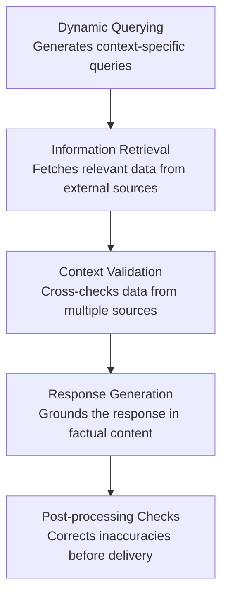
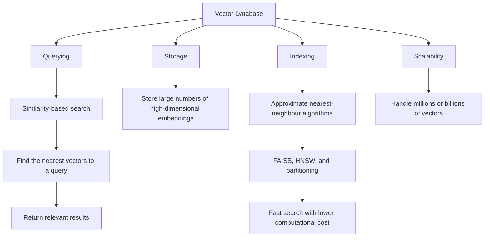

#   Python Syntax 

* Python does not use { } or ; 

* Indentation defines code blocks.  
* Syntax rules

  1 \- No semicolon required  
  2 \- No curly braces  
  3 \- Indentation defines a block  
  4 \- Dynamically typed  
  5 \- Case sensitive   
  6 \- Everything is an object in Python 
  
* Python is interpreted, not compiled.

 # 
# Python Variable 

* Dynamically typed  
* No type declaration needed  
* Created when first assigned  
* Supports multiple assignments  
* Scope: local and global  
* Input returns a string   
* Mutable (lists ), immutable (str, tuples)   
* Constants are uppercase by conventions   
* To create a global variable inside a function, you can use the [global](https://www.w3schools.com/python/ref_keyword_global.asp) keyword.


### Variable Rules:

1.  Must start with a letter or `_`

2.  Cannot start with a number

3.  Case-sensitive (`age` and `Age` are different)

4.  Cannot use keywords (`if`, `for`, `class`, etc.)

#

# Python Data Types

* Python has built-in data types divided into categories   
   
   1. Numeric ( int, float, complex )  
   2. Sequence ( str \- text data , immutable ; list \[\]- ordered , mutable , allows duplicate ; tuple() \- ordered , immutable , allows duplicate )  
   3. Set \- unordered, no duplicates, mutable.  
   4. Dictionary \- stores key-value pairs , key must be immutable (string , int , tuple )  
* List, dict, and  set are mutable   
* Dict ( API response ) , list ( data collections ) , str ( processing) , none ( return values ) , bool ( conditions )

# 

# Python Strings 

* Ordered, immutable, supports indexing and slicing.  
* Cannot modify a string directly   
* “In” operator checks a substring   
* String methods:  
  1. `upper()` \- converts to uppercase  
  2. `lower()` \- converts to lowercase  
  3. `strip()` \- removes whitespace from both ends  
  4. `replace(old, new)` \- replaces a substring  
  5. `split(separator)` \- splits into a list  
  6. `join(iterable)` \- joins elements into a string
  7. `len()` \- returns the length of the string

* string \= "Hello, World!"  
  print(string\[7:12\])  # Output: World  
  print(string\[:5\])    # Output: Hello  
  print(string\[7:\])    # Output: World!  
  print(string\[-6:-1\]) # Output: World

* taking string as input from user  
  name \= input("Enter your name: ")  
  print("Hello, " + name + "!")
   
#
# Difference between is and \==

* Is \- checks if both variables point to the same object in memory   
* \== checks if the value of both variables is equal 

| Feature | List | Tuple | Set | Dictionary |
| ----- | ----- | ----- | ----- | ----- |
| **Syntax** | `[1, 2, 3]` | `(1, 2, 3)` | `{1, 2, 3}` | `{"key": value}` |
| **Ordered** | ✅ Yes | ✅ Yes | ❌ No | ✅ Yes (Python 3.7+) |
| **Mutable** | ✅ Yes | ❌ No | ✅ Yes | ✅ Yes |
| **Allows Duplicates** | ✅ Yes | ✅ Yes | ❌ No | ❌ Keys No (Values Yes) |
| **Indexing Supported** | ✅ Yes | ✅ Yes | ❌ No | ❌ No (use keys) |
| **Key-Value Pair** | ❌ No | ❌ No | ❌ No | ✅ Yes |
| **Use Case** | Store multiple items | Fixed data | Unique elements | Structured data |
| **Performance (Lookup)** | O(n) | O(n) | O(1) avg | O(1) avg |
| **Memory Usage** | Medium | Less (than list) | Medium | More (stores keys & values) |


# 
# List 

* Lists are used to store multiple items in a single variable.  
* List items are ordered, changeable, and allow duplicate values.  
* A list can contain different data types.The
* list() constructor can be used to create a list.
* list functions:  
  1. `append(x)` \- adds an item to the end  
  2. `extend(iterable)` \- adds all items from an iterable  
  3. `insert(i, x)` \- inserts an item at a given position  
  4. `remove(x)` \- removes the first item with the value x  
  5. `pop([i])` \- removes and returns the item at index i (default last)  
  6. `clear()` \- removes all items  
  7. `index(x)` \- returns the index of the first item with value x  
  8. `count(x)` \- returns the number of times x appears  
  9. `sort()` \- sorts the list in place  
  10. `reverse()` \- reverses the list in place

* list operations:  
  1. Concatenation: `list1 + list2`  
  2. Repetition: `list * n`  
  3. Membership: `x in list`  
  4. Slicing: `list[start:end]`  
  5. Length: `len(list)`  
  6. Iteration: `for item in list:`

* list = [1, 2, 3, 4, 5]  
  list.append(6)  
  print(list)  # Output: [1, 2, 3, 4, 5, 6]  
  list.remove(3)  
  print(list)  # Output: [1, 2, 4, 5, 6]
  
* List comprehension:  
  squares = [x**2 for x in range(10)]  # Creates a list of squares from 0 to 9

* List comprehension with condition:  
  even_squares = [x**2 for x in range(10) if x % 2 == 0]  # Squares of even numbers from 0 to 9

* list = [apple, banana, cherry]  
  print(list\[1\])  # Output: banana  
  list\[1\] = orange  
  print(list)  # Output: [apple, orange, cherry
  ]
* Input in list   
  numbers \= list(map(int, input("Enter numbers: ").split()))  
  print(numbers)

#
# 

| Feature  | Append() | add() |
| :---- | :---- | :---- |
| Used with | list | set |
| Allows Duplicates | yes | no |
| MAintains order | yes | no |
| adds | At end  | anywhere |

#
#

| Feature | Append() | Extend |
| :---- | :---- | :---- |
| Works on | List | List |
| Adds | Single element | Multiple elements |
| Accepts | Any object | itereable |
| Modifies original list | yes | yes |
| eg | \[1,2\].append(\[3,4\])-\>\[1,2,\[3,4\]\] | \[1,2\].extend(\[3,4\])-\>\[1,2,3,4\] |


#
# 

| feature | remove() | pop() |
| :---- | :---- | :---- |
| removes | By value | By index |
| Returns value | no | yes |
| Default behaviour | First matching value  | Last element  |
| eg | remove(2) | pop(1) |

#
# 

### Copying lists:  

1. Shallow copy: `copy.copy(list)` or `list.copy()` : Creates a new list with the same elements, but the elements are references to the original elements.

2. Deep copy: `copy.deepcopy(list)` (requires `import copy`) : Creates a new list with new copies of the original elements, including nested objects.


| Feature  | Shallow copy  | Deep copy |
| :---- | :---- | :---- |
| Copies outer object  | yes | yes |
| Copies nested object  | No (refrences) | Yes (new object ) |
| Affects original if nested changed | yes | no |
| Affects original nested change  | Yes  | no |
| Method  | copy.copy() | copy.deepcopy() |

#
# 

| Feature | sort() | sorted() |
| :---- | :---- | :---- |
| Modifies original list  | yes | No  |
| Returns new list | no | yes |
| Works on | Lists only | Any iterable  |
| Returns value | none | Sorted list  |


#
# Tuples


* Tuples are used to store multiple items in a single variable.
* Tuple items are ordered, unchangeable, and allow duplicate values.
* Tuples can contain different data types.
* Tuple functions:  
  1. `count(x)` \- returns the number of times x appears  
  2. `index(x)` \- returns the index of the first item with value x
  3. `len(tuple)` \- returns the length of the tuple
  4. `tuple()` \- creates a tuple from an iterable

* tuple = (1, 2, 3, 4, 5)  
  print(tuple\[2\])  # Output: 3  
  print(tuple.count(2))  # Output: 1  
  print(tuple.index(4))  # Output: 3       
* Input for tuples   
  data \= tuple(map(int, input("Enter values: ").split()))  
  print(data)  
  
#
# Sets

* A set is a collection that is *unordered*, *unchangeable\**, and *unindexed*.  
* Set *items* are unchangeable, but you can remove items and add new items.  
* The values [True](https://www.w3schools.com/python/ref_keyword_true.asp) and 1 are considered the same value in sets, and are treated as duplicates  
* Once a set is created, you cannot change its items, but you can add new items.  
* If the item to remove does not exist, [remove()](https://www.w3schools.com/python/ref_set_remove.asp) will raise an error.  
* If the item to remove does not exist, [discard()](https://www.w3schools.com/python/ref_set_discard.asp) will NOT raise an error.  
* Sets are *unordered*, so when using the [pop()](https://www.w3schools.com/python/ref_set_pop.asp) method, you do not know which item gets removed.  
* The union() and update() methods joins all items from both sets.  
* The intersection() method keeps only the duplicates.  
* The difference() method keeps the items from the first set that are not in the other set(s).  
* The symmetric difference() method keeps all items except the duplicates.  
* Set = {1, 2, 3, 4, 5}  
  Set.add(6)  
  print(Set)  # Output: {1, 2, 3, 4, 5, 6}  
  Set.remove(3)  
  print(Set)  # Output: {1, 2, 4, 5, 6}
  Set.discard(10)  # No error
  Set.pop()  # Removes an arbitrary item
* Input for set   
  values \= set(map(int, input("Enter numbers: ").split()))  
  print(values)

#
# Dictionary 

* Dictionaries are written with curly brackets, and have keys and values  
* Dictionary items are ordered, changeable, and do not allow duplicates  
* You cannot refer to an item using an index in a dictionary   
* You can access the items of a dictionary by referring to its key name. There is also a method called [get()](https://www.w3schools.com/python/ref_dictionary_get.asp) that will give you the same result  
* The [keys()](https://www.w3schools.com/python/ref_dictionary_keys.asp) method will return a list of all the keys in the dictionary.  
* The [values()](https://www.w3schools.com/python/ref_dictionary_values.asp) method will return a list of all the values in the dictionary.
* inventory = {}  
  n = int(input("How many items? "))  
  for _ in range(n):  
    key, value = input("Enter key and value: ").split()  
      inventory[key] = int(value)  
  print(inventory)

#
# Memory management in Python 

* Python uses a garbage collector to automatically manage memory.
* The garbage collector will automatically free up memory that is no longer being used.
* You can manually trigger the garbage collector using the `gc` module.
* The `gc` module also provides functions to control the garbage collection process.
* You can use the `gc.collect()` function to manually trigger garbage collection.
* Objects are reference counted, and when the reference count drops to zero, the memory is deallocated.
* Objects that are no longer reachable are considered garbage and will be collected by the garbage collector.

#
# Git

### Staging Environment

* The staging environment (or staging area) is like a waiting room for your changes.  
* You use it to tell Git exactly which files you want to include in your next commit.  

### Git Stash

* Sometimes you need to quickly switch tasks or fix a bug, but you're not ready to commit your work. Git stash lets you save your uncommitted changes and return to a clean working directory.  
* You can stash your changes with `git stash`, and later retrieve them with `git stash pop` or `git stash apply`.

### Git Config

* This is important for version control systems, as each Git commit uses this information  
* Use \--global to set the value for every repository on your computer. Use \--local (the default) to set it only for the current repository.  
* Can change the email designated to the repository or default code editor, or the user name   
* There are three levels of configuration:  
  System (all users): git config \--system  
  Global (current user): git config \--global  
  Local (current repo): git config \--local  
    
    
1. Git init \- creates a git repo in your current folder . used when starting a new project from scratch   
2. Git clone \- copies a remote repo to your local machine. download all commits, create a working directory, connects to the remote automatically   
3. Git status \- show current branch , modified files , staged files , untracked files   
4. Git add \- moves file from working dir to staging area   
5. Git commit \- saves the staged commit into git histroy. If we commit without add nothing gets committed ( git commit \-m "Added login API")  
6. Git log \- shows commit history   
7. Git diff \- shows diff between working vs staged and staged vs last commit   
8. Git branch \- shows available branches or  its like a different workplace where you can changes or try different things without changing the main project  ( git branch feature-auth)  
9. Git checkout \- switches branches (git checkout feature-auth)  
10. Git merge \- combines another branch into the current branch   
11. Git pull \- fetch (documentation) \+ merge (code )from remote   
12. Git push \- uploads commits to the remote repository (any repo on GitHub)  
13. Git remote \-v \- shows connected remote repository   
14. Git remote add \- connects local repo(on device ) to remote repo (GitHub)  
15. Git reset \- unstages files   
16. Git stash \- temporarily saves changes without committing. git stash, restore \- git stash pop  
17. Git rm \- deletes the file from git tracking   
18. Git rm \-  removes or renames a file  
19. Git  fetch \- downloads changes fromthe  remote but does not merge   
20. Git rebase \- reapplies your commits on top of another branch, creates linear history   
21. Git revert \- creates a new commit that undoes the previous commit. safer than reset ( git revert \< commit-id\>  
22. Git ls \- shows the list of folders   
23. Git tag \- helps in maintaining the versions of the project (v1 , v0 , v2 etc)  
    

### Git workflow 

* Working Directory → git add → Staging Area → git commit → Local Repo → git push → Remote Repo  
* Workflow eg  
       git checkout \-b feature-branch  
       git add .  
       git commit \-m "Meaningful message"  
       git push origin feature-branch


### Fork

* Copy someones else repository to your github acc , used in open source contri. , practice and experimentation  
* Fork \-\> modify \-\> pull request


### Clone

* Download github repo to your local machine 


  


  


|              Feature | `git clone` | `git pull` |
| :---- | ----- | ----- |
|              Purpose | Downloads a repository for the first time | Updates an existing local repository |
| When Used | When you don't have the project locally | When you already have the repo |
| Creates `.git` folder? | ✅ Yes | ❌ Already exists |
| Copies full history? | ✅ Yes | ❌ Only fetches new changes |
| Combines commands? | Clone \= copy repo | Pull \= `fetch` \+ `merge` |
| Used How Many Times? | Usually once per repo | Used frequently (daily) |


  

### Pull Request (PR)
* Request to merge your branch into another branch   
* Workflow \- create branch \-\> push \-\> Open PR \-\> Review \-\> Merge 


### Github Workflow 

git pull origin main  
git checkout \-b feature-new-api  
\# Make changes  
git add .  
git commit \-m "Added new API"  
git push origin feature-new-api

### .gitignore

* The .gitignore file tells Git which files and folders to ignore (not track).


### Git LFS

* Git LFS is an extension for GIT that helps you manage large files ( like videos , images , or datasets ) efficiently   
* Instead of sorting big files directly in your repository Lfs stores a small pointer file in your repo and keeps  the real content on a separate LFS server 

### What is the difference between Fork and Clone?

* Fork creates a copy of a repository on GitHub under my account, while clone downloads a repository from GitHub to my local system for development.
* Fork is used for contributing to someone else's project, while clone is used for working on a project locally.


### What is “upstream”?

* Upstream is the original repository that my fork is based on. I use it to fetch updates from the main project.
* Upstream is typically the remote repository that you have forked from.


### What happens when two people push at the same time?

* Git prevents overwriting changes. The second person must pull the latest changes, resolve conflicts if any, and then push again.  
* git pull origin main  
  \# resolve conflicts  
  git push origin main


### What is a merge conflict?

* A merge conflict happens when Git cannot automatically merge changes due to overlapping modifications. It must be resolved manually.
* Merge conflicts are common when working with multiple branches and collaborating with others.


### What is Rebase?

* Rebase reapplies my commits on top of another branch , creating a linear history , unlike merge which preserves branch history .  
* Instead of merging branches with a merge commit , rebase rewrites  the commit history .  
* Suppose you created a feature branch from main.  
  A —-----B—-----C (main)  
                I  
                I  
                D—--------E (feature)  
    
  Meanwhile , new commits were added to main .  
    
  A—---B—----C—----F—-----G (main)  
            I  
            I  
            D—------E  (feature)  
    
    
  If you rebase feature onto main , Git moves commits D and E after G.  
    
  A—----B—-----C—----F—-----G—------D’—----E’ (feature)

  
  D’ and E’ are new commits (rewritten history)

* Benefits of rebase   
   - Creates a clean linear history   
   - Avoids unnecessary merge commits   
   - Makes code review easier   
  - Helps resolve conflicts earlier   
  - Improves debugging   
  - Helps keep feature branch updated   
* Rebase is unsafe on shared branches because it rewrites history and can cause issues for other developers. Avoid rebasing :   
     - Main  
    - Develop  
     - Any branch already pushed and used by others 

           

| Merge | Rebase  |
| :---- | :---- |
| Preserves branch history  | Creates a linear history  |
| Adds merge commit  | No merge history |
| Safe for teams  | Risky if misused |

### What is head in git head?

* HEAD is the pointer to the current branch.

#

# Lambda Functions 

* It is a small anonymous function written in one line   
* Lambda is mainly used when defining a function separately is unnecessary.  
* Helps in sorting, filtering, transforming data, writing quick logic, functional programming and processing data (sort() , filter(), map(), reduce(), min() , max())  
* Lambda functions do not have name but you can assign them to a variable.  
* Limitations of lambda   
  1. Only one expresoin is allowed   
  2. Cannot contain —-\> statements , loops , assignments , multiple expression   
  3. Hard to read complex logic   
* Syntax :  lambda arguments : expressions  
   Result \= list(map(lambda x : x\*2, nums))  
  Meaning → take x , square it , return nums (lambda input : output )

#
# Map ()

* It is used to apply a function to every element of an iterable ( like a list , tuple , etc ) and returns the results.  
* Syntax : map(function , iterable )  
  Function —\> operation to apply  
  Iterable —\> list , tuple etc  
  Returns a map object (iterator )  
* Eg \- result \= list(map(lambda x: x\*2 , nums))  
  lambda x:x\*2 —\> function  
  Nums → iterable   
  map() → applies the function to each element 
  
#
# Recursion

* When a function calls itself   
* Helps in tree structures, DFS/BFS, divide and conquer ( merge sort , quick sort  , binary search ), file systems, backtracking algorithms , dynamic programming (top to down approach )  
* Syntax   
  Def function\_name(parameters):  
           If base \_condition:  
                   return result  
           Else:   
                   Return function\_name(modified\_parameters)
* Eg \- Factorial of n  
  Def factorial(n):  
           If n==0:  
                   return 1  
           Else:   
                   Return n\*factorial(n-1)

#
# Function as an argument 

* Passing a function inside another function   
* Helps in frameworks, middleware, callbacks, and async programming  
* Syntax :   
              def main\_function(func)  
                 func() 
* Eg \- def greet():  
           print(“Hello”)  
       def execute(func):  
           func()  
       execute(greet)  # Output: Hello


#
# Nested functions

* Function inside another function   
* Encapsulation, cleaner logic, is used in decorators   
* Syntax:  
              Def outer\_function():  
                     Def inner\_function():  
                               print(“inner function”)  
                   inner\_function()  
* Eg \- def outer():  
           print(“outer function”)  
           def inner():  
                   print(“inner function”)  
           inner()  
       outer()  # Output: outer function \n inner function  

#
# Closure 

* A function remembers variables from the outer function even after the outer function is over .   
* Helps in caching, data hiding, factory functions, and decorators   
* Syntax :   
  Def outer\_function():  
       x=10  
       Def inner\_function():  
             print(X)  
       Return inner\_function
* Eg \- def outer():  
           x = 10  
           def inner():  
                   print(x)  
           return inner  
       closure\_func = outer()  
       closure\_func()  # Output: 10

* Difference between nested function and closure  
  - Nested function is defined inside another function, while closure is a nested function that retains access to variables from its enclosing scope even after the outer function has finished executing.  
  - Nested functions do not necessarily retain state, while closures do.  
  - Closures are often used for data hiding and maintaining state across function calls.

#
# Decorators 

* A function that modifies another function without changing its source code
* Used in logging , authentication , authorization , timing , FastAPI   
* syntax:  
            Def decorator\_function(func):  
                    Def wrapper():  
                            print(“before function)  
                            func()  
                            print(“after function”)  
                     return wrapper  
    
* Eg \- logging authentication  
      
  def require\_login(func):  
       def wrapper(user):  
          If not user \[“logged\_in”\]:  
                print(“Access denied”)  
                Return  
              Return func(user)  
         Return wrapper   
    
  Usage:  
    
  @require\_login  
  Def dashboard(user):  
       print(“welcome to dashboard “)

#
# Pure and impure functions 

* Pure functions \- no side effects, same input \-\> same output   
* Helps in easier testing, is safer, used in functional programming   
* Impure functions \- modify external state 


  
* Function as argument →  
"Give me instructions, and I'll execute them."

* Nested function (closure)→  
"I have a helper function inside me."

* Why are functions first-class objects in Python?  
  Because 
  
  - They can be assigned to variables  
  - They can be passed as arguments   
  - They can be returned from other functions  
  

#
# OOPS 


## Constructors 

* It is a special method in a class that executes automatically when an object is created   
* When you create an object, Python must allocate memory for the object, create the object, and initialize attributes. The constructor handles initializing attributes   
* \_\_new\_\_() \-\>creates object in memory (memory allocation)  
  \_\_init\_\_() \-\> initializes it   
* Constructors are used for database model initialization, dependency injection, service initialization, and API client   
* Python does not support traditional overloading; instead, it uses default arguments, \*args, and \*\*kwargs  
* Python doesn't support multiple constructors because it uses dynamic typing; functions are identified by name only, not parameter types. Method overloading by signature does not exist   
    
*  Difference between `__new__` and `__init__ ?`  
  \_\_new\_\_ is responsible for creating and returning a new instance of a class, while \_\_init\_\_ initializes the instance after it has been created. \_\_new\_\_ is called before \_\_init\_\_ and is typically overridden in advanced cases like singletons or immutable types.  
* constructors are used for database model initialization, dependency injection, service initialization, and API client.
* Eg \- class MyClass:  
           def \_\_new\_\_(cls, *args, **kwargs):  
               print("Creating instance")  
               instance = super(MyClass, cls).\_\_new\_\_(cls)  
               return instance  
           def \_\_init\_\_(self, value):  
               print("Initializing instance")  
               self.value = value  
       obj = MyClass(10)  # Output: Creating instance \n Initializing instance
    
    
    
  


| Feature  | \_\_new\_\_ | \_\_init\_\_ |
| :---- | :---- | :---- |
| Purpose  | Creates object  | Initializes object |
| Called first? | yes | no |
| Returns value? | Must return object | Returns none |
| Takes parameter  | cls | self |
| Rarely overridden | yes | no |
| Used in singleton | yes | no |
| Used for immutable types? | yes | no |


  
## Class vs Instance variable 

* Instance variables are specific to an object and stored in the object's namespace, whereas class variables belong to the class itself and are shared among all instances. Python resolves attributes by checking the instance first, then the class.  
* Instance :    
  Defined using \-  self.variable\_name   
  Stored inside \-  object.\_\_dict\_\_  
* Class :   
  Stored inside  \- classname.\_\_dict\_\_  
  


| Feature | Instance variable  | Class Variable  |
| :---- | :---- | :---- |
| Belongs to | object | Class  |
| Stored in | object.dict | class.dict |
| Shared  | no | yes |
| Accessed via | Self.variable  | Class.variable  |
| Memory efficient  | No (separate copies ) | yes |
| Used for  | Object-specific data | Shared config  |


 

## Instance Method 

* It operates on object-level data  
* Instance methods are used for object behavior, encapsulation, and polymorphism.
* Instance methods are the most common type of method in Python classes. They are defined with the `def` keyword and take `self` as the first parameter, which refers to the instance of the class.
* Eg - class MyClass:  
           def instance_method(self):  
               print("This is an instance method")  
       obj = MyClass()  
       obj.instance_method()  # Output: This is an instance method
  

## Class Methods 

* It operates on class-level data .   
* Class methods are defined with the `@classmethod` decorator and take `cls` as the first parameter, which refers to the class itself.
* Class methods are used for factory methods, alternative constructors, and class-level operations.  
* Eg - class MyClass:  
           @classmethod  
           def class_method(cls):  
               print("This is a class method")  
       MyClass.class_method()  # Output: This is a class method


## Static Methods

* It belongs to the class namespace but does not access a class or an instance   
* It uses @staticmethod , takes no ‘ self ‘ , takes no ‘ cls ‘ , acts like a normal function inside a class   
* We use static methods when a function logically belongs to a class, with no access to the instance/class state  
* Eg - class MyClass:  
           @staticmethod  
           def static_method():  
               print("This is a static method")  
       MyClass.static_method()  # Output: This is a static method 
* For better organization   
    - Instance method \-\> works on one object  
    - Class method \-\> works on all objects   
     - Static method \-\> works independently   
  


| Feature | Instance method | Class method | Static methods |
| :---- | :---- | :---- | :---- |
| Decorator  | none | @classmethod | @staticmethod |
| First parameter  | self | cls | none |
| Access instance data  | yes | no | no |
| Access class data | yes | yes | no |
| Modify class data | Usually no | yes | no |
| Used for  | Object behaviour | Factory methods | Utility functions |


  

## Encapsulation

* It refers to building data (variables) and methods ( functions ) inside a class and restricting direct access to some part of the object. In Python, this is achieved through name mangling and a property decorator to ensure controlled access.  
* It helps in maintaining invariants, preventing inconsistent object state, improving maintainability, reduce coupling   
* Access modifiers :   
       
  - Public -> self.balance ( accessible anywhere )  
  - Protected -> self.\_balance ( single underscore, you shouldn't access this directly )  
  - Private -> self.\_\_balance  ( double underscore, name mangling, not accessible outside the class )
    
* Getters and setters are used manually  
* @property allows methods like control and variables like access.
* Eg - class BankAccount:  
           def \_\_init\_\_(self, balance):  
               self.\_\_balance = balance  # private variable  
           @property  
           def balance(self):  
               return self.\_\_balance  
           @balance.setter  
           def balance(self, value):  
               if value < 0:  
                   raise ValueError("Balance cannot be negative")  
               self.\_\_balance = value

## Abstraction 

* It means hiding implementation details and exposing only essential features   
* Python supports abstraction via the abc module ( abstract base classes) and @abstractmethod decorator   
* Abstraction is used to create plug-and-play architecture, enforce contracts between teams, build scalable systems, and implement SOLID principles .
* It helps in reducing complexity, improving maintainability, and increasing code reusability.
* Eg - from abc import ABC, abstractmethod  
       class Shape(ABC):  
           @abstractmethod  
           def area(self):  
               pass  
       class Circle(Shape):  
           def \_\_init\_\_(self, radius):  
               self.radius = radius  
           def area(self):  
               return 3.14 * self.radius ** 2


## Polymorphism

* It allows different objects to respond to the same method call in different ways .  
* With polymorphism code becomes flexible , open for extension , closed for modification , cleaner architecture , plug and play design.  
* Method overloading is not supported in Python, but we can achieve polymorphism through duck typing, method overriding, operator overloading, and function overloading.
* Method overriding is when a child class provides a specific implementation of a method that is already defined in its parent class. This allows the child class to modify or extend the behavior of the parent class method.
* Why is polymorphism better than multiple if else blocks ?  
  Because it eliminates conditional complexity and makes system extensible   
* What happens if parent method is not overridden ?  
  Child inherits parent version   
* Is pyhton polymorphism compile \- time or runtime ?  
  Runtime (dynamic typing )
* Eg - class Animal:  
           def speak(self):  
               print("Animal speaks")  
       class Dog(Animal):  
           def speak(self):  
               print("Dog barks")  
       class Cat(Animal):  
           def speak(self):  
               print("Cat meows")  
       def make_animal_speak(animal):  
           animal.speak()  # Polymorphic behavior based on the object type

| Type  | how | Real use  |
| :---- | :---- | :---- |
| Duck Typing | Same method name | Flexible APIs |
| overriding | Child modifies parent method  | INheritance systems  |
| Operator overloading | Magic methods  | Custom data structures  |
| Function overloading  | Default args | Flexible APIs |


## Dunder methods 

* Dunder \= double underscore  
* They allow you to customize how your objects behave with python built in operations.  
* When we write a+b , python internally calls  a.\_\_add\_\_(b) , when we write print (obj) python calls obj.\_\_str\_\_()  
* \_\_new\_\_ : creates the object in memory   
* \_\_init\_\_  : initializes the object   
* \_\_repr\_\_: user friendly output (for print)  
* \_\_repr\_\_: developer \- friendly representation (for debugging)  
* \_\_call\_\_: makes object callable like function 


## Composition

* It is a design principle where one class contains an object of another class as a part of its state .   
* Composition allows loose coupling , is more flexible , easier to extend  cleaner architecture   
  


| Feature | Inheritance | compositon |
| :---- | :---- | :---- |
| Relationship | IS a | Has a  |
| Coupling | tight | loose |
| Flexibility | low | high |
| Change Impact | risky | safe |
| Industry prefrence | limited | Highly preferred |


  
#
# SOLID principles

## S \- Single Responsibility Principle(SRP)

* A class should have only one reason to cahnge   
* One class one job .    
* Identification of SRP violation
   - Does this class do more than one thing ?
   - Would different teams modify this class ?
   - Does this class mix business \+ infrastructure logic ?

* SRP improves : 
    - Cohesion increases (class methods strongly related)
    - Coupling decreases ( less dependency on other modules)
* Eg - class User:  
           def create_user(self):  
               pass  
           def send_email(self):  
               pass  # SRP violation, should be in a separate EmailService class
               
  corrected version :
  
  class EmailService:
       def send_email(self, user):
           pass

  class User:  
           def create_user(self):  
               pass
           def send_email(self):  
               EmailService.send_email(self)  # Delegates email sending to a separate service class


## O \- Open/Closed (OCP)

* Code should be open for extension  
* Closed for modification  
* We should be able to add new features without changing the existing code.  
* It makes the system stable , scalable and extendable   
* OCP is implemented using abstract classes , polymorphism and composition.
* Eg - class Shape(ABC):  
           @abstractmethod  
           def area(self):  
               pass  
       class Circle(Shape):  
           def \_\_init\_\_(self, radius):  
               self.radius = radius  
           def area(self):  
               return 3.14 * self.radius ** 2  
       class Square(Shape):  
           def \_\_init\_\_(self, side):  
               self.side = side  
           def area(self):  
               return self.side ** 2

## L \- Liskov Substitution Principle (LSP)

* Child classs must be replaceable for parent class without breaking behaviour   
* LSP ensures behavioral correectness , reliable polymorphism and no unexpected runtime errors .  
* LSP rules:  
  - It must not weaken parent behaviour   
  - It must not strengthen preconditions   
  - It must not break expected outputs   
  - It must not change the postconditions   
  - It must not change the invariants   
  - It must not throw unexpected exceptions 
* Eg - class Bird:  
           def fly(self):  
               pass  
       class Sparrow(Bird):  
           def fly(self):  
               print("Sparrow flies")  # LSP compliant  
       class Penguin(Bird):  
           def fly(self):  
               raise NotImplementedError("Penguins can't fly")  # LSP violation, should not override fly method

  Corrected version :

  class Bird:  
           def fly(self):  
               pass  
       class Sparrow(Bird):  
           def fly(self):  
               print("Sparrow flies")  # LSP compliant  
       class Penguin(Bird):  
           def swim(self):  
               print("Penguin swims")  # LSP compliant, different behavior

     

## I \- Interface Segregration Principle (ISP)

* A class should not be forced to implement the methods it doesnt use   
* Many small interfaces \> one large interface  
* It ensures clean architecture , better modularity , flexible systems and easier maintenance .
* Eg - class Bird:  
           def fly(self):  
               pass  
           def swim(self):  
               pass  # ISP violation, not all birds can swim  
       class Sparrow(Bird):  
           def fly(self):  
               print("Sparrow flies")  # LSP compliant  
           def swim(self):  
               raise NotImplementedError("Sparrows can't swim")  # ISP violation, should not implement swim method

  Corrected version :

  class Flyable(ABC):  
           @abstractmethod  
           def fly(self):  
               pass  
       class Swimmable(ABC):  
           @abstractmethod  
           def swim(self):  
               pass  
       class Sparrow(Flyable):  
           def fly(self):  
               print("Sparrow flies")  # ISP compliant  
       class Penguin(Swimmable):  
           def swim(self):  
               print("Penguin swims")  # ISP compliant

  

## D \- Dependency Inversion Principle (DIP)

* High level modules should not depend on low level modules   
* Both should depend on abstraction . and abstractions should not depend on details . details should depend on abstractions   
* It ensures loose coupling , flexible systems , easier testing and maintainability
* Eg - class MySQLDatabase:  
           def connect(self):  
               pass  
       class UserService:  
           def \_\_init\_\_(self, db):  
               self.db = db  # DIP violation, depends on concrete MySQLDatabase class  
           def get_user(self, user_id):  
               self.db.connect()  
               # fetch user logic

  Corrected version :

  class Database(ABC):  
           @abstractmethod  
           def connect(self):  
               pass  
       class MySQLDatabase(Database):  
           def connect(self):  
               pass  # Concrete implementation of Database interface  
       class UserService:  
           def \_\_init\_\_(self, db: Database):  
               self.db = db  # Depends on abstraction (Database) instead of concrete class (MySQLDatabase)  
           def get_user(self, user_id):  
               self.db.connect()  
               # fetch user logic


      
#
# Error and Exception handling 

* An error is a problem in a program that prevents correct execution  
* Categories of error in python  
  


| Error type  | When it happens  | Examle |
| :---- | :---- | :---- |
| Syntax Error | Before program runs | Missing colon |
| Runtime Error (Exception) | During execution | Divide by zero  |
| Logical Error | Program runs but wrong result  | Wrong formula |

*  Error handling (try- except)  
    
  


| Exception | Cause | Example |
| :---- | :---- | :---- |
| ZeroDivisionError | Dividing by zero | 10/0 |
| TypeError | Wrong data type | “5” \+ 2 |
| Value Error | Invalid value | int(“abc”) |
| Index Error | List index out of range  | arr\[10\] |
| Key error | Missing dict key | dict\[“x”\] |
| FileNOtFoundError | File missing  | open(“file.txt”) |
| Attribute Error | Invalid attribute | obj.xyz |

       


* Try except handles error whereas raise creates error.  
* Error \-\> critical issue , program stops.  
  Exception \-\> can be handled , can recover   
  


# Exception Handling 

*  Basic try-except is not enough for real world systems because applications need to : 
   - Log errors   
   - Retry failed operations   
   - Propagate errors across layers   
   - Categorize failures   
   - Maintain system stability 

* Exception chaining \-  sometimes an exception occurs because of another exception . python allows linking them using raise…….from  
* Custom systems hierarchy \- large systems create structured exception classes.  
* Context managers for safe resource handling , used when working with files , database connections and network sockets . Python provides the with statement   
* Retry Pattern \- many failures are temporary , instead of failing immediately , the system retries   
* Logging Exceptions \- in real applications we never just print errors instead we log them using pythons logging module . it preserves stack trace , store logs for debugging , works with monitoring tools   
* Graceful Degradation \- if one component fails , the system continues with reduced functionality   
* Fail fast principle \- if the system detects invalid input , it should fail immediately  
* Circuit Breaker Pattern \- used in microservices , if a service repeatedly fails . stop calling it temporarily   
* Exception Handling Architecture   
    Controller \-\> service \-\> repository \-\> database  
Eg - try:  
           result = service.get_data()  
       except ServiceException as e:  
           logger.error(f"Service failed: {e}")  
           raise ControllerException("Failed to get data") from e
           finally:  
           logger.info("Request completed")


| Block | When it runs |
| :---- | :---- |
| else | Only if no execption |
| finally | Always runs  |


  
#
# Module 

* A module is simply a python file (.py) that contains:  
   - Functions  
   - Classes  
   - Variables  
   - Executable code  
    
*  Python allows you to reuse code using import  
* Different ways to import modules  
  - Normal Import  
  - Import Specific Function  
  - Import with Alias  
  - Import Everything ( not recommended)  
     
     
     
     
     
     
   

| Module | purpose |
| :---- | :---- |
| math | Mathematical operations |
| random | Random number generation |
| datetime | Date and time |
| os | Operating system operations |
| sys | System \- specific functions  |

   

   
#
# Package

* A package is a folder that contains multiple modules .  
* It helps in organize code , maintain structure , improve readability  
* \_\_init\_\_.py —\> this file marks a directory as a python package. It can also run initialization code  
* . \-\> current package .. \-\> parent package  
    
  


| Feature  | Function  | Module  | Package  |
| :---- | :---- | :---- | :---- |
| What it is  | Block of code | Python file | Folder of modules  |
| Purpose  | Perform a task | Orgnaize functions/class  | Organize modules  |
| size | Smallest  | medium | Largest  |
| example | add() | math\_operations.py | Numpy , pandas |


  

#
# List Comprehension 

* It is a short and pythonic way to create list using a single line of code instead of loops , it makes code shorter , faster and more readable .  
* We can also modify elements while creating the lists .  
* Types of comprehension   
  -  List   \[x for x in range (5)\]  
  -   Set  {x for x in range(5)}  
  - Dictionary { x : x\*x for x in range(5)}
* Avoid comprehension when logic becomes too complex , multiple nested conditions , readability decreases .  
* Eg - nums = \[1,2,3,4,5\]  
  squares = \[x\*x for x in nums\]  # Output: \[1,4,9,16,25\]  
  even\_squares = \[x\*x for x in nums if x%2==0\]  # Output: \[4,16\]  

#
# Iterators

*  It is an object that allows you to traverse through a collection one element at a time .  
* Iterators are used in loops , generators , data streaming , lazy evaluation , and functional programming.
* Instead of loading everything in the memory it produces values on demand 
* Real world analogy \- think of a netflix playlist . instead of downloading all movies at once , you watch one movie at a time . same idea with iterators   
* For an object to be an iterator it must implement two methods   
  - \_\_iter\_\_() \- returns the iterator object   
   -  \_\_next\_\_() \- returns the next element 

* Eg - class MyIterator:  
           def \_\_init\_\_(self, data):  
               self.data = data  
               self.index = 0  
           def \_\_iter\_\_(self):  
               return self  
           def \_\_next\_\_(self):  
               if self.index < len(self.data):  
                   result = self.data[self.index]  
                   self.index += 1  
                   return result  
               else:  
                   raise StopIteration()  # Signals the end of iteration

#
# Generators 

* A generator is a simple way to create iterators   
* Instead of writing \_\_iter\_\_ and \_\_next\_\_ python provides  ‘ yield ‘ it pauses the function and remembers state   
* Normal list : 1 million numbers \-\> stored in memory  
  Generator : 1 number at a time \-\> memory efficient   
    
* Generators are used in dajngo querysets , fastAPI streaming responses , kafka consumers , log processors , data engineering pipelines , machine learning data loaders .
* eg - def my\_generator():  
           for i in range(5):  
               yield i  # Pauses and returns the value of i, remembers state for next call
          
* How to stop the generator ?
 
   - Use StopIteration exception or simply let the function finish executing. When the generator function completes, it raises StopIteration automatically.


| Feature | Iterator  | Generator |
| :---- | :---- | :---- |
| Definition | Object with \_\_iter\_\_ and \_\_next\_\_ | Function using yield  |
| Code size | large | Very small |
| Readability | harder | Easier  |
| Memory Efficient | yes | yes |
| State handling  | manual | automatic |
| Use case | Custom iteration logic | Data pipelines |

 

* All generators are iterators but not all iterators are generators   
* Generators automatically manage state and stop iteration   
* Iterators require manual implemnatation

#
# Asynchronus Programming 

* It allows your program to handle multiple tasks concurrently without blocking  
  execution.   
* It is especially useful for I/O bound operations such as :   
  - Network requests   
  - Database queries  
  - File operations   
  - APIs  
  - Web scraping   
* Instead of waiting for one task to finish, python can switch to another task while waiting.


| Type | Best for  |
| :---- | :---- |
| Asyncio | I/O bound tasks  |
| Threading | I/O tasks with blocking libraries |
| Multiprocessing | CPU intensive tasks  |


* Eg \- \> Web requests \- Async  
  Image processing \- Multiprocessing   
  FIle Downloads \- Async   
  Browser rendering \- Multiprocessing
  Code compilation \- Multiprocessing
  Database queries \- Async
    
* USe async for web scraping , APIs, chat servers , real time systems , network services , fast API / backend systems   
* Corotuine is a special function that can pause and resume execution . defined using async def   
* Event loop \- it is the engine that runs all the async tasks . It continuously checks which task is ready to run and execute it .  
    
* Async \- defines asynchronous function   
  Await \- pauses the function without blocking the program   
* Normal function \- run \-\> finish  
  Coroutine \- run \-\> pause \-\> resume \-\> pause \-\> resume \-\> finish  
* Why we have to use coroutines instead of threads ?  
  Because threads are heavy , require context switching , have GIL limitations , and are not memory efficient. Coroutines are lightweight, have lower overhead, and allow cooperative multitasking.
* Awaitable it is an object that can be used with await  
* Three main types


| Type  | description |
| :---- | :---- |
| coroutine | Async function |
| task | Scheduled coroutine |
| future | Placeholder for result  |


* A task is a coroutine that is scheduled to run in the event loop . while a future is a placeholder object that will contain a result later 

| Task | future |
| :---- | :---- |
| Runs Coroutine  | Holds result |
| Created with create\_task() | Created by event loop |
| High level | Low level |

*  Async generators combine : async \+ yield   
* Async flow summary  
   
   1. Async function \-\> corutine   
   2. Coroutine scheduled \- \> task  
   3. Task executed \-\> event loop  
   4. Await \-\> pause execution   
   5. Future \-\> stores result   
   6. Async generator \-\> produces async data  
   7. Async context manager \-\> manages async resources   
     
* Event Loop  
  │  
  ▼  
  Coroutine → Task  
  │  
  await something  
  │  
  paused  
  │  
  Event Loop runs other tasks  
  │  
  resume coroutine

* Eg - import asyncio  
       async def fetch_data():  
           print("Fetching data...")  
           await asyncio.sleep(2)  # Simulate I/O operation  
           print("Data fetched")  
           return {"data": 123}  
       async def main():  
           task = asyncio.create_task(fetch_data())  # Schedule coroutine as a task  
           print("Doing other work...")  
           await task  # Wait for the task to complete  
       asyncio.run(main())  # Output: Doing other work... \n Fetching data... \n Data fetched

#
# Multithreading 

* Multithreading is a programming technique that allows concurrent execution of multiple threads within a single process. It enables efficient utilization of CPU resources and can improve the responsiveness of applications, especially for I/O-bound tasks.
* It means running multiple threads inside the same process   
* A thread is the smallest unit of execution . all threads share the same memory space .  
* Useful for I/O bound tasks :   
  - Web requests   
  - File downloads   
  - Database queries   
  - Network communication  
  - Web scraping   
  
* Eg \- Downloading 10 files   
  Without threads \-\> 10 sequential downloads   
  With threads \-\> parallel downloads   
* Thread lifecycle   
  New \-\> Runnable \-\> running \-\> waiting \-\> terminated   
* Race conditon \- because threads share memory , data corruption can occur   
  Lock ( thread synchronizatoin ) \- locks ensure only one thread access shared data at a time .  
  Rlock (Reentrant lock ) \- allows the same thread to acquire the lock multiple times . useful in recursive functions .  
* Semaphore limits number of threads accessing a resource .
* Semaphore is a synchronization primitive that controls access to a shared resource by multiple threads. It maintains a counter that represents the number of available resources. When a thread wants to access the resource, it must acquire the semaphore, which decrements the counter. If the counter is zero, the thread will block until another thread releases the semaphore, incrementing the counter and allowing access.
* Thread pool \- it is a collection of threads that can be reused for multiple tasks . it avoids the overhead of creating and destroying threads .
* Process pool \- it is a collection of processes that can be reused for multiple tasks . it avoids the overhead of creating and destroying processes .
* Threading is not suitable for CPU bound tasks because of the GIL (Global Interpreter Lock) in Python. The GIL allows only one thread to execute Python bytecode at a time, which means that even if you have multiple threads, only one can run Python code at once. This limits the performance benefits of multithreading for CPU intensive tasks.
* Python Global Interpreter Lock (GIL) : it allows only one thread to execute Python bytecode at a time   
  “ Multiple thread exists but only one runs Python code at once “  


| Task type  | Best Approach  |
| :---- | :---- |
| I/O bound | Multithreading  |
| CPU bound  | Multiprocessing  |

*  Eg CPU task \- image processing , ML computation , encryption , scientific calculations .

* Instead of creating many threads manually , we use thread pool executor   
  Thread pools are used in:  
  - Web servers   
  - API processing   
  - Parallel tasks   
* High Performance Python system combine :   
  Async IO  
  \+Thread pools   
  \+ Multiprocessing   
    
    
  Eg \- FastAPI server 

                            |  
                            | —--async API calls  
                            | —-- Thread pool for blocking DB  
                            |------- Process pool for CPU tasks 

| Feature  | Multithreading | Multiprocessing | Async |
| :---- | :---- | :---- | :---- |
| Memory  | shared | Seperate  | Shared  |
| Best for | I/O tasks  | CPU tasks  | I/O tasks  |
| Parallel CPU | No (GIL) | Yes | No |
| Complexiety | Medium | High | Medium  |

            

* Process   
  Eg \- Chrome browser 

                             |--------Process 1 (Tab 1\)  
                             |--------Process 2 (Tab 2\)  
                             |--------Process 3 (Tab 3\)

* Thread  
  Eg \- Process (python program )  
                   |----------thread 1  
                   |----------thread 2  
                   |----------thread 3


| Feature | Process | Thread  |
| :---- | :---- | :---- |
| Memory  | Seperate memory  | Shared memory  |
| Speed | Slower creation  | Faster creation  |
| Communication | IPC required | Easy (shared memory ) |
| Crash isolation | Safe  | One thread crash can affect process  |
| Use case  | CPU intensive tasks  | I/O tasks  |


* Threading \- it uses multiple OS threads   
  Eg :  
  - Thread 1 —\> download file 
  - Thread 2 —\> API request 
  - Thread 3 —\> read database   
    But python has GIL , so only one thread runs Python bytecode at a time .

* Async Programming \- it uses single thread but cooperative multitasking . tasks pause using AWAIT so other tasks run .  
  Task A waiting → switch to task B   
  Task B waiting —\> switch to task C  
    
    


| Feature | Threading | Async  |
| :---- | :---- | :---- |
| Threads | Multiple  | Single  |
| Scheduling | OS controlled | Event loop controlled |
| Best for  | Blocking  | Non blocking I/O |
| Memory  | Higher  | Lower |
| Context switching | Expensive | Cheap  |


  

* Real Industry Usage 


| Framework  | Concurrency Model |
| :---- | :---- |
| Django | Threads  |
| FAst API | Async |
| Node JS | Async |
| FLask | Threads  |


* Lock \- it allows only one thread at a time to access a resource   
  Problem with lock : if the same thread tries to acquire the lock again , it causes deadlock.  
  Eg \-  Thread acquires lock  -> Calls another function  -> That function tries to acquire a lock  → Deadlock

* Rlock (Reentrant lock ) \- it allows the same thread to acquire the lock multiple times   
  


| Feature  | Lock | Rlock |
| :---- | :---- | :---- |
| Acquisition | Once | Multiple time  |
| Ownership | Any thread | Same thread  |
| Deadlock risk | High in nested locks  | Low  |
| Performance | Faster  | Slightly slower  |


* Visual Summary   
    
  Process   
      |  
      |----------Thread  
      |                |  
      |                |-----------Locks / Synchronization  
      |  
      |  
      |-----------Other threads   
    
  Async Models :   
    
  Event Loop  
         |  
         |--------- Coroutine A  
         | —------- Coroutine B  
         |--------- Coroutine C


## Multiprocessing 

* Multiprocessing means running multiple processes simultaneously.   
  Each process :  
  - Has its own memory   
  - Has its own Python interpreter    
  - Can run on different CPU cores   
    
  Eg -  
  - CPU core 1 —\> Process A  
  - CPU core 2 —-\> Process B  
  - CPU core 3 —-\> Process C  
  - CPU core 4 —-\> Process D  
      
  This enables true parallelism.  
    
* Python has a global interpreter Lock (GIL)  
  This means only one thread executes Python bytecode at a time. So for CPU heavy tasks , threading does not give real paralllel speed. Multiprocessing solves this because each process has its own GIL .  
    
* Process Lifecycle   
  New → ready —\> running —\> waiting —-\> terminated  
    
* Process Communication (IPC)  
  Since processes do not share memory , they communicate using IPC  
  Methods include :   
    1. Queue \- It allow safe data transfer between processes  
    2. Pipe \- it connects two processes directly   
    3. Shared Memory \- processes normally do not share memory . But python allows controlled sharing .  
    4. Manager Objects \- it allow shared objects like
    
    - Lists 
    - Dicts 
    - Sets 

   

   

| Feature | Threading  | MUltiprocessing |
| :---- | :---- | :---- |
| Memory | Shared | Seperate |
| Speed | Fast Creation | Slow creation  |
| CPU parallelism | NO (GIL) | Yes |
| Communiation | Easy | Harder  |
| Use case | I/O tasks | CPU task  |

   

   

## REST API 

* Rest is an architectural style for designing networked applications .  
* Operations happen through HTTP methods  
  GET /users  
  POST /users   
  GET /users /10  
  GET /users/10  
* Rest follow 6 architectural constraints   
    
  


| Principle  | Meaning  |
| :---- | :---- |
| Client-server  | Client and server separated  |
| Stateless  | Server stores no client state  |
| Cacheable  | Responses can be cached  |
| Uniform interface | Standard api structure  |
| Layered system  | Multiple architecture layers allowed  |
| Code on demand  | Optional ( sending executable code) |

   


 

| HTTP method | CRUD | example |
| :---- | :---- | :---- |
| GET | Read  | Get user |
| POST | create | Create user |
| PUT | Update  | Update user  |
| PATCH | Partial update  | Update email |
| DELETE | Delete  | Delete user  |

* REST APIs are stateless , each request contains all required information and server does not store session state  
  Benefits :   
  * Scalability  
  * Easier load balancing   
  * Horizontal scaling 

* Idempotency : An operation is idempotent if repeating it gives the same result   
  POST don’t show idempotency as it creates new users each time .

## API Status Codes 

* HTTPS status codes are 3 digits numbered returned by a server to indicate the result of an HTTp request   
* Categories of HTTP status codes   
    
    
    
    
    
  


| Category | Range | Meaning |
| :---- | :---- | :---- |
| Informational  | 100-199 | Request received  |
| Success | 200-299 | Request succesful |
| Redirection | 300-399 | Resource moved  |
| Client Error  | 400-499 | Problem with request |
| Server Error | 500-599 | Server failed  |


  
* 200- OK  
  Request succeeded  
    
  Eg:  
    
  GET /users  
    
  Response :   
    
  {  
   "users": \["Alice", "Bob"\]  
  }  
    
  Status:   
  200 OK  
    
  Used when :   
  * Data fetched successfully   
  * Update successful  
  * Request processed normally 


* 201 \- created   
  Used when a new resource is created  
    
  Eg   
  POST /users  
    
  Response:  
  {  
   "message": "User created",  
   "id": 101  
  }  
    
  Status :   
    
  201 created  
    
  Common in :   
  * Signup APIs   
  * Creating database records 


* 204- no content  
  Request succeeded but no response body is returned   
    
  Eg :   
   DELETE/users/10  
    
  Response:   
    
  204 no content  
    
  Used when :   
  * Delete successful   
  * No need to return data 


* 301 \- Moved permanently   
    
  Eg :   
  [http://example.com](http://example.com)  
    
  Redirests to :   
  [https://example.com](https://example.com)  
    
  Search engines update the URL permanently 

* 302 \- Found (Temporarily redirect)  
  Used when redirect is temporary   
    
* 400 \- Bad request   
  Server cannot understand request   
    
  Eg  
    
  {  
   "error": "Invalid JSON format"  
  }  
    
  Common causes :   
   * Missing fields   
   * Wrong data format 


* 401 \- unauthorized  
  User not authenticated   
    
  Eg:   
    
  {  
   "error": "Invalid JSON format"  
  }


  Occurs when: 
  
  * Token missing   
  * Login required 


* 403 \- Forbidden   
  User authenticated but not allowed   
    
  Eg :   
  Admin only endpoint   
    
  {  
   "error": "Access forbidden"  
  }


* 404 \- Not found   
  Requested resources does not exist   
    
  Eg :   
    
  GET/ users/999  
    
  Responses:   
    
  {  
   "error": "User not found"  
  }  
    
  Used when:   
  * User not found   
  * Resource does not exist 

* 409 \- conflict   
  Occurs when resource conflicts with existing data.  
    
  Eg :   
     
  User tries to register with existing mail 

* 422 \- unprocessable entity   
    
  Validation failed  
    
  Eg:   
    
  {  
   "error": "Password must be 8 characters"  
  }  
    
    
            
* 500 \- Internal Server Error  
    
  Generic server failure   
    
  Eg :   
    
  Database crash   
    
  {  
   "error": "Something went wrong"  
  }  
    
    
* 502 \- bad gateway  
  Occurs when server receives invalid response from another server   
    
  Eg:   
  API gateway → microservices   
    
* 503 \- service unavailable   
    
  Server overloaded or under maintenance   
    
  Eg ;  
    
  {  
   "message": "Server under maintenance"  
  }  
    
    
    
  


## Django Project Notes

Repository: `Django-project/monthly_challenges`

* This app demonstrates **core Django web development concepts** including:  
  1. Url routing  
  2. Views  
  3. Templates  
  4. Dynamic URL parameters  
  5. Static files  
  6. Template handling  
  7. HTTPS response  

* Django itself follows the MTV architecture (Model \- Template \- View ) which is similar to MVC .

1. ## Project Architecture

   

   Django-project

   │

   ├── manage.py

   │

   ├── monthly\_challenges\_project

   │   ├── settings.py

   │   ├── urls.py

   │   ├── asgi.py

   │   └── wsgi.py

   │

   └── monthly\_challenges

       ├── \_\_init\_\_.py

       ├── admin.py

       ├── apps.py

       ├── urls.py

       ├── views.py

       ├── templates/

       └── static/

 


2. ## Django MTV Architecture 

   

| Django  | MVC equivalent |
| :---- | :---- |
| model | Model |
| template | View  |
| View  | Controller |

   

   Flow : 

    

   User Request

         ↓

   URL Dispatcher (urls.py)

         ↓

   View Function

         ↓

   Business Logic

         ↓

   Template Rendering

         ↓

   HTTP Response

   

   

3. ## File wise explanation

   

* Manage.py  
    
* Purpose 

  [manage.py](http://manage.py) is the command line utility for django projects. It allows you to run commands like:

  python manage.py runserver

  python manage.py makemigrations

  python manage.py migrate

  python manage.py createsuperuser

               

*  Core Function

  execute\_from\_command\_line(sys.argv)

                  

* What it does 

  – set environment variable 

  – loads django project settings 

  – executes command passed from terminal


* Settings.py   
  This is the configuration file of the entire Django project  
    
* STATIC FILES

  Used for CSS , JS , images 

  STATIC\_URL \= '/static/'


  

* MIDDLEWARE

  It processes requests before they reach views 

  Eg middleware:

  → SecurityMiddleware

  →SessionMiddleware

  →AuthenticationMiddleware


  Flow:  

  Request

   ↓

  Middleware

   ↓

  View

   ↓

  Middleware

   ↓

  Response


  

* INSTALLED\_APPS

  Registers Django apps


  INSTALLED\_APPS \= \[

    'django.contrib.admin',

    'django.contrib.auth',

    'monthly\_challenges',

  \]


  This tells Django :

  “ these apps exist and should be loaded”


  

* BASE\_DIR

  Defines the root directory of the project

  BASE\_DIR \= Path(\_\_file\_\_).resolve().parent.parent

  Used to construct paths for : 

  —\> database

  —\>templates

  —\>static files

                               

* Urls.py  
  This is the root URL configuration.  
    
  from django.urls import path, include  
    
  urlpatterns \= \[  
      path("challenges/", include("monthly\_challenges.urls"))  
  \]  
    
  Concept : URL Dispatcher   
  Django routes URLs using pattern matching  
    
  Eg :   
       [example.com/challenges/january](http://example.com/challenges/january)  
  Goes to  
      Monthly\_challenges.views  
    
    
* Monthly\_challenges app  
  This is the main logic of your project .  
              
* views.py

  This file contains view functions 


  Views are responsible for:

  → processing requests

  →returning responses


  Eg : 

  def january(request):

      return HttpResponse("Eat no meat for the entire month\!")


  Concepts used


  HttpRequest

  Automatically passed to the view 


  Contains : 

  → headers

  → GET data

  → POST data 

  → cookies


  HttpResponse

  Returned to the browser 


  Eg : 

  HttpResponse(“Hello”)


  

* admin.py

  Used to register models to Django admin panel

  Eg : 

  from django.contrib import admin


  If the model exist : 

  admin.site.register (ModelName)


  Admin panel URL:

  /admin


* apps.py

  Defines configuration for the django app.


  class MonthlyChallengesConfig(AppConfig):

      name \= 'monthly\_challenges'


  Purpose:

  → register the app

  → manage app metadata


* Dictionary Based Challenge System   
    
  Project looks like something like this :   
    
  monthly\_challenges \= {  
     "january": "Eat no meat",  
     "february": "Walk daily"  
  }


  Why ?  
  To simulate database \- like storage without models   
  Used for learning  
   -  dictionaries  
   -  dynamic routing 

* Dynamic URL Routing   
    
  Eg :   
  path("\<month\>", views.monthly\_challenge)  
    
  If users visit :   
  / challenges/ march   
    
  Then :   
  views.monthly\_challenge(request, month="march")  
    
    
* Template Rendering   
  Instead of returning raw HTML in views , DJango uses templates   
    
  Eg:  
  return render(request, "monthly\_challenges/challenge.html")  
    
  render()  
    
  Combines:  
  →  template  
  → context data  
  → HTTP response  
    
* Templates   
    
  Location   
  templates/monthly\_challenges/  
    
  Eg:  
  challenge.html  
  Index.html  
    
    
* Template Inheritance


  Base template:

  Base.html


  Child template:

  

  Used to maintain consistent layout 


  

* Template Syntax

  Django Template Language (DTL)


  Variable

  {{ challenge\_text }}


  Loop

    


  Conditional

     


  

* Static Files   
     
  Location:  
    static/monthly\_challenges/  
    
  Contains:  
  →  CSS  
  →  images  
  → javascript  
    
  Eg :   
    
  Style.css  
    
  Loaded in templates:  
    
    
    
  \<link rel="stylesheet" href=""\>  
    
* Redirect Logic   
    
  Many versions of this project includes :   
    
   /challenges/1 → january      
    
  Eg code ;  
    
   return HttpResponseRedirect("/challenges/january")  
    
  Concept :   
      
  HttpResponseRedirect   
  Redirects browser to another URL  
    
* URL Parameter Hnadling   
    
  Eg  :   
  def monthly\_challenge(request, month):  
    
  Here   
  Month  
    
  Is extracted from URL


* Error Handling   
    
  Eg:   
    
  raise Http404()  
    
  When user enters invalid month 

# Retrevial \- Augmented Generation(RAG)

* It is an approach that combines large language modes (LLMs) with external data  
  sources . It enhances the models response by retrieving relevant information from a database or search system and using that data to generate more accurate and contextually relevant outputs .  
* External knowledge integration \- combining language models with external data sources for more informed responses .  
* Dynamic information retrival \- Automatically fetching relevant data from databases or web sources during interaction .  
* Contextual response generation \- using retrieved data to craft more accurate and context \- aware answers .

* Principles :   
* Grounding LLMs outputs in factual information \- ensuring that generated responses are based on reliable and up to date external data .  
* Enhancing model knowledge without retraining \- using retrieval mechanisms to improve model performance without the need for extensive retraining on new datasets .

* Advantages of RAG over traditional LLM 

| Aspect  | Traditional LLMs | RAG |
| :---- | :---- | :---- |
| Knowledge source | Internal parameters are the weights and biases in a model that are adjusted during training to define its behavoiour and outputs . | External \+ Parameters combines a models internal parameteres with information retrieved from external sources to improve responses  |
| Updatability  | Requires retraining means a model needs to be retrained to update or improve its knowledge . | Easy to update means a model can quickly incorporate new information without requiring retraining  |
| Factual accuracy  | Can be inconsistent means the models outputs might vary or lack reliability  | Generally more accurate means the model consistently provides correct and reliable responses . |
| Black box | Black box refers to a system or model where the internal workings are not visible or understandable , making it difficult to see how decisions are made . | Provides sources means the model cites or refrences the external information it uses , offerings transparency and traceability for its responses. |


                           

* Pipeline Logic   
    
  User Query → Convert to vector   
  Database Docs → Already Vectors  
  |  
  Compare using cosine similarity  
  |  
  Return Top \- K closest  
    
* Use cases of RAG 


  1. Enhanced content creation   
  2. Customer feedback analysis   
  3. Market intelligence   
  4. Personalized recommendations   
  5. Dialogue systems and chatbots   
 


* Architecture of RAG  
  ```text
  User Question (1)
    |
    v
  Semantic Search <-------- Vector Database (2)
    |
    v
  Retrieved Context + User Question
    |
    v
  Prompt ----------------------> LLM (3)
              |
              v
           Post-processing (4)
              |
              v
              Response
  ```
                    

#   Large Language Models (LLMs)

* These are designed to understand and generate human like text, playing a critical role in natural language processing (NLP) by enabling machines to intercept , analyze and generate human language .      
* Key capabilities :   
  1. Text generation : creating coherent and contextually relevant text from prompts   
  2. Understanding : comprehending and summarizing large text inputs   
  3. Translation : covering text between languages with high accuracy 

        

* Comparison of Open \- source and    closed source models   
  


| Aspect | Open Source Models  | Closed \- Source Models  |
| :---- | :---- | :---- |
| Accessibilty  | Free and accessible to everyone but requires technical expertise  | User friendly with support , but access is restricted and requires payment  |
| Customizability | Highly customizable with full code access , but needs technical skills  | Limited customization through APIs , less flexibilty  |
| Performance | High performance with community contributions varies by implementation  | Generally high performance with providers optimizaations , limited to providers infrastructure  |
| Cost | Free software but incurs costs for insfrasturcture and maintenance | Subscriptions or usage fees , includes support and maintenance  |

             


* Enhancing Domain \-Specific Knowledge   
  Adapting General LLMs to specialized fields:   
* Fine \- Tuning : Adapts the LLMs to specialized knowledge by training it on domain specific datasets ( medical texts fro healthcare queries )  
* Prompt-engineering : Crafts detailed prompts to guide the LLM generating accurate , field \- specific responses (legal or technical advice )  
* Domani \-Specific Retrival : Integrates specialized knowledge bases (legal database) for precise , relevant information retrieval 


* Improving Factual Consistency   
    
1. How RAG grounds responses in retrieved information \- it enhances LLMs by integrating external information retrieval for more accurate responses . 

   Steps: 

* Query Generation : The model creates a query from the input   
* Information Retrival : Relevant data is fetched from external sources.  
* Response Generation : The LLM uses this data to generate a fact based response. 


  

2. Examples of LLM Outputs:  
* Without RAG : An LLM might produce incorrect responses like “ the capital of Australia is Sydeny” relying only on its internal (and possibly outdated ) knowledge .  
* WIth RAG : the LLM retrieves up to date infromation from trusted sources , generating accurate responses like , “ the capital Australia is canberra”   


# Hallucinations 

* In the context of LLMs , a hallucination refers to the genration of incorrect or fabricated information that the model produces , which is not based on actual facts or reliable sources .  
* Techniques RAG uses to Mitigate False Information   
                                                    
    


# Embeddings 

* These are dense vector representations of data (eg text , images , audio) that capture semantic meaning . Generated by machine learning models , they position similar data points closer in vector space . This enables tasks like similarity search and classification.  
* Different embedding models :   
    1.  Word2Vec \- generates embeddings by predicting words in a context or using words to perdict their surrounding words. Produces fixed \- size vectors based on co-occurence in a corpus .  
    
    2. GloVe \- creates embeddings by factorizing the word co-occurence matrix of a corpus , capturing global statistical information about word pairs .  
    
    3. BERT  Based Embeddings \- provides context \-aware embeddings by nuanced understanding of word meanings in different contexts .                                              
        
* GPT Embeddings : GPT models generate embeddings using a transformer architecture trained on diverse texts , capturing rich contextual information. 
 
* Advantages : 
  * Contextual Understanding : captures nuanced menanings and context.  
  * Versatility : Handles text generation , summarization, and translation   
  * Pre trained knowledge : applies extensive pre training to various domains.

* Embeddings convert :   
  Text → Meaning → Numbers   
  Retrieval \= math problem, not NLP problem   
* Use Cases :  

  * Conversational AI : Enhances chatbot responses and dialogue systems .  
  * Content Generation : create coherent and contextually relevant text  
  * Information Retrieval : Find relevant information in large datasets  
  * Semantic Search : Improvised search engines by matching queries with relevant context

                                 

# Vector Databases

* A vector database stores and queries vector embeddings, numerical representations of data like text, images or audio . Generated by machine learning models, these embeddings capture semantic meaning and enable efficient similarity search.  
* Vector embeddings are numerical representations of data objects – such as words , images or users – encoded as dense , continuous valued vectors . They capture semantic or structural relationships so that similar entities are located close together in a geometric space.  
* In vector embedding , Text —\> converted into high dimensional vectors.  
  Eg \-   
  * "dog" → \[0.2, 0.7, \-0.1\]  
  * "cat" → \[0.21, 0.68, \-0.05\]  
  * "car" → \[-0.5, 0.1, 0.9\]  

  Observations :   
  * Dog \= cat (close)  
  * Dog \=\! car(far)

    


* Core components of vector databases :



### Role in RAG systems   

1. Fast Similarity Search for Relevant Information Retrieval 

   * Similarity Search : when a query is received the RAG system generates a query embedding . the vector database performs a fast similarity search, comparing this embedding against the stored document embeddings.  
  
   * Nearest Neighbour Search : The database identifies the most semantically similar documents or passages to the query, enabling retrieval of the most relevant information .


2. Efficient Storage of Document Embeddings : 

   * Storage \- RAG systems generate embeddings for documents, whuch are stored in vector databases. These embeddings capture the semantic content of the documents in a form that can be efficiently managed , even with large volumes of data 


### Types of Vector Databases : 

                      

* FAISS (Facebook AI similarity search): An open-source library developed by facebook AI that supports efficiently similarity search and clustering of dense vectors


* Pinecone : A fully managed vector databse service designed for fast similarity search , including support for real time use cases .


* Weavaite \- An open source vector search engine that combines vector embeddings with traditonals search techniques .


* Milvus : A cloud \- native, open source database optimized for large scale embedding data and machine learning workloads.   
                          


* Use Cases Beyond RAG :
    
  * Recommendation Systems: Vector embeddings help match user prefernces with similar products , media , or content , enhancing personalization.  
  * Image search : Embeddings of images allow finding visually similar images based on content rather than keywords   
  * Anomaly detection : Detects outlies by identifying vectors that deviate from the norm in financial transcations , manufacturing or cybersecurity systems.                                                                     

       

# Indexing and Similarity Search 

* Indexing structures embeddings for fast access, while similarity search uses metrics like cosine similarity to find the closest matches. These processes enable efficient and accurate data retrieval in AI applications                                            

                       

# Techniques For Efficient Retrieval 

1. Annoy ( Approximate Nearest Neighbours Oh Yeah )  
     
   * Description : A tree based indexing method that uses random projections to build multiple tress, providing a fast and memory \- efficinet way to find approximate nearest neighbour .


   * Advantage : Optimized for sceanrios where retrieval speed is crucial , even at the cost of some accuracy .


2. FAISS ( Facebook AI Similarity Search )

   * IVF (Inverted File Index) : Partitions vector space into clusters , searching only within relevant ones.                                                                                                                          Advantages  : Balances speed and accuracy , ideal for large datasets .

   * Logic : 

     * Cluster vectors into groups   
     * Search only relevant clusters 

   * Analogy :   
    
     * Library   
     * Books grouped by category   
     * You dont search whole library

3. HNSW ( Hierarchical Navigable Small World ) : Uses a multi layered graph for efficient data search.                                                                                                                              
   * Advantage : High accuracy and fast searches , especially in high dimensional spaces.

   * Logic : 
       * Build graph of vectors   
       * Jump through nearest neighbours


    * Analogy :   
        * Social network : you find people via mutual connection  
 

# Speed vs Accuracy 

| Accuracy  | Speed |
| :---- | :---- |
| HNSW : known for high accuracy making it suitable for tasks where precision is critical  | Annoy : Prioritizes speed, making it ideal fro real time applications where rapid response are needed , though it may sacrifice some accuracy  |
| IVF : provides a balanced approach with decent accuracy and speed, suitable for a wider range of applications. | IVF : balances speed with reasonable accuracy , making it a versatile choice for a large \- scale searches . |
| Annoy : Focuses more on speed, which can lead to less accurate results in some cases. | HNSW : Offers a fast search with high accuracy , though it acn be more computationally intensive to build the index |

# Top \- K Retrieval 

* K \= number of results                                                                                                                                                                                  Too small —\> miss info                                                                                                                      Too large —\> noise                                                                                                                            Sweet spot : 3-10  
    
* Distance metrics                                                                                                                               L2( Euclidean)                                                                                                                                   Cosine similarity  
  


  # Industry Level Architecture 

    
                        User Query   
                              |  
                 Embedding Model   
                              |  
                  FAISS / Pinecone  
                              |  
                  Top-K Documents  
                              |  
                           LLM

# What is Data Ingestion in RAG ?

Process of collecting → cleaning → structuring —\> storing data for retrieval 

Pipeline 

Raw data → Cleaning → Chunking → Embeddings → Vector DB

# Types of Data Sources

1. Structred  
* SQL DB  
* CSV


2. Semi Structured  
* JSON   
* APIs

   

3. Unstructured  
* PDFs  
* Docs  
* Emails   
* Slack messages 


  

# Why Chunking Exists ?

* Problem 1 : LLM token limit   
* Problem 2 : Embedding Quality   
  


# Chunking 

* Splitting large text into meaningful smaller pieces   
* Each chunk should be self contained , context rich ,  searchable .


  ## Chunking Strategies

1. Fixed-size chunking (basic) : split every 500 characters 

   Pros : simple , Cons : breaks meaning 

   

2. Recursive Chunking ( best default ) : split using hierarchy 

   Paragraph → Sentence →  Words 

   

3. Semantic Chunking ( Advanced ): split based on meaning , not size 

   Logic : detect topic change and split accordingly 

   Eg \- \[ AI intro \]  \[ ML concepts \] \[ Deep Learning \]

   

4. Sliding Window Chunking 

   Logic :  Chunk 1 \[ 1 \- 500\]                                                                                                                                                       

                                     Chunk 2 \[ 450 \- 950\]  
                        Overlap preserves context  —--- sweet spot ( 10-20%)

##                       Why overlap is important ?

* Without overlap   
* Chunk 1 : “ ai is transforming industries “  
* Chunk 2 : “ by enabling automation “

  Meaning split → bad retrieval 

* With overlap   
* Chunk 1 : “ ai is transforming industries “  
* Chunk 2 : “ transforming industries by enabling automation “

  Context is preserved .

 